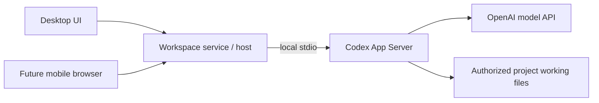

# Architecture

## Status and accepted foundation

This branch contains a runnable local desktop application with settings, workspace management, reviewed direct project discovery, read-only grouped preview and shared Text properties. The service persists canonical sources, named workspaces, one default Table view per workspace and the active workspace/view selection in SQLite.

Workspace names, order and active selection survive restart. Rename/reorder/remove validate IDs and commit snapshots transactionally. Removal deletes only the workspace and its owned views, retains the source even after its last reference, and never deletes external files. Active removal selects the first remaining configuration and its existing Table view; final removal clears selection.

The desktop includes a native directory picker, EN/RU direct-discovery preview/exclusions/Apply and project names with source-owned Text columns in the default Table. The service persists source-owned exclusions/configuration and logical project records. Project folder editing, grouped Apply/category persistence, other property types, property deletion/hiding/reordering, filtering/grouping/dragging, Board/general view management, archive/restore and other filesystem mutations remain future work. SQLite with Drizzle is the selected persistence foundation.

The product uses selected bb architecture and UI foundations while retaining its own folder/project domain. Adopt useful modules deliberately, with provenance and boundary tests; do not assume a whole bb package is independent of its chat/session model.

Desktop starts a separate local TypeScript backend process that owns SQLite and product policy. The first release exposes this service locally; authenticated access from other devices is a separate future capability. See [ADR-0003](adr/0003-separate-local-backend.md).

The runtime uses Electron `utilityProcess` with message ports, React with Vite, and a narrow preload boundary. The renderer has no direct Node.js or database access. SQLite uses Drizzle with `better-sqlite3`; ordered SQL migrations ship with the app. The database belongs beneath Electron's machine-local `userData` directory as `workspace.sqlite`; development uses a distinct `development` subdirectory, and tests use temporary directories. The preference defaults to English and supports English and Russian. See [ADR 0005](adr/0005-local-settings-runtime.md) for build and runtime details.

## Intended responsibilities

| Boundary | Responsibility | Pending decision |
| --- | --- | --- |
| Desktop renderer | React settings, workspace creation/management, removal confirmation, discovery review, Text definition/value editing and applied Table screens; interaction, localization and presentation state | Future routing and state needs as features are added |
| Typed service boundary | Settings/workspace commands, committed snapshots, discovery preview/Apply/project-list commands, source refresh, Text list/create/rename/set-value commands and validated change events through preload and IPC | Additional domain contracts as features are added |
| Local application service | Settings and workspace/source identity persistence in a separate TypeScript process; canonical root validation, transactional workspace creation/rename/order/removal, active Table view selection, direct discovery/identity matching and observed source state | Grouped discovery, other property types and future domain capabilities |
| Machine filesystem adapter | Implemented contained direct scanning; future moves, archive/restore and native integration | Watcher/reconciliation and OS-specific recovery |
| Persistence | SQLite schema, Drizzle migrations and repositories | Database partitioning and backup strategy |
| Shared-folder exchange, later | Durable changes, snapshots, identity and conflict handling | Protocol/library, tombstones and compaction |
| Hosted access, later | Owner-device access to the host service, including responsive mobile browser | Transport, device authentication, client feature scope and host lifecycle |
| Agent execution, later | Personal project chats, local Codex/API-key execution, permission modes and parallel runs | Working-file isolation, result integration and exact runtime policy |

The renderer uses a narrow preload/service boundary. It cannot directly read SQLite, call Node filesystem APIs or hold host credentials. Electron uses context isolation, disabled renderer Node integration and sandboxing. Future filesystem mutations must check the selected source and current destination state.

## Implemented change notifications

The service publishes workspace-list snapshots after successful mutations and source-state events after changed availability or committed locator observations. Source events carry source ID, canonical root, availability and the actual referencing workspace IDs. Load/create/activate and the real refresh-source command observe folder state using the existing canonicalization/access rules; unchanged observations and failed transactions do not publish committed changes. Source availability is runtime state, not a new persisted discovery or watcher capability.

Validated event envelopes are separate from responses on utilityProcess message ports. BackendController forwards events to main, narrow preload subscriptions and WorkspaceServiceClient. Unsubscription, renderer unload and backend shutdown release listeners. React applies source changes only to a referencing configuration and guards delayed command results against newer selection/source observations. The unavailable-folder screen exposes an EN/RU retry action. Applied discovery commits publish workspace.projectsChanged with source ID, actual referencing workspace IDs and committed revision. Sibling configurations reload applied projects and invalidate previews; unchanged Apply and failed transactions emit no project event. Events precede command responses, including an initiating Apply. Renderer revision guards accept that own successful response and reject older responses after newer sibling commits. Property commits use the same transport with an independent revision, described below. External folder watchers and general view management remain future slices.

## Implemented direct discovery and persistence

The service scanner reads only immediate source entries. Ordinary files do not become projects. Symlinks/junctions are excluded without opening their targets; dot-prefixed directories, case-insensitive Windows service directory names ($RECYCLE.BIN and System Volume Information), and the child containing a validated persisted archive designation are automatic exclusions. Archive designation is nullable and is not guessed from names. Invalid designation or unsafe root identity blocks Apply.

Source records own direct mode, revision, saved exact child-name exclusions, nullable archive path and applied root evidence (migration 0003). Project records own opaque UUIDs, source ID, relative path, lossless dev/ino/birth-time evidence and association state (migration 0004). Same-source workspaces share those records; each workspace retains its own Table view. Removing the final workspace preserves the source configuration and projects for later reuse.

Preview performs no persistent writes. One service-memory token per workspace binds source ownership, revision, root identity, draft exclusions and the complete interpretation snapshot; newer previews, removal, service close/restart invalidate owned tokens. Apply accepts no submitted project list. It rescans and revalidates the reviewed state, commits configuration and associations atomically, and publishes only committed changes. Stale previews require refresh and explicit re-Apply. Unavailable/unreadable roots keep saved projects rather than marking every association missing.

Matching only reuses a continuously matching same-path association under the same verified root with sufficient unchanged dev/ino/birth-time evidence and no conflict. Mutable modification/change timestamps assist scan stability checks but are not durable identity. Reliable changed evidence produces a new logical project ID while retaining the replaced record; insufficient, conflicting, missing or reused evidence remains unresolved. Exclusion retains records and continuous re-inclusion can reuse IDs. Missing/unresolved records do not automatically reattach, and native IDs do not match projects across paths. The UI explains retained metadata; reassociation controls remain future work.

Repeated observations and pre-commit checks detect observed changes without providing a filesystem lock or atomic filesystem/database coordination. Later changes and indistinguishable evidence reuse remain a boundary of this local identity strategy.

## Implemented grouped discovery preview

An unconfigured source can review either direct (Root/Project) or grouped (Root/Category/Project) interpretation through workspace.previewDiscovery's optional mode. Omission uses the configured mode, or direct before configuration. The service rejects a different explicit mode for a configured source; configured-source mode switching remains a later command. DiscoveryPreview carries the exact reviewed mode, configuration status and discriminated category/project entries. Direct project entries have a null categoryPath; grouped project entries identify the source-relative enclosing category.

Grouped interpretation is exactly two levels. Every immediate root directory is a category, even a direct-looking project folder. Only immediate real directory children of that category become projects; files are ignored at both levels and project contents are never enumerated. For example, Root/ExistingProject/src becomes category ExistingProject and project src; Root/Category/Project/Deeper stops at Project. Eligible empty categories remain visible with an explicit no-selectable-projects message. This meaning is shown in EN/RU before Apply; this first slice keeps grouped Apply disabled in the UI and explicitly rejected at the service until category persistence is implemented.

The scanner verifies root/category containment, kind and lossless native observations before child access and around category enumeration. A repeated complete snapshot includes mode, root, categories and projects. Observed replacement/link swaps or changes invalidate the review without a token. Automatic hidden/service/link/archive exclusions and manual exclusions are decided from parent directory entries before excluded targets are accessed; an excluded category suppresses its entire child enumeration. Exclusions are exact source-relative paths with one component for a category or two for a project, validated using current OS basename rules. Duplicate, malformed, traversal and unselectable new exclusions fail without configuration writes. Saved missing exclusions remain valid; safe POSIX colon/backslash names are retained.

A persisted archive at category depth excludes that category. A deeper archive excludes its containing immediate project candidate; direct mode retains its conservative containing-child policy. Null means no archive, and names such as Archive do not imply a designation. Non-exact casing uses the designated child's verified native identity without opening its contents. Preview/cancel never persists mode, exclusions or associations and never writes project files. Token state is cloned independently from returned objects; the existing Apply payload still submits only workspace ID and reviewed token.

The production entry/ports/preload/client route carries the optional mode unchanged. React uses a native keyboard-accessible initial mode selector and a nested category/project list, restores focus after refresh/cancellation, and guards delayed requests against newer selections, events, cancellation and backend generations. Real disposable SQLite/filesystem tests and EN/RU interactions verify this preview slice. Grouped persistence, required category values and metadata-only label editing remain subsequent slices; platform/runtime acceptance remains separate.

## Implemented shared Text properties

Migration 0005 adds a persisted source propertyRevision, source-owned Text definitions and project/property Text values with logical-ID foreign keys, a unique value key and database ownership constraints. Definitions use opaque UUIDs, stable creation order and immutable propertyType equal to text. Duplicate names are allowed; nonblank names retain their authored spelling and surrounding whitespace. No generic property-type framework is introduced.

The focused text-properties service validates exact payload keys, UUIDs, existence and workspace/property/project source ownership behind WorkspaceService. List, create, rename and setTextValue run through settings routing, entry validation, main/preload and WorkspaceServiceClient. Value commands use logical project IDs, never folder paths. Null clears a value by removing its row; an empty string remains a stored authored value. Strings are not trimmed or translated. Retained project records retain their values through missing/excluded/replaced observations and last-workspace removal; replacement IDs inherit nothing, and no automatic reassociation is added.

A changed transaction commits data, its returned snapshot and one propertyRevision increment atomically. Identical assignments and clearing an absent value succeed at the current revision without events. workspace.propertiesChanged carries sourceId, actual referencing workspaceIds and the committed revision through the production notification queue after commit. Throwing/reentrant subscribers cannot change committed results or reorder event batches. Property mutations preserve discovery revision/configuration, project associations, selection and view identities, and touch no project files. Discovery preview comparisons use discovery-relevant source fields so independent property commits do not invalidate a valid review.

React combines committed projects and the Text snapshot by logical IDs. It retains drafts separately, rejects older list/save snapshots and preserves own event-before-response success. Same-field sibling changes show a localized notice; Save explicitly submits the retained draft, while Cancel reveals current committed data. Backend generations, workspace/source replacement and cleanup invalidate request lifetimes without mutation replay. Backend transitions also clear prior-generation source observation/version caches; newer events in the current generation still override delayed loads. Same-source availability/locator changes reset discovery review without remounting Text editors; project refreshes retain committed rows while loading. A cell uses Enter to open, textarea Enter for line breaks, Ctrl/Cmd+Enter to save and Escape to cancel, plus explicit Save/Clear/Cancel and focus restoration.

Real temporary SQLite/filesystem tests cover baseline migration upgrade, reopen, ownership/type validation, rollback and unchanged inventories/bytes; production entry/controller/preload/client tests cover notifications and cleanup. EN/RU interactions and Ladle states complement permanent Electron feature/restart scenarios. Physical macOS27 shutdown #44 remains a final-release blocker; pre-quit feature checks and unreached restart scenarios are reported separately. Local macOS evidence does not establish Windows behavior.

## bb UI reference

The examined bb revision is `f135a001e72942cee9118d2693208ec0725e2f18`; [source links and reuse rules](reuse.md) pin the evidence.

- React, TypeScript and Vite; Tailwind and shadcn/Radix components.
- React Router for the desktop app; TanStack Query for service state and Jotai for UI state.
- Hugeicons, dnd-kit, virtualization and resizable panels where required by the feature.
- Ladle for component development. bb's script named `storybook` does not mean it uses Storybook.

These are the reference foundations, not an installed dependency manifest. `@bb/shared-ui` is a source workspace package with build seams and styles to adapt. Its table primitives are not a complete property table. Chat editors, terminals, diff viewers and mobile packages are later feature choices rather than mandatory initial dependencies.

## Data ownership constraints

Paths locate folders; they are not sufficient durable project identities. A project source owns projects, property definitions/values, discovery mode and archive location. Each workspace references one source and owns its view set and presentation settings; multiple workspaces may reference the same source. Schema design must preserve those scopes, and private views must not accidentally enter shared exchange.

The current workspace lifecycle is local. Shared metadata remains a later module: the local working database stays outside synchronized folders, and enabling sharing publishes logical exchange data. See [ADR-0001](adr/0001-sqlite-and-drizzle.md) and [ADR-0002](adr/0002-local-database-and-folder-exchange.md).

New application data starts clean; this removes legacy import work, not the need for versioned migrations between future releases. File-operation recovery and database transactions must account for their different failure boundaries.

## Local project identity

Filesystem identity and logical project identity have different scopes. Windows documents file identifiers in combination with a volume serial number and permits reuse over time; Node exposes filesystem evidence such as `dev` and `ino`. These identifiers can assist local reconciliation but do not establish one portable project identity across synchronized computers. Sources: [Microsoft file identifiers](https://learn.microsoft.com/en-us/windows/win32/api/fileapi/ns-fileapi-by_handle_file_information), [Node filesystem statistics](https://nodejs.org/api/fs.html#statsino).

The previous implementation derived ordinary project IDs from source/path information and retained `{path, dev, ino}` locators after explicit application moves. It did not put a permanent project-ID marker in every folder. This observation comes from `src/workspaceObjects.js`, `src/workspaceBackend.js` and `src/workspaceStatusMove.js` in the preserved pre-rebuild history; it is not the new design contract.

For the local release, project records remain in the application database and are associated with folders using paths and native filesystem identity. No permanent project-ID marker is written inside project folders. Filesystem evidence helps reconcile a folder with its logical project record; neither a path nor a raw filesystem ID becomes the portable identity of the project. See [ADR-0004](adr/0004-local-folder-identity-without-markers.md).

When a folder cannot be matched unambiguously, retain its project and properties, show retained/missing state; manual reassociation is a later capability. When the whole root is unavailable, represent source unavailability rather than treating every project as individually deleted. No automatic metadata deletion follows either case.

Matching synchronized replicas across computers is still an open part of the later sharing protocol. The local decision does not claim that filesystem IDs persist across volumes or devices; copied/replaced folders and reused identifiers require conservative matching rules.

## Future Codex integration

The accepted first AI scope is personal project chats with local Codex execution and API-key authentication. Discussion permits no file changes; Work on project permits project-scoped edits and commands under an enforced permission policy. Parallel editing agents in one project are required, but their working-file isolation and result-application contract have not yet been selected.

The recommended adapter is a local Codex App Server process over `stdio`, owned by the Workspace service/host. OpenAI documents App Server for rich custom clients with threads, streaming and approvals, and supports API-key login. The SDK is another integration route, oriented toward programmatic task automation. This is an integration recommendation, not installed or compatibility-tested code. Sources: [OpenAI App Server](https://developers.openai.com/codex/app-server/), [SDK](https://developers.openai.com/codex/sdk/), [authentication](https://developers.openai.com/codex/auth/).

Local execution refers to the agent process, commands and file tools; model inference still uses the API. Credentials belong on the executing host and must be excluded from browser responses, shared-folder exchange, ordinary metadata exports and logs. Use the Workspace authenticated host boundary for browser access rather than exposing the Codex process directly. Pin and validate the required protocol surface when implementing the adapter, including sandbox, approval and event behavior on macOS and Windows.

Initial remote access serves the same owner's devices, with a responsive mobile browser for views/properties, host-executed chats and file viewing/downloading. The client requires connectivity and maintains no offline mutation/command queue. On reconnect it loads actual host state; commands/runs already accepted before a disconnect require status reconciliation to avoid duplicate execution. A full mobile editor and multi-user invitations follow later.

## Parallel agent environments: open decision

The inspected bb baseline supports both shared existing checkouts and isolated Git worktrees. Shared-checkout reuse is not a guarantee against concurrent edits to the same files. Git worktrees require a Git repository with a commit; ordinary directories use their existing paths. References: [shared checkout provider](https://github.com/get-bb/bb/blob/f135a001e72942cee9118d2693208ec0725e2f18/plugins/environment-project-checkout/server.ts), [Git worktree provider](https://github.com/get-bb/bb/blob/f135a001e72942cee9118d2693208ec0725e2f18/plugins/environment-git-worktree/server.ts).

Workspace requires parallel agents. The user explicitly deferred the shared-folder versus isolated-version policy to AI implementation design, including non-Git isolation, result application and cleanup. These decisions do not block the earlier local release, and no default environment has been selected. Selective bb reuse does not automatically settle those choices. In particular, preserving unaccepted or uncommitted agent results needs an explicit lifecycle policy before adopting upstream cleanup behavior.
