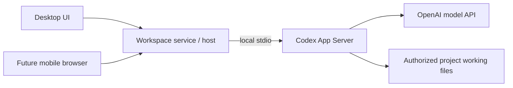

# Architecture

## Status and accepted foundation

This branch contains a runnable local desktop application with settings, workspace management, reviewed direct/grouped project discovery and configured mode changes, persisted required grouped categories, shared Text, Number and Date properties, external reconciliation and explicit folder reassociation, recoverable project creation, Table Name editing with explicit status/recovery, Table category editing with explicit move status/recovery and trusted native Reveal. The service persists canonical sources, named workspaces, one default Table view per workspace and the active workspace/view selection in SQLite.

Workspace names, order and active selection survive restart. Rename/reorder/remove validate IDs and commit snapshots transactionally. Removal deletes only the workspace and its owned views, retains the source even after its last reference, and never deletes external files. Active removal selects the first remaining configuration and its existing Table view; final removal clears selection.

The desktop includes a native directory picker, EN/RU direct/grouped preview/exclusions/Apply and editable project names with source-owned Text/Number/Date columns and required grouped categories in the default Table. The service persists source-owned exclusions/configuration and logical project records. Property deletion/hiding/reordering, filtering/grouping/dragging, Board/general view management and further filesystem mutations remain future work. Source archive/restore is described below. SQLite with Drizzle is the selected persistence foundation.

The product uses selected bb architecture and UI foundations while retaining its own folder/project domain. Adopt useful modules deliberately, with provenance and boundary tests; do not assume a whole bb package is independent of its chat/session model.

Desktop starts a separate local TypeScript backend process that owns SQLite and product policy. The first release exposes this service locally; authenticated access from other devices is a separate future capability. See [ADR-0003](adr/0003-separate-local-backend.md).

The runtime uses Electron `utilityProcess` with message ports, React with Vite, and a narrow preload boundary. The renderer has no direct Node.js or database access. SQLite uses Drizzle with `better-sqlite3`; ordered SQL migrations ship with the app. The database belongs beneath Electron's machine-local `userData` directory as `workspace.sqlite`; development uses a distinct `development` subdirectory, and tests use temporary directories. The preference defaults to English and supports English and Russian. See [ADR 0005](adr/0005-local-settings-runtime.md) for build and runtime details.

## Intended responsibilities

| Boundary | Responsibility | Pending decision |
| --- | --- | --- |
| Desktop renderer | React settings, workspace creation/management, removal confirmation, discovery/recovery review, project creation/Name/category move/status/recovery/Reveal and source Refresh, Text/Number/Date definition/value and category-label editing and applied Table screens; interaction, localization and presentation state | Future routing and state needs as features are added |
| Typed service boundary | Settings/workspace commands, committed snapshots, discovery preview/Apply/project-list and recovery preview/reassociate commands, creation/status/recovery, project rename/status/recovery, category move/status/recovery and ID-only Reveal, source refresh/current observation, Text/Number/Date list/create/rename/set-value and category-property rename commands and validated change events through preload and IPC | Additional domain contracts as features are added |
| Local application service | Settings and workspace/source identity persistence in a separate TypeScript process; canonical root validation, transactional workspace creation/rename/order/removal, active Table view selection, direct/grouped discovery/identity matching, validated project reassociation, reconciliation transactions, durable creation, project rename/category move/recovery and bounded source observation | Remaining property types and future domain capabilities |
| Machine filesystem adapter | Implemented contained direct/grouped scanning and nonrecursive root/category notification hints, exclusive nonrecursive project mkdir and private native no-replace rename/category move; trusted desktop macOS shell.showItemInFolder and Windows ready-parent/SelectItem adapter for file-manager selection; recoverable source archive/restore | Further native integration and OS-specific recovery |
| Persistence | SQLite schema, Drizzle migrations and repositories | Database partitioning and backup strategy |
| Shared-folder exchange, later | Durable changes, snapshots, identity and conflict handling | Protocol/library, tombstones and compaction |
| Hosted access, later | Owner-device access to the host service, including responsive mobile browser | Transport, device authentication, client feature scope and host lifecycle |
| Agent execution, later | Personal project chats, local Codex/API-key execution, permission modes and parallel runs | Working-file isolation, result integration and exact runtime policy |

The renderer uses a narrow preload/service boundary. It cannot directly read SQLite, call Node filesystem APIs or hold host credentials. Electron uses context isolation, disabled renderer Node integration and sandboxing. Future filesystem mutations must check the selected source and current destination state.

## Implemented change notifications

The service publishes workspace-list snapshots after successful mutations and source-state events after changed availability or committed locator observations. Source events carry source ID, canonical root, availability and the actual referencing workspace IDs. Load/create/activate and the real refresh-source command observe folder state using the existing canonicalization/access rules; unchanged observations and failed transactions do not publish committed changes. Source availability and observation status are runtime state, separate from persisted discovery revisions.

Validated event envelopes are separate from responses on utilityProcess message ports. BackendController forwards events to main, narrow preload subscriptions and WorkspaceServiceClient. Unsubscription, renderer unload and backend shutdown release listeners. React applies source changes only to a referencing configuration and guards delayed command results against newer selection/source observations. The unavailable-folder screen exposes an EN/RU retry action. Applied discovery commits publish workspace.projectsChanged with source ID, actual referencing workspace IDs and committed revision. Sibling configurations reload applied projects and invalidate previews; unchanged Apply and failed transactions emit no project event. Events precede command responses, including an initiating Apply. Renderer revision guards accept that own successful response and reject older responses after newer sibling commits. Property commits use the same transport with an independent revision, described below. External folder watchers use this route with a service-local observation revision, described below; general view management remains future work.

## Implemented direct discovery and persistence

The service scanner reads only immediate source entries. Ordinary files do not become projects. Symlinks/junctions are excluded without opening their targets; dot-prefixed directories, case-insensitive Windows service directory names ($RECYCLE.BIN and System Volume Information), and the child containing a validated persisted archive designation are automatic exclusions. Archive designation is nullable and is not guessed from names. Invalid designation or unsafe root identity blocks Apply.

Source records own direct mode, revision, saved exact child-name exclusions, nullable archive path and applied root evidence (migration 0003). Project records own opaque UUIDs, source ID, relative path, lossless dev/ino/birth-time evidence and association state (migration 0004). Same-source workspaces share those records; each workspace retains its own Table view. Removing the final workspace preserves the source configuration and projects for later reuse.

Preview performs no persistent writes. One service-memory token per workspace binds source ownership, revision, root identity, draft exclusions and the complete interpretation snapshot; newer previews, removal, service close/restart invalidate owned tokens. Apply accepts no submitted project list. It rescans and revalidates the reviewed state, commits configuration and associations atomically, and publishes only committed changes. Stale previews require refresh and explicit re-Apply. Unavailable/unreadable roots keep saved projects rather than marking every association missing.

Discovery Apply reuses a continuously matching same-path association under the same verified root with sufficient unchanged dev/ino/birth-time evidence and no conflict. Mutable modification/change timestamps assist scan stability checks but are not durable identity. Reliable changed evidence produces a new logical project ID while retaining the replaced record; insufficient, conflicting, missing or reused evidence remains unresolved. Exclusion retains records and continuous re-inclusion can reuse IDs. Missing/unresolved records do not automatically reattach, and only the separate reconciliation path considers unique cross-path evidence for stored active records. The UI exposes retained metadata and explicit reassociation controls, described below.

Repeated observations and pre-commit checks detect observed changes without providing a filesystem lock or atomic filesystem/database coordination. Later changes and indistinguishable evidence reuse remain a boundary of this local identity strategy.

## Implemented grouped discovery and categories

An unconfigured source can review either direct (Root/Project) or grouped (Root/Category/Project) interpretation through workspace.previewDiscovery's optional mode. Omission uses the configured mode, or direct before configuration. A configured source can review a different explicit mode through the same command; omission preserves its current mode. DiscoveryPreview carries the exact reviewed mode, configuration status and discriminated category/project entries. Direct project entries have a null categoryPath; grouped project entries identify the source-relative enclosing category.

Grouped interpretation is exactly two levels. Every immediate root directory is a category, even a direct-looking project folder. Only immediate real directory children of that category become projects; files are ignored at both levels and project contents are never enumerated. For example, Root/ExistingProject/src becomes category ExistingProject and project src; Root/Category/Project/Deeper stops at Project. Eligible empty categories remain visible with an explicit no-selectable-projects message. This meaning is shown in EN/RU before Apply. Apply persists eligible empty categories as well as projects.

The scanner verifies root/category containment, kind and lossless native observations before child access and around category enumeration. A repeated complete snapshot includes mode, root, categories and projects. Observed replacement/link swaps or changes invalidate the review without a token. Automatic hidden/service/link/archive exclusions and manual exclusions are decided from parent directory entries before excluded targets are accessed; an excluded category suppresses its entire child enumeration. Exclusions are exact source-relative paths with one component for a category or two for a project, validated using current OS basename rules. Duplicate, malformed, traversal and unselectable new exclusions fail without configuration writes. Saved missing exclusions remain valid; safe POSIX colon/backslash names are retained.

A persisted archive at category depth excludes that category. A deeper archive excludes its containing immediate project candidate; direct mode retains its conservative containing-child policy. Null means no archive, and names such as Archive do not imply a designation. Non-exact casing uses the designated child's verified native identity without opening its contents. Preview/cancel never persists mode, exclusions or associations and never writes project files. Token state is cloned independently from returned objects; the existing Apply payload still submits only workspace ID and reviewed token.

The production entry/ports/preload/client route carries the optional mode unchanged. React uses a native keyboard-accessible mode selector for new and configured sources and a nested category/project list, restores focus after refresh/cancellation, and guards delayed requests against newer selections, events, cancellation and backend generations. Real disposable SQLite/filesystem tests and EN/RU interactions verify preview and persistence. Metadata-only label editing is implemented; platform/runtime acceptance remains separate.

Migration 0006 adds source-owned category records with opaque UUIDs, relative paths, native evidence and the same conservative association states as projects. A project has a nullable category ID; SQLite foreign keys and insert/update triggers enforce same-source ownership, matching category depth and an active category for every active grouped project. The original direct-history prohibitions in migration 0006 are superseded by migration 0007; operational direct projects still have no category. Category deactivation requires deactivating dependent projects first. Existing migrations 0000–0005 and populated Text values remain intact.

Apply compares token ownership, exact mode, discovery configuration, stored category/project records and the complete reviewed filesystem interpretation. It repeats the scan before writes inside one SQLite transaction and after writes, retiring dependent projects before categories and inserting new categories before projects. Any observed stale review or injected storage failure rolls back mode, exclusions, categories, project associations and category-property identity without notifications. Category-only changes, including empty categories, increment discoveryRevision; unchanged rescans publish nothing. Final-workspace removal retains all source-owned records and independent Text data.

Discovery Apply reuses category IDs while same-path/native evidence continuously matches beneath the verified source root. Excluded categories suppress child access and retain associations; continuous reinclusion can restore their IDs. Missing/unresolved categories do not automatically reattach projects. Category replacement retires old project associations even when child evidence remains the same, so new IDs cannot inherit old Text metadata. Conflicting reused evidence stays unresolved. Cross-path active-category reconciliation is described below.

Each grouped source has one stable category-property UUID and nullable authored label, with a separate categoryPropertyRevision initialized to zero. Null renders localized Category/Категория. ProjectList returns mode, active saved categories, category-property metadata and independent revisions; ProjectSummary returns categoryId and the native project basename. Table displays required category values and saved categories even with zero projects; active grouped projects expose explicit category editing through the move service. Stable Text cell keys preserve drafts through same-source refreshes. List/Apply snapshots compare discovery and category-property revisions independently. The focused category-properties service exposes workspace.renameCategoryProperty with exactly type, workspaceId, propertyId and name. It validates UUIDs, existence, grouped mode, source ownership and nonblank labels; duplicate display names are allowed and authored whitespace/spelling are preserved. One transaction commits the label, returned CategoryPropertySnapshot and independent categoryPropertyRevision. Identical assignments emit no event. After commit, workspace.categoryPropertyChanged carries the source, actual referencing workspaces and revision through the existing notification queue, production ports, main, preload and typed client.

Label changes touch no folders, category/project IDs, Text propertyRevision or discoveryRevision and do not invalidate discovery reviews. Table exposes an EN/RU header editor with Enter/save, Escape/cancel and restored focus; active grouped category values use the separate explicit move editor. Sibling changes retain the label draft and require an explicit save. Project lists and label responses merge with independent revision guards; old lists cannot overwrite newer labels. A newer event supersedes delayed saves while an own event-before-response success remains valid. Selection/removal, backend generations and cleanup invalidate response lifetimes without replay. Same-source refreshes preserve both category-label and Text drafts.

When a category is excluded after its project was excluded, the UI removes that category's child selections from the draft. Refresh keeps the parent choice; reinclusion exposes fresh child choices. The service continues rejecting unselectable new child inputs beneath excluded parents and never opens them to validate a draft. Saved missing exclusions remain valid.

## Implemented configured discovery mode changes

workspace.previewDiscovery accepts a target mode for an existing source. DiscoveryPreview includes currentMode, added/retained/no-longer-recognized project effects, already-retained metadata, category availability and inactiveExcludedRelativePaths. Added targets have no inferred project UUID. The service builds effects and Apply associations from one target interpretation, with conservative historical path/native reservations. The token binds current configuration, all stored association state, root evidence and complete target snapshot independently of returned mutable objects. Text and category-label edits retain their independent revisions.

Migration 0007 adds mode_inactive to project/category associations, defaulting to false for existing records, without changing migrations 0000–0006. Updated triggers permit dormant history while enforcing current operational depth, same-source ownership and an active operational category for grouped projects. Mode Apply retires incompatible operational projects/categories, changes source configuration, establishes reviewed categories, then establishes target projects in one transaction. Repeated pre/post-write validation rejects observed races; failures roll back all writes and emit no committed event. A mode change increments discoveryRevision once without changing Text/category-label revisions; a no-op Apply emits no discovery event.

Mode inactivity preserves UUIDs, paths, native evidence, prior association states and category references. Projects remain retained and Text-editable; discovery, Refresh, startup and watch hints cannot reactivate them. Returning to the previous mode still requires explicit project recovery, including reviewed own-historical-path recovery. Explicit successful reassociation clears inactivity only on the chosen project and preserves its exact values. Changing folder role never transfers project values or merges project/category identities, and depth changes do not authorize cross-path matching.

Category history and the category-property UUID/label/revision survive direct mode, whose ProjectList exposes no active category/property. Explicit grouped Apply may resume a dormant previously active/excluded category only after unchanged same-category path, native evidence and source-root checks. Missing, unresolved, replaced and conflicting history remains unavailable; project recovery cannot repair that category. External category reconciliation permits only the bounded legitimate role overlap with exact reliable evidence from a same-source dormant, previously active/excluded direct-role project. Same-role aliases, insufficient/reused evidence and incompatible birthtime still block matching. The dormant project itself stays unchanged.

Authored exclusions persist at one or two components. Effective exclusions are computed for the reviewed target mode, and inactive paths remain visible. Two-component exclusions are inactive in direct mode and never expand to their parent. A one-component exclusion applies literally to a direct project or grouped category subtree, with its target scope explained before Apply. Archive designation and containment policy are preserved.

Committed mode changes retarget observation and invalidate sibling discovery/recovery reviews. Existing source fanout and independent workspace views remain intact. React merges discovery/category-label revisions separately so delayed lists/label responses cannot restore a category column in direct mode. Text and hidden category-label drafts use logical identities across transitions; pending saves retain mode, generation and response-lifetime guards. Stale review requires another explicit Apply and uncertain outcomes reload committed state without replay. See [criterion-mapped verification](verification/issue-16-discovery-mode.md).

## Implemented retained projection and folder recovery

ProjectList separates stored associationState from current observed resolution and returns active projects plus retainedProjects and a matching retainedCount. Only a complete scan under verified root evidence derives individual resolution. An unavailable/unreadable/conflicting root or incomplete scan produces source-level feedback and null individual resolution; list queries leave database records and revisions unchanged. Retained rows expose historical category labels without treating retired categories as active options, and stable logical project/property keys keep Text editable.

The focused project-recovery service handles workspace.previewProjectRecovery and workspace.reassociateProject through settings, production entry, IPC, the isolated preload and WorkspaceServiceClient. Preview validates exact payloads, UUIDs, same-source workspace/project ownership, configured depth and an eligible missing/unresolved/replaced or mode-inactive subject. The read-only review returns source-relative directory entries and typed conflicts; operational continuously verified active and manually excluded records are not recovery subjects; mode-inactive history is eligible for explicit recovery. The renderer selects and reviews a target before explicit Reassociate; cancellation writes nothing and recovery requires no discovery Apply.

Direct targets have one native basename component; grouped targets have category/project depth. The existing scanner enforces real directory kind, containment, native identity, platform basename rules, exclusions, designated archive/service rules and no links/junctions without enumerating project contents. Another non-replaced project reserves its path. Conflicting current native evidence blocks ownership; replaced records' historical evidence alone cannot establish live ownership or invalidate a continuously verified active association. Recovery never transfers, merges or deletes another logical record.

Grouped recovery requires a continuously verified active same-source category or a genuinely new category with no conflicting current association. Missing, unresolved, excluded or conflicting existing categories are unavailable in this slice. A new category is inserted before activating the selected project in one transaction, without discovering unrelated projects. The selected project's path, native evidence, category and active association state change together; project ID, exact Text, source ownership, workspace/view IDs and independent property/category-label revisions are preserved. Recovery itself introduces no filesystem mutation or additional migration; mode-change history uses migration 0007.

Ephemeral reviews bind workspace/project ownership, discovery configuration/revision, project/category records, root evidence and the filesystem snapshot. Revalidation before and after writes inside the transaction rolls back observed changes with stale_preview; only a committed mutation increments discoveryRevision once and publishes source-scoped projectsChanged. Association commits and source observations invalidate same-source discovery/recovery reviews; workspace removal and service close clear relevant tokens. Independent Text/category-label edits do not invalidate association reviews. Tokens are never persisted or replayed.

React guards delayed lists/previews/commits by selection, request lifetime, source/workspace/project, backend generation and discovery revision. Own event-before-response success remains valid while older responses cannot replace newer sibling snapshots. Availability refresh and retained-to-active transitions preserve independent Text/category-label drafts. Lost mutation responses report uncertainty and reload actual committed state without automatic retry or fabricated success; stale review requires refresh, reselection and explicit confirmation. No filesystem lock joins observations with SQLite: later changes and indistinguishable evidence reuse cannot be ruled out. Automatic cross-path reconciliation and watchers are described below; whole-source relocation remains future work; configured mode changes follow the contract above. See [verification](verification/issue-14-folder-recovery.md).

## Implemented external reconciliation and observation

workspace.refreshSource invokes the same backend reconciliation used by startup and notifications, preserving its WorkspaceSourceState response. List/preview queries remain read-only. external-reconciliation.ts requires unchanged sufficient applied-root evidence, valid saved configuration and repeated complete scans. Unavailable, unreadable, incomplete or conflicting roots preserve every stored association. Temporarily absent active records keep their stored evidence, so a later unique eligible observation may match; persisted missing/unresolved/replaced records use explicit recovery, and excluded records are not followed across paths.

A cross-path match requires exactly one eligible observation with unchanged lossless dev/ino/positive birthtimeNs evidence, the original volume and no competing current/historical native evidence. Modification/change timestamps support stability only. Paths, casing or dev/ino alone cannot establish identity. Copies, changed birthtime, cross-volume evidence, native aliases, historical conflicts, unsafe depths, links, exclusions and archives retain metadata. Exact entry spelling is retained, including verified case-only changes; no global case-folding is used. Recovery's continuously matching same-path exception remains valid. These checks cannot detect indistinguishable reuse of the complete evidence tuple and do not lock the filesystem.

Category mappings are computed before grouped projects, including simultaneous renames and verified occupied-path permutations. A moved active project reuses a uniquely matched active category or a genuinely new eligible immediate category with sufficient stable evidence and no current/historical path or native conflict. Existing unavailable/unresolved/excluded/replaced/conflicting category associations remain recovery cases even when child evidence matches. An unmatched active child defers a dependent category rename rather than inferring its identity; already retained children keep their prior locators/evidence.

Only categories required by accepted known-project moves are inserted; one UUID is shared by moves into the same needed category. No project UUID is created and unrelated children, other categories and empty new categories are not enrolled. The old empty category is retained. Explicit Discovery Apply continues to enroll reviewed unrelated folders under its existing contract.

One SQLite transaction temporarily releases affected project then category reservations, establishes final categories before restoring active projects, and increments discoveryRevision once for the entire changed batch. Configuration, records, root and filesystem are revalidated before and after writes. Observed races or storage failures roll back inserts, locators, category associations and revision with no committed project event. Text/category-label revisions, authored values, IDs, settings and views remain independent. Repeated successful scans produce no mapping/revision/event churn.

source-observer.ts owns one nonrecursive, nonpersistent fs.watch per referenced source root; macOS also watches eligible immediate category directories. Siblings share ownership. Windows uses root notifications plus a complete validated grouped-source scan on each five-second health tick when eligible categories exist, avoiding descendant watch handles that can obstruct external parent moves. This fallback does not depend on category timestamps as a change journal. Project contents, excluded targets and source parents are never watched or polled. All hints, including absent/hostile filenames, schedule a complete validated scan after 100 ms without extending its deadline. Hints during a pass request at most one following pass. One unreferenced five-second health timer per source probes root availability/evidence and retries degraded installation/observation; healthy macOS operation does not periodically enumerate projects. Obsolete watchers close before validated replacement; an installation-window rescan covers missed hints. Observing a new category does not enroll it. Final-reference removal and service close cancel timers/watchers and reject late callbacks; retained data remains reusable.

The Windows strategy follows the failed live grouped-root rename cases recorded in [T08 verification](verification/issue-15-external-reconciliation.md#ci-continuation). The pinned [libuv Windows watcher implementation](https://raw.githubusercontent.com/nodejs/node/v22.21.1/deps/uv/src/win/fs-event.c) already requests FILE_SHARE_DELETE; absence of that flag is not the diagnosed cause. Permanent native fixtures compare root-only/root-plus-category handles and require root disconnect/reconnect, category rename and same-category project rename with production observation running. Actual Windows acceptance requires the next exact-SHA CI run; local macOS diagnostics cannot establish the Windows mechanism or repair outcome.

workspace.sourceObserved carries sourceId, actual workspaceIds, service-local observationRevision, scan state and active/degraded automaticUpdates. Meaningful topology, resolution, scan/status changes invalidate discovery/recovery reviews even without a locator commit; timestamp-only noise is ignored. A changed locator batch publishes workspace.projectsChanged after commit and before command responses. workspace.getSourceObservation is a validated read of current observation status, used by the production client/UI after mount/selection/backend readiness so startup feedback remains visible even when early events preceded the renderer subscription. It returns no mutation to replay and changes no persisted revisions.

React exposes EN/RU keyboard Refresh with pending/error/degraded feedback and guards event/list/Refresh results by observation, selection, cancellation and backend generation. Stable logical row keys preserve Text/category-label drafts and focus across names and category placement. Review changes require explicit refresh/reselection/save, with no automatic mutation replay. Actual evidence and pending platform gates are recorded in [T08 verification](verification/issue-15-external-reconciliation.md).

The bounded watcher and matching choices are implementation inferences within D25/D26. [Node 22.21.1](https://nodejs.org/download/release/v22.21.1/docs/api/fs.html#caveats) documents platform-dependent/missed notifications, inode replacement, absent filenames and stat-time limitations. [Microsoft file information](https://learn.microsoft.com/en-us/windows/win32/api/fileapi/ns-fileapi-by_handle_file_information) describes volume-associated, reusable and filesystem-specific native IDs; [filename rules](https://learn.microsoft.com/en-us/windows/win32/fileio/naming-a-file) describe case behavior and its exceptions. These sources do not guarantee permanent or portable identity.

## Implemented shared Text properties

Migration 0005 adds a persisted source propertyRevision, source-owned Text definitions and project/property Text values with logical-ID foreign keys, a unique value key and database ownership constraints. Definitions use opaque UUIDs, stable creation order and immutable propertyType equal to text. Duplicate names are allowed; nonblank names retain their authored spelling and surrounding whitespace. No generic property-type framework is introduced.

The focused text-properties service validates exact payload keys, UUIDs, existence and workspace/property/project source ownership behind WorkspaceService. List, create, rename and setTextValue run through settings routing, entry validation, main/preload and WorkspaceServiceClient. Value commands use logical project IDs, never folder paths. Null clears a value by removing its row; an empty string remains a stored authored value. Strings are not trimmed or translated. Retained project records retain their values through missing/excluded/replaced observations and last-workspace removal; replacement IDs inherit nothing. Reconciliation only changes locators for uniquely verified stored active IDs.

A changed transaction commits data, its returned snapshot and one propertyRevision increment atomically. Identical assignments and clearing an absent value succeed at the current revision without events. workspace.propertiesChanged carries sourceId, actual referencing workspaceIds and the committed revision through the production notification queue after commit. Throwing/reentrant subscribers cannot change committed results or reorder event batches. Property mutations preserve discovery revision/configuration, project associations, selection and view identities, and touch no project files. Discovery preview comparisons use discovery-relevant source fields so independent property commits do not invalidate a valid review.

React combines committed projects and the Text snapshot by logical IDs. It retains drafts separately, rejects older list/save snapshots and preserves own event-before-response success. Same-field sibling changes show a localized notice; Save explicitly submits the retained draft, while Cancel reveals current committed data. Backend generations, workspace/source replacement and cleanup invalidate request lifetimes without mutation replay. Backend transitions also clear prior-generation source observation/version caches; newer events in the current generation still override delayed loads. Same-source availability/locator changes reset discovery review without remounting Text editors; project refreshes retain committed rows while loading. A cell uses Enter to open, textarea Enter for line breaks, Ctrl/Cmd+Enter to save and Escape to cancel, plus explicit Save/Clear/Cancel and focus restoration.

Real temporary SQLite/filesystem tests cover baseline migration upgrade, reopen, ownership/type validation, rollback and unchanged inventories/bytes; production entry/controller/preload/client tests cover notifications and cleanup. EN/RU interactions and Ladle states complement permanent Electron feature/restart scenarios. Physical macOS27 shutdown #44 remains a final-release blocker; pre-quit feature checks and unreached restart scenarios are reported separately. Local macOS evidence does not establish Windows behavior.

## bb UI reference

The examined bb revision is `f135a001e72942cee9118d2693208ec0725e2f18`; [source links and reuse rules](reuse.md) pin the evidence.

- React, TypeScript and Vite; Tailwind and shadcn/Radix components.
- React Router for the desktop app; TanStack Query for service state and Jotai for UI state.
- Hugeicons, dnd-kit, virtualization and resizable panels where required by the feature.
- Ladle for component development. bb's script named `storybook` does not mean it uses Storybook.

These are the reference foundations, not an installed dependency manifest. `@bb/shared-ui` is a source workspace package with build seams and styles to adapt. Its table primitives are not a complete property table. Chat editors, terminals, diff viewers and mobile packages are later feature choices rather than mandatory initial dependencies.

## Data ownership constraints

Paths locate folders; they are not sufficient durable project identities. A project source owns projects, property definitions/values, discovery mode and archive location. Each workspace references one source and owns its view set and presentation settings; multiple workspaces may reference the same source. Schema design must preserve those scopes, and private views must not accidentally enter shared exchange.

The current workspace lifecycle is local. Shared metadata remains a later module: the local working database stays outside synchronized folders, and enabling sharing publishes logical exchange data. See [ADR-0001](adr/0001-sqlite-and-drizzle.md) and [ADR-0002](adr/0002-local-database-and-folder-exchange.md).

New application data starts clean; this removes legacy import work, not the need for versioned migrations between future releases. File-operation recovery and database transactions must account for their different failure boundaries.

## Local project identity

Filesystem identity and logical project identity have different scopes. Windows documents file identifiers in combination with a volume serial number and permits reuse over time; Node exposes filesystem evidence such as `dev` and `ino`. These identifiers can assist local reconciliation but do not establish one portable project identity across synchronized computers. Sources: [Microsoft file identifiers](https://learn.microsoft.com/en-us/windows/win32/api/fileapi/ns-fileapi-by_handle_file_information), [Node filesystem statistics](https://nodejs.org/api/fs.html#statsino).

The previous implementation derived ordinary project IDs from source/path information and retained `{path, dev, ino}` locators after explicit application moves. It did not put a permanent project-ID marker in every folder. This observation comes from `src/workspaceObjects.js`, `src/workspaceBackend.js` and `src/workspaceStatusMove.js` in the preserved pre-rebuild history; it is not the new design contract.

For the local release, project records remain in the application database and are associated with folders using paths and native filesystem identity. No permanent project-ID marker is written inside project folders. Filesystem evidence helps reconcile a folder with its logical project record; neither a path nor a raw filesystem ID becomes the portable identity of the project. See [ADR-0004](adr/0004-local-folder-identity-without-markers.md).

When a folder cannot be matched unambiguously, retain its project and properties, show retained/missing state; explicit manual reassociation is implemented through the validated service boundary. When the whole root is unavailable, represent source unavailability rather than treating every project as individually deleted. No automatic metadata deletion follows either case.

Matching synchronized replicas across computers is still an open part of the later sharing protocol. The local decision does not claim that filesystem IDs persist across volumes or devices; copied/replaced folders and reused identifiers require conservative matching rules.

## Future Codex integration

The accepted first AI scope is personal project chats with local Codex execution and API-key authentication. Discussion permits no file changes; Work on project permits project-scoped edits and commands under an enforced permission policy. Parallel editing agents in one project are required, but their working-file isolation and result-application contract have not yet been selected.

The recommended adapter is a local Codex App Server process over `stdio`, owned by the Workspace service/host. OpenAI documents App Server for rich custom clients with threads, streaming and approvals, and supports API-key login. The SDK is another integration route, oriented toward programmatic task automation. This is an integration recommendation, not installed or compatibility-tested code. Sources: [OpenAI App Server](https://developers.openai.com/codex/app-server/), [SDK](https://developers.openai.com/codex/sdk/), [authentication](https://developers.openai.com/codex/auth/).

Local execution refers to the agent process, commands and file tools; model inference still uses the API. Credentials belong on the executing host and must be excluded from browser responses, shared-folder exchange, ordinary metadata exports and logs. Use the Workspace authenticated host boundary for browser access rather than exposing the Codex process directly. Pin and validate the required protocol surface when implementing the adapter, including sandbox, approval and event behavior on macOS and Windows.

Initial remote access serves the same owner's devices, with a responsive mobile browser for views/properties, host-executed chats and file viewing/downloading. The client requires connectivity and maintains no offline mutation/command queue. On reconnect it loads actual host state; commands/runs already accepted before a disconnect require status reconciliation to avoid duplicate execution. A full mobile editor and multi-user invitations follow later.

## Parallel agent environments: open decision

The inspected bb baseline supports both shared existing checkouts and isolated Git worktrees. Shared-checkout reuse is not a guarantee against concurrent edits to the same files. Git worktrees require a Git repository with a commit; ordinary directories use their existing paths. References: [shared checkout provider](https://github.com/get-bb/bb/blob/f135a001e72942cee9118d2693208ec0725e2f18/plugins/environment-project-checkout/server.ts), [Git worktree provider](https://github.com/get-bb/bb/blob/f135a001e72942cee9118d2693208ec0725e2f18/plugins/environment-git-worktree/server.ts).

Workspace requires parallel agents. The user explicitly deferred the shared-folder versus isolated-version policy to AI implementation design, including non-Git isolation, result application and cleanup. These decisions do not block the earlier local release, and no default environment has been selected. Selective bb reuse does not automatically settle those choices. In particular, preserving unaccepted or uncommitted agent results needs an explicit lifecycle policy before adopting upstream cleanup behavior.

Permanent Ladle fixtures cover EN/RU grouped preview (empty/mixed roots), applied read-only categories and category-label default/authored/loading/editing/saving/validation/failure/sibling/saved/newer states. The layout script captures 1440×960, 1024×720 and 420×800 with bounded Table scrolling, wrapping, accessible recovery and focus restoration. Permanent Electron smoke scenarios add disposable grouped roots through production IPC, both-level exclusions, cancel/stale explicit Apply, label-only rename, sibling/source isolation and assertions for restart and retained-source reuse. Implemented assertions and observed execution are distinct; see [actual T06 verification](verification/issue-13-grouped-discovery.md) for passed, failed and unreached stages.

## Implemented project creation and native Reveal

Migration 0008 adds a source-owned immutable creation journal with a reserved project UUID, request/configuration binding, root/parent evidence, destination locator, stage and optional immutable destination evidence. Standalone intent commits before mkdir; destination evidence commits separately; the project association, completed receipt and one discoveryRevision increment commit atomically. Existing Text/category-label revisions, settings, workspace/view identities and source history remain independent. Completed receipts return original outcome fields after later locator changes; current project/history reserves actual associations, while only unfinished operations reserve extra paths/native evidence. Removing the final workspace retains the journal for source reuse.

project-creation.ts validates exact typed input, workspace/source ownership, platform basename, applied mode/revision, active grouped category, canonical root/parent evidence, links, exclusions/archive and historical/current reservations. Reused dev/ino with incompatible birthtime is a native conflict, matching discovery policy. project-filesystem.ts uses Node lstat/realpath and exclusive nonrecursive mkdir with repeated checks around evidence and metadata writes. No native addon, identity marker, recursive deletion or general mutation framework was added. A concurrent ancestor move or unobserved substitution between path-based calls remains a TOCTOU window; the service preserves effects/evidence and reports uncertainty without guaranteed confinement or rollback. Process-interruption recovery is implemented; coordinated power-loss durability is not established.

intent, evidence_recorded and uncertain operations load before observation can enroll destinations. Discovery preview/Apply, project reassociation and external reconciliation include their path/native reservations and invalidate affected reviews. Read-only status/startup queries never replay mkdir. Explicit recovery binds a fresh service-memory review token to source, operation, workspace, revision and folder evidence. retry_missing, complete_recorded and associate_reviewed keep the reserved UUID; changed recorded evidence remains unresolved. Production platform watchers and grouped Windows polling stay active.

ProjectCreationPanel keeps authored drafts and the original request while transport outcomes are uncertain. An explicit Retry original request preserves operation ID, payload and expected revision; missing requests can be delivered, completed ones reconcile their receipt, and definite no-effect rejection restores editing. Backend/selection/request guards reject obsolete responses and prevent duplicate pending submissions. Status/recovery of another operation cannot clear the uncertain original request or unlock its draft. Reconnect/list/cancel paths perform no automatic replay. Confirmed creation feedback and interrupted-operation list errors use independent state. Outdated list replies cannot replace command feedback or clear a current list error; a fresh successful read clears only that list error. ProjectRevealButton provides per-row EN/RU pending/error/dispatch feedback. Benign ready/active observations may reload the unchanged authorized project without discarding a confirmed dispatched response. Source lifetime, discovery revision and monotonic per-row target versions still invalidate changed source/project/category locators or retained state, including a target change away and back; backend/selection/unmount and exact response-ID guards remain. Text/category drafts retain their component lifetimes and a pending Reveal cannot dispatch twice. Permanent native fixtures Reveal immediately after creation without Refresh or settling waits, with production observation active; local evidence and independent coordinator acceptance are separated in the verification report.

Reveal validates logical workspace/project ownership, current mode/root/category policy, active real-folder evidence and containment in the service. The actual entry/controller private request/reply route binds a dispatch UUID to one pending request/backend generation; main requests backend reauthorization and rechecks evidence before macOS Electron shell.showItemInFolder or the Windows ready-parent/SelectItem adapter, without desktop-default package execution. Windows opens the authorized parent once, waits for an exact captured ready Explorer view, then requests fresh backend authorization and main filesystem/current checks before one GO permit and one SelectItem. Fixed PowerShell resources ship outside ASAR; the executable is derived from unique loaded OS module paths rather than PATH/environment. Abort/expiry stops only the owned bridge. The twelve-second process, fifteen-second service and seventeen-second outer Windows Reveal budgets leave normal quit and external observation at ten seconds. Before-permit cancellation prevents selection; after-permit cancellation cannot atomically undo an in-flight command. Paths/evidence never enter renderer results. Native errors/timeouts, shutdown/cancellation and stale generations clean pending requests/listeners. Optional private native diagnostics retain at most seventeen fixed first-received bootstrap/read labels and receiver elapsed times before READY, inside the existing byte/deadline bounds; they cannot supply targets or grant GO, and do not identify a current blocked query after repeated polls. contextIsolation, disabled nodeIntegration and sandbox remain enabled. Post-dispatch evidence/policy validation is useful detection, not a filesystem lock or undo mechanism. Every successful full authorization also requires identical persisted bindings before and after its filesystem/discovery checks. A dirty full-source scan after a completed native dispatch can retain the dispatch acknowledgment only if the request-local persisted workspace/source, complete project/category records and outstanding reservation bindings remain identical to the last successful authorization, and fresh root/category/selected-folder evidence and accessibility still pass. Dirty scans before dispatch, unreadable/unavailable scans and changed authority still reject; no scan retry or future dispatch permission is granted. The public dispatched outcome means the native command returned without throwing; it is not OS success confirmation. Exact selected-item observation is tracked separately. See [ADR 0006](adr/0006-recoverable-project-creation.md) and [T10 verification](verification/issue-17-create-reveal.md).

### Bounded startup diagnostics

The service entry reports initialization stage and an allowlisted SQLite/OS error code through its existing startup-error message. Main validates this finite diagnostic before adding it to BackendStatus; timeout, process start/error and process exit are distinct categories. A bounded numeric exit code may accompany process_exit. Drizzle migration causes are inspected only to a fixed depth for an allowed code; messages, SQL, paths, stacks and native process reports are excluded. The creation smoke records terminal startup failure separately from a missing interface element. This diagnostic does not retry startup or establish the cause of an earlier uninstrumented failure.

## Implemented recoverable project rename service

The production service accepts exactly `workspace.renameProject` with `workspaceId`, `projectId`, `operationId`, authored `name` and `expectedRevision`. It resolves the source, mode, existing category, parent, paths and native evidence itself. The basename remains untrimmed and must satisfy current platform naming, exclusions/archive and reservation policy. Direct renames stay under the root; grouped renames stay under the existing category. No category move is implied. Results distinguish `completed`, `unchanged`, `rejected` and `recoverable`, with finite problem categories. Malformed or foreign bindings return service errors. Public operation snapshots include source-relative original/requested paths and last verified placement; absolute paths, staging locators, native identities and module selection remain private.

Migration 0009 adds `project_rename_operations`. Immutable fields bind the original request, existing project UUID/category, source configuration, original/requested locators, optional hidden same-parent staging locator and full root/parent/project identities. Identity is lossless dev/ino/positive birthtimeNs; historical reused dev/ino remains conservatively conflicting. SQLite guards transitions, retained evidence, terminal receipts, DELETE/REPLACE history protection, same-source completion, one unfinished operation per project and exact cross-operation placement reservations. Service checks additionally cover folded path/native conflicts with projects, categories, retained history and unfinished creation/rename operations. The initiating workspace ID is historical and survives configuration removal.

| Journal boundary | Persisted meaning |
| --- | --- |
| `intent` | Standalone commit before any native effect; original placement verified |
| `staged` | First staging hop verified; staging evidence committed before hop two |
| `destination_recorded` | Exact requested spelling enumerated and unchanged full identity recorded |
| `uncertain` | Unfinished outcome with a finite problem; previous verified placement/evidence retained |
| `completed` | Project locator, receipt and one discovery revision commit together; validated `unchanged` receipts retain the revision |
| `failed` | Terminal rejection with verified original placement, including explicit `keep_original` |

An absent destination uses one private native no-replace call. Actual destination lookup and full identity establish whether it aliases the selected directory; OS names or folded strings cannot grant that self exception. An actual self alias uses two no-replace hops through a reserved hidden basename under the same parent. Root, parent, project, policy, ownership and reservations are revalidated around each hop, evidence write and final transaction. Completion requires the exact requested spelling in parent enumeration. Existing UUID, category, exact Text, property/category-label revisions, settings, selection, views and earlier receipts survive. A successful rename/recovery publishes one `workspace.projectsChanged` event with the committed revision and actual referencing workspace IDs before its response. Unchanged and rejected requests publish no project change.

An exact-current-name request is `unchanged` only after current revision, ownership, policy, reservations and actual location validation; it writes a durable terminal receipt without a native call or revision increment. Accepted operation IDs are immutable. Explicit original-request retries must preserve the initiating workspace/project, operation ID, name and expected revision. Receipt lookup precedes new-command stale-revision checks: terminal retries return the recorded result even after later changes, while unfinished retries return `recoverable` without replay. Retrying through a sibling is not the original request; siblings can read status and explicitly recover.

`workspace.listProjectRenames` lists unfinished operations for the selected source; `workspace.getProjectRename` reads an operation's durable result. `workspace.previewProjectRenameRecovery` inspects fresh placements and advertises only safe actions with a service-memory token. `workspace.recoverProjectRename` accepts exactly workspace/operation IDs, that token and an advertised action. The token binds workspace/source authorization, current revision, operation/evidence, parent enumeration and reservations; replacement previews, relevant source changes, workspace removal and backend restart invalidate it. Recovery rechecks the entire review before effects.

| Action | Required unique verified placement and effect |
| --- | --- |
| `retry_original` | Original placement matches; execute the original intended rename, staging when reserved |
| `finish_staged` | Staging placement matches; commit staged evidence if needed and execute the remaining hop |
| `complete_destination` | Requested destination matches with exact spelling; record evidence and complete metadata without another native move |
| `keep_original` | Original placement matches; terminate as rejected/kept_original without moving or discarding prior evidence |

Missing, replaced, linked, inaccessible, multiple or conflicting placements stay unresolved. No other folder is adopted. Recovery can use a currently authorized sibling or a recreated workspace over the retained source after final-reference removal. Read-only status/list/preview, startup, reconnect and immutable unfinished retries never replay a mutation. The typed Workspace/desktop/protocol unions, Settings dispatch, exact entry validation and query classification carry all five requests through the production utilityProcess/controller/preload/client route. The client forwards caller fields unchanged, with no mutation queue or automatic retry. Renderer isolation remains `contextIsolation: true`, `nodeIntegration: false`, `sandbox: true`.

Unfinished rename reservations are read from SQLite before startup observation. Source locator reconciliation and conflicting discovery Apply, reassociation, creation/recovery and additional rename execution pause until resolution; reviews bind the reservation snapshot and repeat checks inside transactions. Reads, Text editing, unrelated sources and eligible unrelated Reveal remain available. Reveal rejects the affected unfinished project and conflicting placements. Old pending authorization fails after rename; fresh private authorization resolves the committed/recovered locator. Terminal rename/creation receipts do not permanently reserve vacated paths; current project/history policy still applies.

The native adapter fails closed for unsupported filesystems or missing/corrupt/incompatible modules, without ordinary-rename fallback. Verified no-effect failures can terminate at the original placement; possible effects remain recoverable. A failed uncertainty write leaves earlier intent/evidence authoritative. Abrupt-process tests stop after intent, first effect, staged evidence, final effect, destination evidence and final commit. Restart preserves the durable boundary and requires explicit recovery, with no automatic rollback, marker file or recursive deletion.

No-replace protects the destination at the native operation, but source/ancestor substitution between path checks and that call can redirect effects. Repeated checks detect observed races without guaranteeing confinement, locating every displaced effect or undoing changes. SQLite WAL/foreign keys do not join filesystem operations into one atomic transaction; synchronous/fullfsync remain driver defaults, with no parent-directory flush protocol. Process-interruption recovery is established; coordinated machine-crash/power-loss durability is not. See [ADR 0007](adr/0007-no-replace-project-renames.md) and [service verification](verification/issue-18-project-rename-service.md) for the service checkpoint. The implemented UI and local graphical/package evidence are described below; full Issue #18 completion remains coordinator-owned.

## Implemented Table Name editing and rename recovery

TextPropertiesTable opens the associated EN/RU Name editor only for an eligible active row. ProjectRenamePanel submits exact authored text, immutable operation UUID, workspace/project IDs and the current expected discovery revision through WorkspaceServiceClient. Enter submits, Escape cancels and focus returns to the initiating control or a stable Table fallback. Pending requests prevent duplicate submissions. Retained rows remain Text-editable. Naming, containment, collision, alias and recovery policy remain in the service.

DiscoveryPanel owns committed lists, source lifetimes, discovery revisions and observation generations. Drafts and receipts never optimistically replace a committed Name; confirmed completion/unchanged/kept-original outcomes reload the current projection. Source-scoped presentation memory preserves accepted operation identity independently of editor visibility across backend/selection remounts. Unknown transport outcomes block replacement mutations and expose explicit getProjectRename status. Workspace/source/project/operation and immutable original-request bindings, backend/request generations, source lifetime, revision and observation guards reject foreign or delayed responses. Own events before responses can reload a newer placement without an old receipt repainting it. Cancellation, refresh, reconnect, rerender and list/status requests never replay a mutation.

listProjectRenames loads unfinished work for the selected source on mount, reconnect, relevant changes and Refresh. List generations and response bindings reject older or foreign results; list failures cannot remove independent unknown-operation status access. Explicit previewProjectRenameRecovery shows original/intermediate/destination placement states and only advertised retry_original, finish_staged, complete_destination or keep_original controls. Staging locators and native identities stay private. Relevant observations, revisions, refresh, operation/backend/selection changes invalidate reviews. recoverProjectRename sends a fresh token only after explicit action; uncertainty returns to the same operation's status route. keep_original resolves as retained-original success. Competing folder reassociation is disabled during rename editing/recovery.

Public-list regression tests reproduced an unfinished intent appearing as policy-excluded in both modes. The bounded discovery correction retains it as unresolved after manual/archive exclusion and native replacement checks, preserving UUID, original Name, category and exact Text. Repeated/sibling reads, Refresh and startup preserve placement reservations without replay or duplicate enrollment.

Permanent typed-client interactions and 96 EN/RU direct/grouped Ladle states cover drafts, keyboard/focus, pending/errors/unknown outcomes, list races, placement recovery and stale reviews. Actual macOS development and fresh packaged Electron runs exercise production preload/utilityProcess/native wiring, mounted case behavior, explicit interruption recovery, sibling visibility, exact-target Finder Reveal, normal quit and owned-fixture cleanup. Actual Windows graphical/package acceptance, separate review and independent shutdown gates remain open. See [UI acceptance mapping and revisions](verification/issue-18-project-rename-ui.md).

## Implemented recoverable project category move service

`workspace.moveProjectCategory` accepts exactly its discriminator, `workspaceId`, `projectId`, `operationId`, `destinationCategoryId` and `expectedRevision`. An active grouped project can move to an existing active category of the same source. The service resolves both parents, basename, paths, configuration and full native identities; the caller supplies no path, name, evidence or adapter. Direct-mode projects, empty/malformed/foreign destination IDs and missing, replaced, linked, excluded, archived, mode-inactive or inaccessible placements fail validation. Empty eligible category directories are valid destinations. Results distinguish `completed`, `unchanged`, `rejected` and `recoverable` with finite problems. Public snapshots expose relative placements and opaque IDs, keeping absolute paths and native evidence private.

Migration 0010 adds `project_category_move_operations` rather than changing migration 0009's enforced same-parent/name rename semantics. Its immutable request binds the initiating workspace, source/project, both category IDs and parent locators/identities, root/project identity, basename, original/requested placement and source policy. Historical initiating workspace IDs survive removal. SQLite guards same-source ownership, legal transitions, evidence retention, terminal receipts and DELETE/REPLACE protection. New move IDs cannot overlap creation/rename history, and new creation/rename IDs cannot overlap move history; historical creation/rename overlaps remain readable and preserve their receipts. Self exceptions identify both operation kind and ID.

| Durable stage | Meaning |
| --- | --- |
| `intent` | Original placement verified; standalone commit before the native effect |
| `destination_recorded` | Destination verified with exact spelling and unchanged full identity; separate evidence commit |
| `uncertain` | Possible effect or changed outcome; previous verified evidence retained |
| `completed` | Category ID, locator, receipt and one discovery revision committed atomically |
| `failed` | Terminal rejection with a freshly verified original placement |

Cross-parent moves retain the basename exactly and use one existing private `renameNoReplace` call, without a staging hop, ordinary rename, copy/delete or overwrite fallback. Root, both parents, project, containment, exact spelling, accessibility, exclusions/archive, configuration revision and reservations are rechecked immediately before effects and around evidence/completion writes. UUID, full project identity, exact Text, independent Text/category-label revisions, settings, selection and views survive. Completion publishes one `workspace.projectsChanged` event to actual source siblings before the response; unrelated sources remain isolated.

Assigning the current category is `unchanged` only after fresh ownership, revision, policy, reservation and filesystem validation. It writes an immutable receipt without native effects, revision increment or project event. Identical original requests return terminal receipts before new-command stale-revision checks, even after later mutations; changed bindings fail. Unfinished original-request retries return status without replay. Terminal receipts add no permanent placement reservation: a vacated location is available to a fresh operation only under current project/history, ownership and policy checks. Creation/rename/move receipts remain immutable after placement reuse and reopen.

`workspace.listProjectCategoryMoves` lists unfinished source operations; `workspace.getProjectCategoryMove` reads durable status. `workspace.previewProjectCategoryMoveRecovery` freshly reviews original/destination placement, policy, revision and complete reservations. `workspace.recoverProjectCategoryMove` accepts workspace/operation IDs, a fresh owned `previewToken` and an advertised action. Recovery can use a currently authorized sibling or recreated workspace over the retained source.

| Explicit action | Required evidence and effect |
| --- | --- |
| `retry_original` | Unique matching original placement; execute the originally intended one-hop move |
| `complete_destination` | Unique matching exact destination; record evidence and complete metadata without another move |
| `keep_original` | Unique matching original placement; terminate as rejected/kept_original without moving |

Missing, replaced, linked, inaccessible, multiple or conflicting evidence remains unresolved; recovery never adopts another folder or overwrites retained evidence. Replacement previews, relevant operation/reservation/configuration/placement changes, workspace removal and backend restart invalidate the review. Revalidation repeats before effects and inside metadata transactions. Startup, observation, reconnect and read-only status/list/preview do not replay effects. Proven no-effect native failures may terminate; possible effects and failed evidence/uncertainty writes preserve earlier durable history for explicit recovery.

The shared SQLite reservation reader loads unfinished move original/destination placements and full evidence before startup observation. Conflicting creation/rename/recovery, discovery Apply, reassociation, locator reconciliation and root rebinding pause; reviews bind complete reservation snapshots and metadata transactions recheck them. Observation cannot enroll the destination or rewrite the project association before explicit completion. Reads, Text editing, unrelated-source mutations and eligible unrelated Reveal remain usable. Reveal rejects unresolved projects and conflicting placements; stale authorization fails and fresh authorization resolves the committed/recovered locator.

All five requests traverse exact production entry validation, utilityProcess/controller, narrow preload and typed client routing. The client forwards fields without automatic retries or a mutation queue. The local Table implements EN/RU category editing for active grouped projects, explicit durable status and source-scoped unfinished-move recovery through these typed requests. The editor preserves the exact Name and Text, retains unsubmitted/unknown drafts and blocks conflicting effects while read-only status remains usable. Recovery displays placement evidence and only service-advertised actions from a fresh preview; lifecycle changes never replay effects. The production category runtime driver now checks the UI/preload/backend route with disposable real SQLite/filesystem fixtures, controlled interruption preparation and explicit UI recovery. It preserves named failure/unreached states, exact input identity, normal graphical shutdown and owned cleanup. Early Windows UI tests passed for the reviewed UI slice; final exact-SHA Windows graphical development/packaged results and whole Issue #19 acceptance remain coordinator-owned. See [UI runtime verification](verification/issue-19-category-move-ui.md) for actual local receipts and platform limits. Renderer isolation remains `contextIsolation: true`, `nodeIntegration: false`, `sandbox: true`; Node, database and native adapters stay outside the renderer.

The graphical category driver accepts completion feedback only after correlating the actual single UI action with its exact typed operation receipt, durable journal/native bindings and independent preservation/event proofs. It distinguishes unchanged current-category completion, completed moves and rejected keep-original resolution. Keep-original may return only the selected pending project to its independently retained original active read projection. Ordinary and guarded completion acknowledgments both require authoritative proof and detached editors/reviews. These checks change fixture verification; production observer, renderer guards, service policy and deadlines remain unchanged. Local graphical evidence and pending platform/review gates are recorded in [UI runtime verification](verification/issue-19-category-move-ui.md).

No-replace protects the destination at the native operation. Path-based source/ancestor substitutions between checks and that call can redirect effects; repeated checks detect observed changes without atomic confinement, guaranteed rollback or locating every displaced effect. Filesystem and SQLite commits are not one transaction. WAL uses driver-default synchronous/fullfsync and no coordinated parent-directory flush protocol; process-interruption recovery does not establish machine-crash/power-loss durability. See [ADR 0007](adr/0007-no-replace-project-renames.md), [verification](verification/issue-19-category-move-service.md) and [the service plan](plans/completed/issue-19-category-move-service.md) for actual local checks and pending coordinator gates.

## Category folder options (Issue 20)

The typed Workspace service owns category-folder preview, Apply, status and explicit recovery. `workspace.previewCategoryFolder` selects `create`, `associate` or `rename`; callers supply a workspace, authored basename and a category ID only for rename. A preview binds the source policy, discovery revision, complete scan and affected project identities. Another preview for the workspace replaces it; external changes, ownership changes, restart and relevant source invalidation require a new review. Preview/cancel perform no filesystem or persisted metadata mutation.

New categories create new empty immediate-child folders. Empty categories persist and remain valid project-creation/move destinations. Existing eligible folders require explicit `associate` preview; the preview lists eligible immediate-child projects before enrolling them, and refuses retained path/native-identity conflicts. Hidden/service, archive, excluded and linked categories are unavailable. Folder rename previews all enrolled contained projects, refuses unresolved/mode-inactive members, undiscovered eligible children and configured exclusion/archive ancestors (including absent children), and uses ADR 0007's native no-replace primitive. Alias collisions, including a case/normalization alias of the current folder name, are rejected rather than guessed or overwritten; a distinct temporary authored name can be used in two separately reviewed operations.

Migration 0011 adds `category_folder_operations` and `category_presentation`. Immutable operation IDs bind source/workspace, category, action, reviewed names and private scan/identity evidence. A committed intent precedes filesystem effects; verified destination evidence precedes atomic category/project-locator, receipt and discovery-revision completion. Project/category IDs and ordinary values are retained. Existing grouped ownership guards remain active; members are temporarily mode-inactive only within the completion transaction while their category and child locators change. Category operations participate in the shared durable reservation reader before observation. Conflicting discovery Apply, relocation, creation, reassociation and root rebinding pause. Status, observation, restart and original-request retries do not replay effects.

`workspace.listCategoryFolderOperations` lists unfinished source operations; `workspace.getCategoryFolderOperation` reads any authorized source operation's receipt. `workspace.previewCategoryFolderRecovery` freshly inspects original/destination placement and advertises only `complete_destination` or `keep_original` when ownership is proven. `workspace.recoverCategoryFolder` consumes a workspace-owned fresh token and repeats authorization/evidence checks. It never retries a physical rename. A currently authorized sibling can recover retained source operations. A created folder interrupted before native evidence was recorded is not adopted from its path; changed or ambiguous evidence stays recoverable without an unsafe action.

`workspace.listCategoryPresentation` and `workspace.setCategoryPresentation` own color, hidden state and option order in the workspace. Changes do not rename folders, change category identity or remove projects. A typed `workspace.categoryPresentationChanged` event targets that workspace without advancing the source discovery revision. Default category presentation is unchanged; hidden categories can be shown again in the saved-category summary and remain valid physical project locations. The existing category-property display-label command is metadata-only and independent of category-folder rename.

The EN/RU category-options panel routes all actions through the typed preload/client. Folder actions require a physical-effect preview and explicit Apply; Escape cancels a review. Pending operations expose explicit recovery; unknown responses retain an operation ID and offer read-only status rather than resubmitting the mutation. Presentation controls use native keyboard controls. No new bb modules or runtime dependency were copied.

ADR 0007's path-substitution and filesystem/SQLite durability limits remain: no-replace protects the destination, repeated identity checks do not establish atomic ancestor confinement, and process-interruption recovery does not promise power-loss durability. See [the task plan](plans/issue-20-category-options.md) and [verification](verification/issue-20-category-options.md) for actual evidence and remaining platform gates.

## Recoverable category removal (Issue 21)

`workspace.previewCategoryRemoval` accepts exactly workspace/category IDs and a nullable destination category ID. The service resolves the grouped source, policy, category/project identities and source-relative placements. Occupied categories require another active destination; empty categories need none. Preview binds source state, associations, complete relevant directory entries/identities and reservations in backend memory. Another preview, a source invalidation, restart or changed binding makes Apply stale. Unexpected entries, unavailable projects, existing destinations, planned aliases and destination-child policy produce visible blockers. Unrelated excluded destination children remain eligible; removing an ancestor of a configured exclusion/archive locator remains unavailable rather than stranding that configuration.

`workspace.applyCategoryRemoval` accepts an immutable operation ID and preview token. Migration 0012 adds source-owned `category_removal_operations` and durable `category_removal_attempts`. The batch intent precedes any attempt; each assigned move ID precedes the existing journaled no-replace project move. Only an exact private durable child assignment may use its parent's reservation. Unfinished batches reserve placements, prevent conflicting source mutations/reconciliation and survive workspace removal. Source siblings may review/recover the operation. Original-request retries, lists, restart and observation return status without replaying effects.

The owner selected stop-at-first-failure semantics: completed project moves remain committed; later projects are not attempted. Per-project results distinguish pending, completed, rejected and recoverable. Rejected receipts are immutable; a fresh explicit retry creates a new attempt for remaining work and skips completed projects. A physically moved child with an interrupted response is completed from verified native evidence, without another rename. The existing move service continues to validate both parents, project identity, policy, source revision and reservations. Project IDs, exact values, bytes and historical receipts are preserved.

After every reviewed project is verified at its destination, the service journals `cleanup_intent`, rechecks original identity/emptiness and uses only nonrecursive `rmdir`. Late entries cause OS rejection; nothing recursively deletes files or newly arrived projects. Permissions, replacement and unexpected entries pause cleanup. Final completion atomically marks the historical category association missing, advances discovery revision and retains the terminal receipt. Category identity/history/presentation records remain stored; the retired option disappears from active projections. A process exit after `rmdir` leaves explicit cleanup recovery: when the original is still absent and all reviewed destinations match, only metadata completion is needed. Replaced or ambiguous folders are never adopted.

`workspace.listCategoryRemovals` exposes unfinished source batches. `workspace.getCategoryRemoval` returns a source-owned receipt or an explicit absent result; the latter lets the UI resolve a request that was never accepted without resubmitting it. `workspace.previewCategoryRemovalRecovery` binds fresh evidence and advertises safe actions. `workspace.recoverCategoryRemoval` consumes a workspace-owned token for explicit `retry_remaining` or `abandon`. Abandon performs no filesystem rollback and releases the batch reservation only when no unresolved child remains; after cleanup intent it also requires the original category still to match. If the cleanup folder is already absent, finish metadata recovery instead.

The EN/RU controls live inside category options. They show the physical effect, collision/partial results and failure policy before Apply, support native keyboard controls and Escape cancellation, and retain unknown operation IDs for read-only status checks. Recovery requires a fresh review and explicit action. No new bb modules, dependency, renderer filesystem or database access is introduced. Source sibling notifications refresh actual projections after completion/abandonment. Process-interruption tests do not establish power-loss durability; ADR 0007's path-substitution and filesystem/SQLite atomicity limits remain. See [the plan](plans/issue-21-category-removal.md) for scenarios and acceptance evidence.

## Implemented source archive and restore

Issue #22 adds reviewed source-owned archive designation and explicit archive/restore through the typed Workspace service. The UI suggests `Archive`; another safe non-hidden contained folder may be designated without moving files. Changing designation requires an empty archive and no unfinished filesystem operations. The designation excludes its containing discovery candidate under the existing scanner policy; archive commands create missing ancestors exclusively after durable intent.

Migration 0013 separates physical archived placement from the existing historical project locator. Archived projects remain mode-inactive and cannot enter active reassociation; project UUID, native evidence and source-owned Text survive. `project_archives` retains the exact original path, mode, category name and parent evidence. Active/Archived controls expose ordinary Text editing while category placement remains fixed.

Restore uses the original location. Occupied destinations require removing the conflict or explicitly selecting another basename in the original parent. Missing parents require explicit creation; a recreated grouped parent receives a new category identity. Replaced parents are not adopted automatically, and incompatible source modes require returning to the original mode. There is no overwrite, silent renaming or bulk relocation.

`project_archive_operations` records intent before filesystem effects, append-only parent evidence, verified destination evidence and immutable terminal receipts. Existing source-wide reservation readers include unfinished archive/restore operations before observation and discovery. Explicit reviewed recovery offers only evidenced original retry, destination completion or original-placement retention; reads/reconnect/retries never replay filesystem effects. An unrecorded mkdir after interruption may be left intact by explicit original-placement retention before a new preview. The existing native no-replace primitive and ADR 0007's path-based confinement/power-loss limitations remain unchanged. No additional bb code was copied. See [issue-22 verification](verification/issue-22-archive-restore.md) for observed checks and pending platform gates.

## Implemented Number properties

Issue #23 extends the existing source-owned ordinary-property projection with Number
creation, immutable type, stable ordering, rename and numeric values. Migration 0014
preserves populated Text rows and rebuilds definitions with both accepted types; source,
project and property foreign keys, immutable-type and value-type triggers remain enforced.
The existing `workspace.listTextProperties` endpoint and Text type aliases remain compatible
projection names; Number definitions add a separate `numberValues` array. `values` continues
to carry exact Text. Sources without Number retain their original response shape.

`workspace.setNumberValue` validates IDs, exact payload keys, ownership and a bounded
arithmetic expression behind the Workspace service. The IPC entry validator accepts the
new command and creation type. A recursive-descent parser accepts decimal dot/comma,
optional exponent, unary signs, parentheses and `+ - * /`; it never evaluates host code.
Input is limited to 512 characters, 256 tokens and 32 nesting/unary levels. Every literal
and intermediate/final value must be finite with magnitude no greater than
Number.MAX_SAFE_INTEGER; nonzero literal or multiplication/division underflow to zero
is rejected. Results use IEEE-754 precision and normalize negative zero. Null or blank
input clears the row; only the computed number is persisted. Malformed arithmetic leaves
the previous value/revision intact. Changed transactions increment the shared property
revision and notify source siblings; equivalent results emit no change.

The existing Table/value cell now supports Number creation and single-line arithmetic
entry, EN/RU instructions and error feedback, Enter Save, Escape Cancel, Clear and focus
restoration. EN renders round-trippable dot decimals; RU substitutes comma without grouping.
Both separators are accepted in either language. Drafts survive errors and sibling changes;
a language change preserves the draft and stored value. Number metadata remains editable
on retained and archived projects, independently of discovery and folder mutations. No
additional bb module or dependency was copied. See the [plan](plans/issue-23-number-properties.md)
and [verification](verification/issue-23-number-properties.md) for observed evidence and gates.

## Implemented calendar Date properties

Issue #24 extends source-owned definitions and property revisions with calendar-only Date.
`workspace.createProperty` admits `date`; `workspace.setDateValue` accepts a canonical real
Gregorian `YYYY-MM-DD` (0001–9999) or null/blank to clear. Invalid/noncanonical dates never
normalize or change previous values. The existing property snapshot adds `dateValues` only
when that source has Date definitions, keeping Text/Number projections separate. Sibling
notifications, immutable types, ownership, independent views and retained/archive editing
retain their existing rules. No project files or locators change.

Migration 0015 preserves Text/Number rows, expands the definition constraint, restores
existing typed/immutable guards and adds calendar-checked Date rows with source/project
foreign keys. Table reuses the shared property editor with EN/RU validation, canonical
single-line keyboard input, Enter/save, Escape/cancel, Clear, pending/error and focus.
Medium-date display uses an explicit Gregorian UTC Intl adapter with full-year assignment;
it does not convert stored dates into time-of-day or timezone values. Language changes
preserve active drafts and intended days. See the [Date contract/scenarios](plans/issue-24-date-properties.md)
and [observed verification](verification/issue-24-date-properties.md); current platform and
integration acceptance belongs to GitHub #24.

## Implemented ordinary Single Select

Issue #25 adds immutable `single_select` definitions through the existing property service,
with stable source-owned option UUIDs, exact nonblank names, named colors and order.
Create/update/reorder commands and nullable project assignment validate exact payloads and
source/property/project/option ownership. All writes are transactional and increment the
independent property revision only on change, notifying source siblings after commit.
The compatible `workspace.listTextProperties` projection adds `selectOptions` and
`selectValues` only for sources with Single Select definitions. Text/Number/Date retain
separate arrays and their current semantics.

The owner confirmed workspace-local option hiding. The picker omits hidden options for
new assignments in that workspace; an assigned hidden option remains displayed, editable
and clearable. Siblings share names/colors/order and values but retain independent
visibility. Typed assignment is independent of presentation. Migration 0016 preserves all
existing typed values and guards while adding ownership-checked option/value tables and
workspace-owned visibility with workspace-removal cascade. Ordinary Select operations
never invoke filesystem commands or change project identities/locators.

Table reuses its keyboard editor with a native select, empty choice, Save/Clear/Cancel,
pending/validation/error feedback and focus restoration. An EN/RU option editor exposes
create/rename/color/reorder/hide/show. Option/property deletion, MultiSelect and general
view/grouping behavior remain separate work. Existing bb primitives are reused; no new
upstream module/dependency was copied. See the [contract/scenarios](plans/issue-25-single-select.md)
and [verification](verification/issue-25-single-select.md); GitHub #25 owns CI/integration status.

## Implemented MultiSelect sets

Issue #26 adds immutable source-owned `multi_select` definitions and atomic complete-set
assignment through `workspace.setMultiSelectValue`. Empty arrays clear all memberships;
duplicate, malformed and foreign option IDs fail without changing values or revisions.
Input order is irrelevant; membership rows are returned by stable option ID while Table
presentation follows the shared option order. Same-set writes publish no event.

Definitions reuse ordinary option UUIDs, names, palette, order and workspace-local hiding.
Renaming, recoloring, ordering and hiding never clear memberships. Hidden assigned options
remain visible/removable; hidden unassigned options are omitted from this workspace's
picker. Siblings share values and settings with independent visibility. Complete-set
replacement, revision and sibling notification are transactional. No folder command or
project creation is involved, including for retained or archived projects.

Migration 0017 preserves Text/Number/Date/Single Select values, options and visibility
while expanding the definition constraint. A membership composite key prevents duplicates;
foreign keys enforce project/property/option source ownership and triggers guard immutable
types and matching Single Select/MultiSelect value tables. React reuses the typed preload
route and options editor, with an EN/RU checkbox editor, Save/Clear/Cancel, keyboard focus,
pending/error feedback and retained drafts during sibling changes. No new bb module or
dependency was copied. Grouping, dragging and destructive option/property deletion remain
separate slices. See [contract/scenarios](plans/issue-26-multiselect.md) and
[observed verification](verification/issue-26-multiselect.md).
