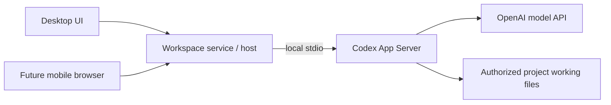

# Architecture

## Status and accepted foundation

This branch contains a runnable local desktop application with settings and the initial workspace lifecycle. The service persists canonical sources, named workspaces, one default Table view per workspace and the active workspace/view selection in SQLite. The desktop includes a native directory picker and a localized empty Table screen. Project discovery and editing, properties, Board views, archive/restore and other filesystem operations remain future work. SQLite with Drizzle is the selected persistence foundation.

The product uses selected bb architecture and UI foundations while retaining its own folder/project domain. Adopt useful modules deliberately, with provenance and boundary tests; do not assume a whole bb package is independent of its chat/session model.

Desktop starts a separate local TypeScript backend process that owns SQLite and product policy. The first release exposes this service locally; authenticated access from other devices is a separate future capability. See [ADR-0003](adr/0003-separate-local-backend.md).

The runtime uses Electron `utilityProcess` with message ports, React with Vite, and a narrow preload boundary. The renderer has no direct Node.js or database access. SQLite uses Drizzle with `better-sqlite3`; ordered SQL migrations ship with the app. The database belongs beneath Electron's machine-local `userData` directory as `workspace.sqlite`; development uses a distinct `development` subdirectory, and tests use temporary directories. The preference defaults to English and supports English and Russian. See [ADR 0005](adr/0005-local-settings-runtime.md) for build and runtime details.

## Intended responsibilities

| Boundary | Responsibility | Pending decision |
| --- | --- | --- |
| Desktop renderer | React settings, workspace creation and empty Table screens; interaction, localization and presentation state | Future routing and state needs as features are added |
| Typed service boundary | Settings and workspace query/command contracts and normalized errors, exposed through preload and IPC | Additional contracts and event subscriptions as features are added |
| Local application service | Settings and workspace/source identity persistence in a separate TypeScript process; canonical root validation, atomic workspace creation, active Table view selection | Discovery policy, properties and future domain capabilities |
| Machine filesystem adapter | Validated discovery, moves, archive/restore and native integration | Watcher/reconciliation and OS-specific recovery |
| Persistence | SQLite schema, Drizzle migrations and repositories | Database partitioning and backup strategy |
| Shared-folder exchange, later | Durable changes, snapshots, identity and conflict handling | Protocol/library, tombstones and compaction |
| Hosted access, later | Owner-device access to the host service, including responsive mobile browser | Transport, device authentication, client feature scope and host lifecycle |
| Agent execution, later | Personal project chats, local Codex/API-key execution, permission modes and parallel runs | Working-file isolation, result integration and exact runtime policy |

The renderer uses a narrow preload/service boundary. It cannot directly read SQLite, call Node filesystem APIs or hold host credentials. Electron uses context isolation, disabled renderer Node integration and sandboxing. Future filesystem mutations must check the selected source and current destination state.

## bb UI reference

The examined bb revision is `f135a001e72942cee9118d2693208ec0725e2f18`; [source links and reuse rules](reuse.md) pin the evidence.

- React, TypeScript and Vite; Tailwind and shadcn/Radix components.
- React Router for the desktop app; TanStack Query for service state and Jotai for UI state.
- Hugeicons, dnd-kit, virtualization and resizable panels where required by the feature.
- Ladle for component development. bb's script named `storybook` does not mean it uses Storybook.

These are the reference foundations, not an installed dependency manifest. `@bb/shared-ui` is a source workspace package with build seams and styles to adapt. Its table primitives are not a complete property table. Chat editors, terminals, diff viewers and mobile packages are later feature choices rather than mandatory initial dependencies.

## Data ownership constraints

Paths locate folders; they are not sufficient durable project identities. A project source owns projects, property definitions/values, discovery mode and archive location. Each workspace references one source and owns its view set and presentation settings; multiple workspaces may reference the same source. Schema design must preserve those scopes, and private views must not accidentally enter shared exchange.

The current workspace lifecycle is local. Shared metadata remains a later module: the local working database stays outside synchronized folders, and enabling sharing publishes logical exchange data. See [ADR-0001](adr/0001-sqlite-and-drizzle.md) and [ADR-0002](adr/0002-local-database-and-folder-exchange.md).

New application data starts clean; this removes legacy import work, not the need for versioned migrations between future releases. File-operation recovery and database transactions must account for their different failure boundaries.

## Local project identity

Filesystem identity and logical project identity have different scopes. Windows documents file identifiers in combination with a volume serial number and permits reuse over time; Node exposes filesystem evidence such as `dev` and `ino`. These identifiers can assist local reconciliation but do not establish one portable project identity across synchronized computers. Sources: [Microsoft file identifiers](https://learn.microsoft.com/en-us/windows/win32/api/fileapi/ns-fileapi-by_handle_file_information), [Node filesystem statistics](https://nodejs.org/api/fs.html#statsino).

The previous implementation derived ordinary project IDs from source/path information and retained `{path, dev, ino}` locators after explicit application moves. It did not put a permanent project-ID marker in every folder. This observation comes from `src/workspaceObjects.js`, `src/workspaceBackend.js` and `src/workspaceStatusMove.js` in the preserved pre-rebuild history; it is not the new design contract.

For the local release, project records remain in the application database and are associated with folders using paths and native filesystem identity. No permanent project-ID marker is written inside project folders. Filesystem evidence helps reconcile a folder with its logical project record; neither a path nor a raw filesystem ID becomes the portable identity of the project. See [ADR-0004](adr/0004-local-folder-identity-without-markers.md).

When a folder cannot be matched unambiguously, retain its project and properties, show that its folder is missing and offer manual reassociation. When the whole root is unavailable, represent source unavailability rather than treating every project as individually deleted. No automatic metadata deletion follows either case.

Matching synchronized replicas across computers is still an open part of the later sharing protocol. The local decision does not claim that filesystem IDs persist across volumes or devices; copied/replaced folders and reused identifiers require conservative matching rules.

## Future Codex integration

The accepted first AI scope is personal project chats with local Codex execution and API-key authentication. Discussion permits no file changes; Work on project permits project-scoped edits and commands under an enforced permission policy. Parallel editing agents in one project are required, but their working-file isolation and result-application contract have not yet been selected.

The recommended adapter is a local Codex App Server process over `stdio`, owned by the Workspace service/host. OpenAI documents App Server for rich custom clients with threads, streaming and approvals, and supports API-key login. The SDK is another integration route, oriented toward programmatic task automation. This is an integration recommendation, not installed or compatibility-tested code. Sources: [OpenAI App Server](https://developers.openai.com/codex/app-server/), [SDK](https://developers.openai.com/codex/sdk/), [authentication](https://developers.openai.com/codex/auth/).

Local execution refers to the agent process, commands and file tools; model inference still uses the API. Credentials belong on the executing host and must be excluded from browser responses, shared-folder exchange, ordinary metadata exports and logs. Use the Workspace authenticated host boundary for browser access rather than exposing the Codex process directly. Pin and validate the required protocol surface when implementing the adapter, including sandbox, approval and event behavior on macOS and Windows.

Initial remote access serves the same owner's devices, with a responsive mobile browser for views/properties, host-executed chats and file viewing/downloading. The client requires connectivity and maintains no offline mutation/command queue. On reconnect it loads actual host state; commands/runs already accepted before a disconnect require status reconciliation to avoid duplicate execution. A full mobile editor and multi-user invitations follow later.

## Parallel agent environments: open decision

The inspected bb baseline supports both shared existing checkouts and isolated Git worktrees. Shared-checkout reuse is not a guarantee against concurrent edits to the same files. Git worktrees require a Git repository with a commit; ordinary directories use their existing paths. References: [shared checkout provider](https://github.com/get-bb/bb/blob/f135a001e72942cee9118d2693208ec0725e2f18/plugins/environment-project-checkout/server.ts), [Git worktree provider](https://github.com/get-bb/bb/blob/f135a001e72942cee9118d2693208ec0725e2f18/plugins/environment-git-worktree/server.ts).

Workspace requires parallel agents. The user explicitly deferred the shared-folder versus isolated-version policy to AI implementation design, including non-Git isolation, result application and cleanup. These decisions do not block the earlier local release, and no default environment has been selected. Selective bb reuse does not automatically settle those choices. In particular, preserving unaccepted or uncommitted agent results needs an explicit lifecycle policy before adopting upstream cleanup behavior.
