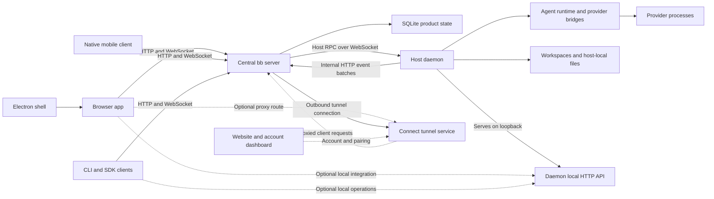

# bb architecture

## Snapshot and scope

Upstream: [get-bb/bb](https://github.com/get-bb/bb). Source baseline: [`f135a001e72942cee9118d2693208ec0725e2f18`](https://github.com/get-bb/bb/commit/f135a001e72942cee9118d2693208ec0725e2f18), inspected on 2026-10-08. All source links below are pinned to that commit.

This is a source-inspected architecture reference. It describes implemented component boundaries and distinguishes them from support claims and operational acceptance. bb was not installed, built or executed for this analysis. The [Workspace architecture](workspace-architecture.md) describes our application independently; similarly named concepts are not assumed to have identical meanings.

bb is an agent-oriented development environment organized around a central server, execution-machine daemons and several control surfaces. The server owns product policy and durable state; daemons own host-local execution. Browser, desktop, mobile, CLI and SDK clients address these boundaries rather than each maintaining a separate application backend. [Repository overview][repository] supplies the high-level map; the entrypoints and contracts below establish the actual wiring.

## Domain model

| Concept | Meaning and relationship |
| --- | --- |
| Project | Repository-oriented container with one or more sources. |
| Project source | Location of code; a local-path source belongs to a particular host. |
| Host | Enrolled execution machine with a durable identity. The server records its primary host and can dispatch to other hosts. |
| Environment | Host-bound execution context and workspace directory; can use an existing directory or a managed workspace. Several threads can share one. |
| Thread | Agent conversation and unit of work, including standard and manager threads. |
| Event | Persisted conversation/progress record, with sequence/identity handling and derived search/timeline data. |
| Provider | Agent implementation registered through runtime bridge capabilities. |
| Plugin | Installed extension contributing declared backend, runtime or UI capabilities. |
| Skill | Instruction tree supplied to agent execution; distinct from the provider process and runtime. |

In bb, a **workspace** commonly means an execution directory within an environment. Workspace's saved configuration is a different concept. Similarly, a bb thread is not our folder-backed project or a GitHub development issue.

Thread lifecycle ownership is also distinct from visual nesting: immutable `lifecycleOwnerThreadId` controls dependent archive/delete cleanup, `parentThreadId` describes sidebar relationships, and `sourceThreadId` records a fork. The server persists lifecycle decisions before coordinating host cleanup. These semantics matter when multiple projects, environments and machines participate in one workflow. See [system overview][system] and [database schema][schema].

## Runtime topology

The diagram represents responsibilities, not a requirement to run every process on one machine. The launcher can supervise a co-located full stack or start separate modes. Additional enrolled daemons provide remote execution. A browser device is a control surface; opening the browser does not enroll it as an execution host. Optional native folder/editor/open-target operations use the daemon's loopback [local HTTP API][local-api], independently of the central server API. The website/account dashboard and the connect tunnel service are separate deployment responsibilities; the server maintains its outbound tunnel connection.

The [bb-app launcher][launcher] resolves runtime configuration and supervises server/daemon processes. [Server startup][server-start] initializes persistence, registries, plugins and services, then starts the HTTP listener. [Daemon startup][daemon-start] resolves enrollment/identity, local locks and environment, constructs the host application and starts its lifecycle. The [desktop main process][desktop-main] starts the packaged runtime through its process supervisor.

## Monorepo ownership

| Location | Responsibility |
| --- | --- |
| `packages/bb-app` | Published npm launcher, bundled CLI, runtime packaging and public SDK export. |
| `apps/server` | Hono HTTP API, WebSockets, product policy, durable state and host coordination. |
| `apps/host-daemon` | Workspace provisioning, provider/terminal execution, local API and event delivery. |
| `apps/app` | React browser UI, also loaded by the desktop shell. |
| `apps/desktop` | Electron windows, native integrations, runtime supervision and update behavior. |
| `apps/mobile` | Expo/React Native client with profile-bound server connections. |
| `apps/cli`, `packages/sdk` | Scriptable CLI and programmatic application access. |
| `apps/web` | Public website plus hosted account, dashboard and connect services. |
| `packages/server-contract` | Typed client-to-server HTTP/WebSocket API. |
| `packages/host-daemon-contract` | Server-to-daemon RPC, internal event and local-API protocols. |
| `packages/db` | Relational schema, migrations and connection/query support. |
| `packages/client-core` | Pure reusable client behavior independent of browser/framework state. |
| `packages/agent-runtime` | Provider session/turn orchestration and bridge coordination. |
| Plugin packages and `plugins/` | Extension contracts, build/artifact registry and concrete extensions. |

pnpm workspaces define the package graph; Turbo defines task dependencies and caching. Package boundaries permit different delivery targets to share contracts and pure logic while retaining platform adapters. This is more than a frontend directory convention: server state, host execution and client presentation have independent entrypoints and lifecycles. Evidence: [workspace configuration][workspaces], [Turbo tasks][turbo] and [repository map][repository].

## Interface, state and styling

[Browser startup][app-main] mounts React with the shared TanStack Query client and browser router. [App composition][app-root] installs navigation/command/UI hosts and realtime subscriptions. The [browser SDK adapter][browser-sdk] targets the current origin using app-surface fetch behavior.

State is divided by ownership:

- **Server-derived data:** TanStack Query caches projects, threads, environments, timelines, terminals and related resources. The [query client][query] centralizes retry/refetch and mutation-error policy. [WebSocket handling][app-ws] converts notifications into resource-specific cache effects rather than treating notifications as a second database.
- **Client interaction/preferences:** Jotai atoms and app-local owners handle selected UI state and persisted preferences. Persistence is mixed: some preferences are local, while others use server `uiPreferences` and related endpoints.
- **Pure client behavior:** [client-core][client-core] contains panel/tab mechanics, sidebar grouping/order/read state, prompt and timeline logic, file-preview and transport helpers. Its [no-DOM test][no-dom] rejects browser globals and React/Jotai/Query/router imports. This creates a testable reuse boundary for multiple clients.

UI foundations are shared core/UI packages, Radix primitives, Tailwind and semantic theme tokens. [App theme CSS][theme] defines the styling layer; Ladle stories provide component inspection. App-local [split loading][split] separates initial shell requirements from preloaded and intent-driven features, with local loading/error boundaries and build-budget enforcement. These mechanisms exist in source; their presence is not a fresh performance measurement.

bb's UI state is substantially richer than Workspace's current session owner: it includes running-thread, timeline, prompt, plugin and remote-resource concerns. Adopting the separation principle does not require importing every state library or feature.

## Server, contracts and request flows

The [server composition root][server] registers project, environment, thread, terminal, host, queue, preferences, plugin, skill and server-movement routes, plus internal endpoints and client/daemon/terminal WebSocket protocols. The [server contract][server-contract] defines the client-facing boundary; the [host-daemon contract][host-contract] defines machine-execution and internal communication separately.

**Start agent work.** A client submits a thread/action through the server API. Server policy validates and persists the request, resolves the environment/host and dispatches host RPC through the active daemon WebSocket. The daemon provisions or uses the workspace and invokes its runtime manager. Command-result handling settles the coordinated action; provider progress travels through a separate event path. Evidence: [server routes][server], [daemon protocol][daemon-protocol] and [runtime manager][runtime-manager].

**Publish progress.** The daemon's [event sink][event-sink] batches events, retries delivery and flushes on lifecycle transitions. Its [server client][daemon-client] posts internal HTTP batches. [Internal event handling][events] validates them and appends accepted events in a database transaction before notifying clients. Some interaction lifecycle events are authored exclusively by the server; a daemon cannot simply manufacture every event type.

**Update a client.** The [client WebSocket protocol][client-protocol] and hub notify subscriptions. The browser applies cache-owner-specific invalidation or updates; subsequent API reads and timeline merging supply consistent resource views. HTTP operations, host RPC, persisted events and client notifications are related mechanisms with different responsibilities.

Server movement is an implemented subsystem: startup includes import/reconciliation/retirement handling, and request composition includes a move coordinator and freeze middleware. A plan document alone would not establish that wiring; the current [startup][server-start] and [server composition][server] do. Its existence does not establish acceptance of every migration/failure scenario.

## Persistence and execution state

The product database is SQLite through **better-sqlite3 and Drizzle**. [Database initialization][db-init] opens the connection and applies migrations; [connection setup][connection] configures WAL, foreign keys, busy-timeout and other connection behavior. [Schema][schema] includes projects/sources, hosts, environments, threads/events, daemon and terminal sessions, queued messages, pending interactions, preferences, installed plugins and plugin state, attachments and derived search/timeline structures.

This database is the server's canonical structured product state. Workspace directories, provider session files, artifacts, logs, configuration and skill trees also exist on disk. Therefore “stored in SQLite” does not mean every byte of execution state is inside the database. Event ingestion appends progress records, but retention/pruning and lifecycle cleanup remain separate policies.

Managed environments and provider sessions introduce recovery obligations beyond UI persistence: a durable record can exist while a host is disconnected or cleanup is pending. Daemon protocol/liveness, event delivery and server lifecycle reconciliation address these boundaries. The clients do not independently provision execution directories merely by restoring a panel layout.

## Desktop, browser and mobile surfaces

**Desktop:** Electron wraps the browser UI and adds native windows/browser views, menus, find, clipboard, opening targets, update and runtime supervision. The [preload][desktop-preload] exposes typed capabilities using `contextBridge`/IPC and desktop contracts. [Window creation][desktop-window] retains `contextIsolation: true`, `nodeIntegration: false`, `sandbox: true`. Native shell integration does not replace the server's application-data layer.

**Browser:** `apps/app` addresses a bb server through HTTP/WebSocket. It can control work running elsewhere. Optional machine-local editor integration is a separate helper path; browser access and execution-machine enrollment are independent. See [multiple devices][devices].

**Mobile:** `apps/mobile` is a real Expo/React Native client, with Expo Router, SDK/client-core/contracts, Query, secure profile storage and native navigation/gesture/keyboard infrastructure. Its [root layout][mobile-layout] initializes the platform providers, sharing/quick actions and notifications. Native screens and embedded web surfaces coexist; this is not a claim of complete native implementation or parity with desktop. The phone does not run a host daemon or agents. [Platform support][platforms] distinguishes available backend plugin capabilities from unavailable plugin frontends and local editor integrations.

That support document describes iOS-first support and says Android builds have not been produced/tested, while the pinned source already contains [Android EAS build configuration][mobile-eas] and [Android E2E workflow][android-e2e]. This is a documentation/tooling discrepancy: the presence of build/test definitions does not establish an accepted Android release, and the documentation alone does not describe all existing tooling.

## Providers, plugins, skills and auxiliary AI

The daemon [runtime manager][runtime-manager] creates an [agent runtime][runtime]. Runtime ownership covers provider processes, sessions, turns, cancellation and bridge translation. The [provider registry][providers] constructs adapters from plugin-provided bridge launch descriptors. Concrete provider plugins include Codex, Claude Code, Pi and ACP; a generic ACP bridge does not imply identical built-in behavior for every agent advertised elsewhere.

The [plugin service][plugin-service] installs/enables/reloads registrations and manages artifacts, settings, watchers and contribution registries. Host-side execution has its own plugin workers/artifact handling. [Plugin SDK contracts][plugin-sdk] and build tooling expose distinct backend/runtime and app extension surfaces. Frontend plugins can contribute panels, actions, slots, themes and trusted content scripts. Those content scripts run as trusted same-origin code, not inside an untrusted sandbox.

Skills have catalog, install, distribution and injection paths through [server skill services][skills], internal endpoints and host instruction trees. An instruction tree augments an agent's execution context; it is not an alternative to the runtime lifecycle or provider protocol. Repository `.bb/skills` also contains **development workflows**, a separate use of skills from product-level injection.

[Auxiliary AI services][ai] register capabilities such as completion and transcription with status/cache/timeout behavior. These services are distinct from a long-running agent thread and can have their own plugin identity. This distinction keeps small AI tasks from defining the whole agent execution model.

## Website, deployment and security

`apps/web` is a separate TanStack Start application deployed through Cloudflare. It contains landing pages plus account/dashboard/connect routes. [Wrangler configuration][web-config] defines environment configuration, D1 account/connect data, a binding to the tunnel service's Durable Object, marketplace R2 and rate limits. The [connect plugin][connect-plugin] owns the bb server's tunnel connection. Hosted account data is separate from the bb server's SQLite product data. The public website is not the same application as the browser control UI in `apps/app`.

The npm launcher and desktop packaging bundle/supervise the runtime; the execution host can be separate from the browser. Direct URLs, private-network access and bb connect have different access boundaries. Native host/runtime support and minimum Node versions are documented in [platform support][platforms]; configuration is centralized in the config package and launcher rather than embedded in React.

Security is layered. Internal daemon HTTP calls verify machine credentials; daemon WebSockets validate enrollment/protocol; browser routes apply host/origin checks; access-provider bridges and the connect plugin can add remote policy and tunnels. These mechanisms do **not** mean every public API route universally requires authentication. The [multiple-device documentation][devices] explicitly qualifies direct wildcard network binding as an unauthenticated API with command/file capabilities, requiring an external trusted boundary. Conversely, describing every internal transport as unauthenticated would also be wrong. See [server routing][server] and [internal authentication][auth].

Source inspection establishes which boundaries exist; it does not certify a deployed server, plugin or tunnel configuration.

## Verification, support and architectural trade-offs

The repository includes package-scoped Vitest unit/integration suites, pure-core architecture checks, runtime/provider protocol tests, packaged npm smoke checks, desktop packaging tests, component stories and mobile simulator workflows. Root [package scripts][package], [CI workflows][ci] and [verification skill][verify] define the available tools and evidence requirements. Affected-work selection includes a full fallback; platform and packaged-artifact checks cover risks that a browser build alone cannot establish.

The source contains desktop/browser clients, server/daemon execution, native mobile infrastructure and extensibility. Platform support remains qualified: Windows native host support is alpha, mobile is iOS-first, and feature availability depends on provider, plugin and deployment configuration. No all-green test or operational-support claim was established during this analysis.

Observed trade-offs follow from these boundaries:

- Separate server and daemon processes permit remote execution and multiple control surfaces, but require enrollment, reconnect, command settlement and cleanup reconciliation.
- Pure client-core enables shared behavior and headless verification, while Query/Jotai/platform adapters retain their own effects and persistence.
- Plugins make providers and UI features extensible, but add artifact compatibility, trusted-code and lifecycle concerns.
- Central SQLite simplifies authoritative product policy, while machine-local execution files still require separate ownership and recovery.
- A separate hosted website/account/connect stack enables public distribution and remote access without moving all product state into the website database.

These are descriptions of bb's implemented architecture, not a recommendation to replace Workspace's backend or adopt bb's product functions wholesale.

[repository]: https://github.com/get-bb/bb/blob/f135a001e72942cee9118d2693208ec0725e2f18/docs/repository-overview.md
[system]: https://github.com/get-bb/bb/blob/f135a001e72942cee9118d2693208ec0725e2f18/docs/system-overview.md
[schema]: https://github.com/get-bb/bb/blob/f135a001e72942cee9118d2693208ec0725e2f18/packages/db/src/schema.ts
[launcher]: https://github.com/get-bb/bb/blob/f135a001e72942cee9118d2693208ec0725e2f18/packages/bb-app/src/launcher.ts
[server-start]: https://github.com/get-bb/bb/blob/f135a001e72942cee9118d2693208ec0725e2f18/apps/server/src/start-server.ts
[daemon-start]: https://github.com/get-bb/bb/blob/f135a001e72942cee9118d2693208ec0725e2f18/apps/host-daemon/src/start-host-daemon.ts
[desktop-main]: https://github.com/get-bb/bb/blob/f135a001e72942cee9118d2693208ec0725e2f18/apps/desktop/src/main.ts
[workspaces]: https://github.com/get-bb/bb/blob/f135a001e72942cee9118d2693208ec0725e2f18/pnpm-workspace.yaml
[turbo]: https://github.com/get-bb/bb/blob/f135a001e72942cee9118d2693208ec0725e2f18/turbo.json
[app-main]: https://github.com/get-bb/bb/blob/f135a001e72942cee9118d2693208ec0725e2f18/apps/app/src/main.tsx
[app-root]: https://github.com/get-bb/bb/blob/f135a001e72942cee9118d2693208ec0725e2f18/apps/app/src/App.tsx
[browser-sdk]: https://github.com/get-bb/bb/blob/f135a001e72942cee9118d2693208ec0725e2f18/apps/app/src/lib/sdk.ts
[query]: https://github.com/get-bb/bb/blob/f135a001e72942cee9118d2693208ec0725e2f18/apps/app/src/lib/query-client.ts
[app-ws]: https://github.com/get-bb/bb/blob/f135a001e72942cee9118d2693208ec0725e2f18/apps/app/src/hooks/useWebSocket.ts
[client-core]: https://github.com/get-bb/bb/tree/f135a001e72942cee9118d2693208ec0725e2f18/packages/client-core/src
[no-dom]: https://github.com/get-bb/bb/blob/f135a001e72942cee9118d2693208ec0725e2f18/packages/client-core/test/no-dom.test.ts
[theme]: https://github.com/get-bb/bb/blob/f135a001e72942cee9118d2693208ec0725e2f18/apps/app/src/components/ui/theme.css
[split]: https://github.com/get-bb/bb/blob/f135a001e72942cee9118d2693208ec0725e2f18/docs/ui-code-splitting.md
[server]: https://github.com/get-bb/bb/blob/f135a001e72942cee9118d2693208ec0725e2f18/apps/server/src/server.ts
[server-contract]: https://github.com/get-bb/bb/blob/f135a001e72942cee9118d2693208ec0725e2f18/packages/server-contract/src/index.ts
[host-contract]: https://github.com/get-bb/bb/tree/f135a001e72942cee9118d2693208ec0725e2f18/packages/host-daemon-contract
[daemon-protocol]: https://github.com/get-bb/bb/blob/f135a001e72942cee9118d2693208ec0725e2f18/apps/server/src/ws/daemon-protocol.ts
[runtime-manager]: https://github.com/get-bb/bb/blob/f135a001e72942cee9118d2693208ec0725e2f18/apps/host-daemon/src/runtime-manager.ts
[event-sink]: https://github.com/get-bb/bb/blob/f135a001e72942cee9118d2693208ec0725e2f18/apps/host-daemon/src/event-sink.ts
[daemon-client]: https://github.com/get-bb/bb/blob/f135a001e72942cee9118d2693208ec0725e2f18/apps/host-daemon/src/server-client.ts
[events]: https://github.com/get-bb/bb/blob/f135a001e72942cee9118d2693208ec0725e2f18/apps/server/src/internal/events.ts
[client-protocol]: https://github.com/get-bb/bb/blob/f135a001e72942cee9118d2693208ec0725e2f18/apps/server/src/ws/client-protocol.ts
[db-init]: https://github.com/get-bb/bb/blob/f135a001e72942cee9118d2693208ec0725e2f18/apps/server/src/db.ts
[connection]: https://github.com/get-bb/bb/blob/f135a001e72942cee9118d2693208ec0725e2f18/packages/db/src/connection.ts
[desktop-preload]: https://github.com/get-bb/bb/blob/f135a001e72942cee9118d2693208ec0725e2f18/apps/desktop/src/preload.ts
[desktop-window]: https://github.com/get-bb/bb/blob/f135a001e72942cee9118d2693208ec0725e2f18/apps/desktop/src/desktop-window-factory.ts
[devices]: https://github.com/get-bb/bb/blob/f135a001e72942cee9118d2693208ec0725e2f18/docs/multiple-devices.md
[mobile-layout]: https://github.com/get-bb/bb/blob/f135a001e72942cee9118d2693208ec0725e2f18/apps/mobile/app/_layout.tsx
[platforms]: https://github.com/get-bb/bb/blob/f135a001e72942cee9118d2693208ec0725e2f18/docs/platform-support.md
[runtime]: https://github.com/get-bb/bb/blob/f135a001e72942cee9118d2693208ec0725e2f18/packages/agent-runtime/src/runtime.ts
[providers]: https://github.com/get-bb/bb/blob/f135a001e72942cee9118d2693208ec0725e2f18/packages/agent-runtime/src/provider-registry.ts
[plugin-service]: https://github.com/get-bb/bb/blob/f135a001e72942cee9118d2693208ec0725e2f18/apps/server/src/services/plugins/plugin-service.ts
[plugin-sdk]: https://github.com/get-bb/bb/tree/f135a001e72942cee9118d2693208ec0725e2f18/packages/plugin-sdk
[skills]: https://github.com/get-bb/bb/tree/f135a001e72942cee9118d2693208ec0725e2f18/apps/server/src/services/skills
[ai]: https://github.com/get-bb/bb/blob/f135a001e72942cee9118d2693208ec0725e2f18/apps/server/src/services/ai/ai-service-registry.ts
[web-config]: https://github.com/get-bb/bb/blob/f135a001e72942cee9118d2693208ec0725e2f18/apps/web/wrangler.jsonc
[auth]: https://github.com/get-bb/bb/blob/f135a001e72942cee9118d2693208ec0725e2f18/apps/server/src/internal/auth.ts
[package]: https://github.com/get-bb/bb/blob/f135a001e72942cee9118d2693208ec0725e2f18/package.json
[ci]: https://github.com/get-bb/bb/tree/f135a001e72942cee9118d2693208ec0725e2f18/.github/workflows
[verify]: https://github.com/get-bb/bb/tree/f135a001e72942cee9118d2693208ec0725e2f18/.bb/skills/verify-bb
[local-api]: https://github.com/get-bb/bb/blob/f135a001e72942cee9118d2693208ec0725e2f18/apps/host-daemon/src/local-api.ts
[connect-plugin]: https://github.com/get-bb/bb/tree/f135a001e72942cee9118d2693208ec0725e2f18/plugins/connect
[mobile-eas]: https://github.com/get-bb/bb/blob/f135a001e72942cee9118d2693208ec0725e2f18/apps/mobile/eas.json
[android-e2e]: https://github.com/get-bb/bb/blob/f135a001e72942cee9118d2693208ec0725e2f18/.github/workflows/mobile-android-e2e.yml
