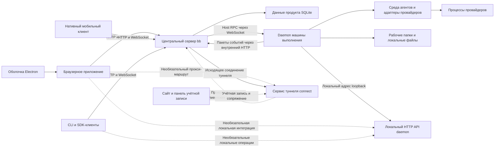

# Архитектура bb

## Версия и границы исследования

Исходный проект: [get-bb/bb](https://github.com/get-bb/bb). Версия кода: [`f135a001e72942cee9118d2693208ec0725e2f18`](https://github.com/get-bb/bb/commit/f135a001e72942cee9118d2693208ec0725e2f18), исследована 8 октября 2026 года. Все ссылки на исходники ниже закреплены за этим коммитом.

Это описание архитектуры по исходникам. Оно показывает реализованные границы компонентов отдельно от заявленной поддержки и приёмки в работающей среде. bb в рамках исследования не устанавливался, не собирался и не запускался. [Архитектура Workspace](workspace-architecture.ru.md) описана независимо: одинаковые названия не означают одинаковый смысл. [Оригинал на английском](bb-architecture.md).

bb — среда разработки с агентами, построенная вокруг центрального сервера, фоновых служб на машинах выполнения и нескольких клиентских интерфейсов. Сервер владеет продуктовыми правилами и постоянными данными; службы daemon отвечают за выполнение на своих машинах. Браузер, desktop, мобильное приложение, CLI и SDK обращаются к этим границам, вместо того чтобы каждый содержать собственный бэкенд. Общую карту даёт [обзор репозитория][repository]; фактическое подключение подтверждается точками входа и контрактами ниже.

## Предметная модель

| Понятие | Значение и связь |
| --- | --- |
| Project — проект | Контейнер, обычно связанный с репозиторием, с одним или несколькими источниками. |
| Project source — источник проекта | Местоположение кода; источник с локальным путём принадлежит конкретному хосту. |
| Host — хост | Зарегистрированная машина выполнения с постоянной идентичностью. Сервер знает основной хост и может отправлять работу на другие. |
| Environment — среда | Контекст выполнения и рабочая папка на хосте; использует существующую папку или управляемую рабочую область. Может быть общей для нескольких потоков. |
| Thread — поток | Диалог с агентом и единица работы; существуют обычные и управляющие потоки. |
| Event — событие | Сохранённая запись диалога или прогресса, с порядком/идентичностью и производными данными поиска и ленты. |
| Provider — провайдер | Реализация агента, зарегистрированная через возможности адаптера исполнения. |
| Plugin — плагин | Установленное расширение с объявленными возможностями бэкенда, среды исполнения или интерфейса. |
| Skill — скилл | Дерево инструкций, передаваемое агенту; отличается от процесса провайдера и среды исполнения. |

В bb **workspace** обычно означает рабочую папку выполнения внутри среды. Сохранённая конфигурация Workspace в нашем продукте — другое понятие. Аналогично поток bb не равен нашему проекту-папке или задаче разработки в GitHub.

Владение жизненным циклом потока отличается от визуальной вложенности: неизменяемый `lifecycleOwnerThreadId` управляет каскадным архивированием/удалением зависимых потоков, `parentThreadId` описывает связи в боковой панели, `sourceThreadId` фиксирует ответвление. Сервер сохраняет решение о жизненном цикле до координации очистки на хостах. Эти различия важны, когда в одном процессе работы участвуют несколько проектов, сред и машин. См. [обзор системы][system] и [схему базы данных][schema].

## Схема работающих компонентов

Схема показывает ответственность компонентов, а не обязательное размещение всех процессов на одной машине. Launcher может управлять локальным полным стеком или запускать отдельные режимы. Дополнительные зарегистрированные daemon обеспечивают удалённое выполнение. Браузерное устройство — интерфейс управления; открытие браузера не регистрирует его как машину выполнения. Необязательные нативные операции выбора папки, редактора и открытия файлов используют [локальный HTTP API][local-api] daemon на loopback-адресе независимо от центрального серверного API. Сайт/учётные записи и сервис туннеля connect имеют отдельные обязанности при развёртывании; сервер поддерживает исходящее соединение туннеля.

[Launcher bb-app][launcher] определяет конфигурацию и управляет процессами сервера и daemon. [Запуск сервера][server-start] инициализирует хранение, реестры, плагины и сервисы, затем начинает принимать HTTP-запросы. [Запуск daemon][daemon-start] разрешает регистрацию/идентичность, локальные блокировки и окружение, создаёт приложение хоста и запускает его жизненный цикл. [Главный desktop-процесс][desktop-main] запускает упакованную среду через механизм управления процессами.

## Ответственность пакетов монорепозитория

| Расположение | Ответственность |
| --- | --- |
| `packages/bb-app` | Публикуемый npm-launcher, встроенный CLI, упаковка среды исполнения и экспорт SDK. |
| `apps/server` | Hono HTTP API, WebSocket, продуктовые правила, постоянные данные и координация хостов. |
| `apps/host-daemon` | Подготовка рабочих папок, выполнение провайдеров и терминалов, локальный API и доставка событий. |
| `apps/app` | Браузерный интерфейс React, который также загружает desktop-оболочка. |
| `apps/desktop` | Окна Electron, системные интеграции, управление процессами и обновление. |
| `apps/mobile` | Клиент Expo/React Native с подключениями к серверу по профилям. |
| `apps/cli`, `packages/sdk` | Скриптуемый CLI и программный доступ к приложению. |
| `apps/web` | Публичный сайт и размещённые сервисы учётных записей, панели управления и connect. |
| `packages/server-contract` | Типизированный клиент-серверный HTTP/WebSocket API. |
| `packages/host-daemon-contract` | RPC сервер–daemon, внутренние события и протоколы локального API. |
| `packages/db` | Реляционная схема, миграции и поддержка соединений/запросов. |
| `packages/client-core` | Чистая повторно используемая клиентская логика, независимая от браузера и фреймворков состояния. |
| `packages/agent-runtime` | Координация сессий/ходов провайдеров и их адаптеров. |
| Пакеты плагинов и `plugins/` | Контракты расширений, сборка, реестр артефактов и конкретные расширения. |

pnpm workspaces задаёт граф пакетов; Turbo — зависимости задач и кэширование. Границы пакетов позволяют разным приложениям использовать общие контракты и чистую логику, сохраняя платформенные адаптеры. Это шире структуры папок фронтенда: серверные данные, выполнение на хосте и клиентский интерфейс имеют независимые точки входа и жизненные циклы. Источники: [конфигурация workspace][workspaces], [задачи Turbo][turbo], [карта репозитория][repository].

## Интерфейс, состояние и оформление

[Запуск браузерного приложения][app-main] монтирует React с общим клиентом TanStack Query и браузерным маршрутизатором. [Корневой компонент][app-root] подключает навигацию, команды, UI-контейнеры и realtime-подписки. [Браузерный SDK-адаптер][browser-sdk] обращается к текущему origin с поведением запросов для интерфейса приложения.

Состояние разделено по владельцам:

- **Данные сервера:** TanStack Query кэширует проекты, потоки, среды, ленты событий, терминалы и связанные ресурсы. [Query-клиент][query] централизует повторные запросы, обновление данных и ошибки изменений. [Обработка WebSocket][app-ws] преобразует уведомления в изменения конкретных кэшей, а не считает уведомления второй базой данных.
- **Взаимодействие и настройки клиента:** атомы Jotai и локальные владельцы управляют выбранным UI-состоянием и сохранёнными настройками. Хранение смешанное: часть настроек локальна, другие используют серверные `uiPreferences` и соответствующие API.
- **Чистая клиентская логика:** [client-core][client-core] содержит механику панелей/вкладок, группировку, порядок и прочитанность боковой панели, логику запросов агенту и объединения ленты, предпросмотр файлов и транспортные помощники. [Тест no-DOM][no-dom] запрещает браузерные глобальные объекты и импорты React/Jotai/Query/маршрутизатора. Это проверяемая граница переиспользования между клиентами.

Основа оформления — общие core/UI-пакеты, Radix, Tailwind и семантические токены темы. [CSS темы][theme] задаёт оформление; истории Ladle помогают осматривать компоненты. [Разделение загрузки UI][split] отделяет необходимый первоначальный экран от предварительно загружаемых функций и функций, загружаемых по намерению пользователя; есть локальные состояния загрузки/ошибок и проверка бюджета сборки. Наличие механизмов в коде не является свежим измерением производительности.

UI-состояние bb значительно богаче текущего владельца сессии Workspace: оно включает работающие потоки, ленты, запросы агенту, плагины и удалённые ресурсы. Перенос принципа разделения ответственности не требует переноса всех библиотек состояния и функций.

## Сервер, контракты и потоки запросов

[Корень сборки сервера][server] регистрирует маршруты проектов, сред, потоков, терминалов, хостов, очередей, настроек, плагинов, скиллов и перемещения сервера, а также внутренние API и WebSocket-протоколы клиентов, daemon и терминалов. [Серверный контракт][server-contract] определяет клиентскую границу; [контракт host-daemon][host-contract] отдельно задаёт выполнение на машине и внутреннее общение.

**Запуск работы агента.** Клиент отправляет поток или действие через серверный API. Сервер проверяет и сохраняет запрос, определяет среду/хост и передаёт Host RPC по активному WebSocket daemon. Daemon подготавливает или использует рабочую папку и вызывает менеджер среды исполнения. Результат команды завершает координируемое действие; прогресс провайдера передаётся отдельным потоком событий. Источники: [серверные маршруты][server], [протокол daemon][daemon-protocol], [runtime manager][runtime-manager].

**Публикация прогресса.** [Приёмник событий daemon][event-sink] группирует события, повторяет доставку и отправляет накопленное при переходах жизненного цикла. Его [серверный клиент][daemon-client] публикует пакеты через внутренний HTTP. [Серверная обработка событий][events] проверяет их и добавляет принятые записи в транзакции базы данных до уведомления клиентов. Часть событий жизненного цикла взаимодействий может создавать только сервер; daemon не может произвольно производить все типы событий.

**Обновление клиента.** [Клиентский WebSocket-протокол][client-protocol] и hub уведомляют подписчиков. Браузер обновляет или инвалидирует кэш согласно владельцу ресурса; последующие API-чтения и объединение ленты обеспечивают согласованное представление. HTTP-операции, Host RPC, сохранённые события и клиентские уведомления связаны, но имеют разные обязанности.

Перемещение сервера — реализованная подсистема: запуск включает импорт, согласование и вывод старой стороны из работы; обработка запросов включает координатор перемещения и middleware заморозки. Одного документа-плана было бы недостаточно, но текущие [запуск][server-start] и [сборка сервера][server] подтверждают подключение. Само наличие кода не подтверждает приёмку каждого сценария миграции или отказа.

## Хранение и состояние выполнения

База продукта — SQLite через **better-sqlite3 и Drizzle**. [Инициализация БД][db-init] открывает соединение и применяет миграции; [настройка соединения][connection] задаёт WAL, внешние ключи, ожидание занятой базы и другие параметры. [Схема][schema] включает проекты/источники, хосты, среды, потоки/события, сессии daemon и терминалов, сообщения в очередях, ожидаемые взаимодействия, настройки, установленные плагины и их состояние, вложения и производные структуры поиска/ленты.

База является каноническим источником структурированных данных продукта на сервере. Рабочие папки, файлы сессий провайдеров, артефакты, логи, конфигурация и деревья скиллов также существуют на диске. Поэтому хранение в SQLite не означает, что всё состояние выполнения находится в базе. Приём событий добавляет записи прогресса; сроки хранения, прореживание и очистка жизненного цикла остаются отдельными правилами.

Управляемые среды и сессии провайдеров требуют восстановления сверх сохранения интерфейса: постоянная запись может существовать, пока хост отключён или очистка ещё ожидается. Эти границы обслуживают протокол daemon и контроль доступности, доставка событий и серверное согласование жизненного цикла. Восстановление раскладки панелей само по себе не создаёт рабочие папки выполнения.

## Desktop, браузер и мобильный клиент

**Desktop:** Electron оборачивает браузерный интерфейс и добавляет нативные окна/browser views, меню, поиск, буфер обмена, открытие объектов, обновление и управление процессами. [Preload][desktop-preload] предоставляет типизированные возможности через `contextBridge`/IPC и desktop-контракты. [Создание окон][desktop-window] сохраняет `contextIsolation: true`, `nodeIntegration: false`, `sandbox: true`. Нативная оболочка не заменяет серверное хранение данных приложения.

**Браузер:** `apps/app` обращается к bb-серверу через HTTP/WebSocket и может управлять работой на другой машине. Необязательная интеграция с локальным редактором использует отдельный помощник. Доступ браузера и регистрация машины выполнения независимы. См. [несколько устройств][devices].

**Мобильный клиент:** `apps/mobile` — настоящее Expo/React Native приложение с Expo Router, SDK/client-core/контрактами, Query, защищённым хранением профилей, нативной навигацией, жестами и клавиатурой. [Корневой layout][mobile-layout] инициализирует платформенные провайдеры, обмен содержимым, быстрые действия и уведомления. Нативные экраны сосуществуют со встроенными веб-представлениями; полная нативность и равенство функций desktop здесь не утверждаются. На телефоне не выполняются daemon или агенты. [Документ поддержки платформ][platforms] различает доступные серверные возможности плагинов и недоступные plugin frontends/интеграции с локальными редакторами.

Этот документ описывает приоритет iOS и говорит, что Android-сборки не выпускались/не тестировались, хотя закреплённая версия кода уже содержит [настройки Android EAS][mobile-eas] и [Android E2E-workflow][android-e2e]. Это расхождение документации и инструментов: наличие определений сборки/тестов не доказывает принятый Android-релиз, а документация не описывает все существующие инструменты.

## Провайдеры, плагины, скиллы и вспомогательный ИИ

[Менеджер выполнения][runtime-manager] daemon создаёт [среду исполнения агентов][runtime]. Она владеет процессами провайдеров, сессиями, ходами, отменой и переводом протоколов через адаптеры. [Реестр провайдеров][providers] создаёт адаптеры по описаниям запуска bridge, предоставленным плагинами. Конкретные плагины включают Codex, Claude Code, Pi и ACP; общий ACP-мост не означает одинаковую встроенную поддержку любого упомянутого агента.

[Сервис плагинов][plugin-service] устанавливает, включает и перезагружает регистрации, управляет артефактами, настройками, наблюдением за исходниками и реестрами возможностей. На хосте есть отдельные plugin workers и обработка артефактов. [Plugin SDK][plugin-sdk] и инструменты сборки определяют отдельные поверхности бэкенда/исполнения и приложения. Фронтенд-плагины могут добавлять панели, действия, слоты, темы и доверенные content scripts. Такие скрипты работают как доверенный код того же origin, а не в песочнице для недоверенного кода.

Скиллы имеют пути каталогизации, установки, распространения и внедрения через [серверные сервисы скиллов][skills], внутренние API и деревья инструкций хоста. Дерево инструкций дополняет контекст агента, но не заменяет жизненный цикл среды исполнения или протокол провайдера. Репозиторий `.bb/skills` также содержит **процессы разработки** — отдельное применение скиллов от внедрения в продукт.

[Вспомогательные AI-сервисы][ai] регистрируют возможности вроде completion — генерации продолжения — и транскрипции, с состояниями, кэшем и тайм-аутами. Они отличаются от длительно работающего агентного потока и могут иметь собственную идентичность плагина. Такое разделение не заставляет небольшие AI-задачи определять всю модель исполнения агентов.

## Сайт, развёртывание и безопасность

`apps/web` — отдельное приложение TanStack Start на Cloudflare. Оно содержит лендинг и маршруты учётных записей, панели управления и connect. [Конфигурация Wrangler][web-config] задаёт окружения, D1-данные учётных записей/connect, привязку к Durable Object сервиса туннеля, marketplace R2 и ограничения частоты запросов. [Плагин connect][connect-plugin] владеет соединением туннеля bb-сервера. Размещённые данные учётных записей отделены от продуктовой SQLite-базы bb. Публичный сайт и браузерный интерфейс управления `apps/app` — разные приложения.

Npm-launcher и desktop-упаковка включают среду исполнения и управляют её процессами; хост выполнения может находиться отдельно от браузера. Прямые URL, приватная сеть и bb connect имеют разные границы доступа. Поддержка ОС хоста и минимальные версии Node описаны в [поддержке платформ][platforms]; конфигурация централизована в config-пакете и launcher, а не внутри React.

Безопасность многоуровневая. Внутренние HTTP-запросы daemon проверяют учётные данные машины; WebSocket daemon — регистрацию и протокол; браузерные маршруты — host/origin; адаптеры провайдеров доступа и connect-плагин могут добавлять удалённые политики и туннели. Это **не означает**, что все публичные API-маршруты всегда требуют аутентификацию. [Документ нескольких устройств][devices] явно описывает прямую сетевую привязку к wildcard-адресу как API без аутентификации, с возможностями команд и чтения файлов, которому необходима внешняя доверенная граница. Но считать все внутренние транспорты неаутентифицированными тоже неверно. См. [маршрутизацию сервера][server] и [внутреннюю аутентификацию][auth].

Исследование исходников показывает существующие границы, но не сертифицирует конфигурацию развёрнутого сервера, плагина или туннеля.

## Проверки, поддержка и архитектурные компромиссы

Репозиторий содержит Vitest unit/integration-тесты пакетов, архитектурные проверки чистого ядра, тесты runtime/протоколов провайдеров, smoke-проверки npm-пакетов, проверки desktop-упаковки, истории компонентов и workflow мобильных симуляторов. Корневые [скрипты пакета][package], [CI-workflow][ci] и [скилл проверки][verify] задают инструменты и требования к свидетельствам. Выбор затронутых проверок имеет переход к полному набору; платформенные проверки и проверки упакованных артефактов покрывают риски, которые одна сборка браузерного интерфейса не подтверждает.

В коде есть desktop/браузерные клиенты, сервер/daemon, нативная мобильная инфраструктура и расширяемость. Поддержка имеет оговорки: нативный Windows-хост — alpha, мобильная разработка ориентирована сначала на iOS, доступность функций зависит от провайдера, плагина и конфигурации развёртывания. В ходе исследования не подтверждались успешность полного набора тестов и поддержка конкретной работающей установки.

Из границ компонентов следуют наблюдаемые компромиссы:

- Отдельные сервер и daemon позволяют удалённое выполнение и несколько интерфейсов управления, но требуют регистрации, повторного соединения, завершения команд и согласования очистки.
- Чистый client-core обеспечивает общую логику и проверки без браузера, а Query/Jotai/платформенные адаптеры сохраняют собственные побочные эффекты и хранение.
- Плагины расширяют провайдеров и UI, но добавляют вопросы совместимости артефактов, доверенного кода и жизненного цикла.
- Центральная SQLite упрощает единый источник продуктовых правил, однако локальные файлы выполнения всё равно требуют отдельного владения и восстановления.
- Отдельные сайт/учётные записи/connect обеспечивают публичное распространение и удалённый доступ без переноса всех продуктовых данных в базу сайта.

Это описание реализованной архитектуры bb, а не рекомендация заменить бэкенд Workspace или полностью перенести функции bb.

[repository]: https://github.com/get-bb/bb/blob/f135a001e72942cee9118d2693208ec0725e2f18/docs/repository-overview.md
[system]: https://github.com/get-bb/bb/blob/f135a001e72942cee9118d2693208ec0725e2f18/docs/system-overview.md
[schema]: https://github.com/get-bb/bb/blob/f135a001e72942cee9118d2693208ec0725e2f18/packages/db/src/schema.ts
[launcher]: https://github.com/get-bb/bb/blob/f135a001e72942cee9118d2693208ec0725e2f18/packages/bb-app/src/launcher.ts
[server-start]: https://github.com/get-bb/bb/blob/f135a001e72942cee9118d2693208ec0725e2f18/apps/server/src/start-server.ts
[daemon-start]: https://github.com/get-bb/bb/blob/f135a001e72942cee9118d2693208ec0725e2f18/apps/host-daemon/src/start-host-daemon.ts
[desktop-main]: https://github.com/get-bb/bb/blob/f135a001e72942cee9118d2693208ec0725e2f18/apps/desktop/src/main.ts
[workspaces]: https://github.com/get-bb/bb/blob/f135a001e72942cee9118d2693208ec0725e2f18/pnpm-workspace.yaml
[turbo]: https://github.com/get-bb/bb/blob/f135a001e72942cee9118d2693208ec0725e2f18/turbo.json
[app-main]: https://github.com/get-bb/bb/blob/f135a001e72942cee9118d2693208ec0725e2f18/apps/app/src/main.tsx
[app-root]: https://github.com/get-bb/bb/blob/f135a001e72942cee9118d2693208ec0725e2f18/apps/app/src/App.tsx
[browser-sdk]: https://github.com/get-bb/bb/blob/f135a001e72942cee9118d2693208ec0725e2f18/apps/app/src/lib/sdk.ts
[query]: https://github.com/get-bb/bb/blob/f135a001e72942cee9118d2693208ec0725e2f18/apps/app/src/lib/query-client.ts
[app-ws]: https://github.com/get-bb/bb/blob/f135a001e72942cee9118d2693208ec0725e2f18/apps/app/src/hooks/useWebSocket.ts
[client-core]: https://github.com/get-bb/bb/tree/f135a001e72942cee9118d2693208ec0725e2f18/packages/client-core/src
[no-dom]: https://github.com/get-bb/bb/blob/f135a001e72942cee9118d2693208ec0725e2f18/packages/client-core/test/no-dom.test.ts
[theme]: https://github.com/get-bb/bb/blob/f135a001e72942cee9118d2693208ec0725e2f18/apps/app/src/components/ui/theme.css
[split]: https://github.com/get-bb/bb/blob/f135a001e72942cee9118d2693208ec0725e2f18/docs/ui-code-splitting.md
[server]: https://github.com/get-bb/bb/blob/f135a001e72942cee9118d2693208ec0725e2f18/apps/server/src/server.ts
[server-contract]: https://github.com/get-bb/bb/blob/f135a001e72942cee9118d2693208ec0725e2f18/packages/server-contract/src/index.ts
[host-contract]: https://github.com/get-bb/bb/tree/f135a001e72942cee9118d2693208ec0725e2f18/packages/host-daemon-contract
[daemon-protocol]: https://github.com/get-bb/bb/blob/f135a001e72942cee9118d2693208ec0725e2f18/apps/server/src/ws/daemon-protocol.ts
[runtime-manager]: https://github.com/get-bb/bb/blob/f135a001e72942cee9118d2693208ec0725e2f18/apps/host-daemon/src/runtime-manager.ts
[event-sink]: https://github.com/get-bb/bb/blob/f135a001e72942cee9118d2693208ec0725e2f18/apps/host-daemon/src/event-sink.ts
[daemon-client]: https://github.com/get-bb/bb/blob/f135a001e72942cee9118d2693208ec0725e2f18/apps/host-daemon/src/server-client.ts
[events]: https://github.com/get-bb/bb/blob/f135a001e72942cee9118d2693208ec0725e2f18/apps/server/src/internal/events.ts
[client-protocol]: https://github.com/get-bb/bb/blob/f135a001e72942cee9118d2693208ec0725e2f18/apps/server/src/ws/client-protocol.ts
[db-init]: https://github.com/get-bb/bb/blob/f135a001e72942cee9118d2693208ec0725e2f18/apps/server/src/db.ts
[connection]: https://github.com/get-bb/bb/blob/f135a001e72942cee9118d2693208ec0725e2f18/packages/db/src/connection.ts
[desktop-preload]: https://github.com/get-bb/bb/blob/f135a001e72942cee9118d2693208ec0725e2f18/apps/desktop/src/preload.ts
[desktop-window]: https://github.com/get-bb/bb/blob/f135a001e72942cee9118d2693208ec0725e2f18/apps/desktop/src/desktop-window-factory.ts
[devices]: https://github.com/get-bb/bb/blob/f135a001e72942cee9118d2693208ec0725e2f18/docs/multiple-devices.md
[mobile-layout]: https://github.com/get-bb/bb/blob/f135a001e72942cee9118d2693208ec0725e2f18/apps/mobile/app/_layout.tsx
[platforms]: https://github.com/get-bb/bb/blob/f135a001e72942cee9118d2693208ec0725e2f18/docs/platform-support.md
[runtime]: https://github.com/get-bb/bb/blob/f135a001e72942cee9118d2693208ec0725e2f18/packages/agent-runtime/src/runtime.ts
[providers]: https://github.com/get-bb/bb/blob/f135a001e72942cee9118d2693208ec0725e2f18/packages/agent-runtime/src/provider-registry.ts
[plugin-service]: https://github.com/get-bb/bb/blob/f135a001e72942cee9118d2693208ec0725e2f18/apps/server/src/services/plugins/plugin-service.ts
[plugin-sdk]: https://github.com/get-bb/bb/tree/f135a001e72942cee9118d2693208ec0725e2f18/packages/plugin-sdk
[skills]: https://github.com/get-bb/bb/tree/f135a001e72942cee9118d2693208ec0725e2f18/apps/server/src/services/skills
[ai]: https://github.com/get-bb/bb/blob/f135a001e72942cee9118d2693208ec0725e2f18/apps/server/src/services/ai/ai-service-registry.ts
[web-config]: https://github.com/get-bb/bb/blob/f135a001e72942cee9118d2693208ec0725e2f18/apps/web/wrangler.jsonc
[auth]: https://github.com/get-bb/bb/blob/f135a001e72942cee9118d2693208ec0725e2f18/apps/server/src/internal/auth.ts
[package]: https://github.com/get-bb/bb/blob/f135a001e72942cee9118d2693208ec0725e2f18/package.json
[ci]: https://github.com/get-bb/bb/tree/f135a001e72942cee9118d2693208ec0725e2f18/.github/workflows
[verify]: https://github.com/get-bb/bb/tree/f135a001e72942cee9118d2693208ec0725e2f18/.bb/skills/verify-bb
[local-api]: https://github.com/get-bb/bb/blob/f135a001e72942cee9118d2693208ec0725e2f18/apps/host-daemon/src/local-api.ts
[connect-plugin]: https://github.com/get-bb/bb/tree/f135a001e72942cee9118d2693208ec0725e2f18/plugins/connect
[mobile-eas]: https://github.com/get-bb/bb/blob/f135a001e72942cee9118d2693208ec0725e2f18/apps/mobile/eas.json
[android-e2e]: https://github.com/get-bb/bb/blob/f135a001e72942cee9118d2693208ec0725e2f18/.github/workflows/mobile-android-e2e.yml
