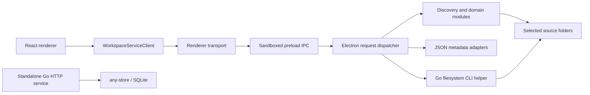

# Workspace architecture

## Snapshot and scope

Source baseline: `080b416c57b2869024ac62363e96b68b40f499c0`, inspected on 2026-10-08 after the main-branch consolidation. This is a source-inspected architecture reference, not a new product contract or migration plan. It describes the active application separately from implemented but unattached components and future intentions. Runtime acceptance was not rerun for this documentation task.

The application is a local Electron desktop client for managing projects that already exist as filesystem folders. React presents Board, Table, settings and project details. A sandboxed preload bridge connects it to the application's Node backend. JSON adapters currently persist product metadata. The repository also contains a Go binary with two distinct roles: an active bounded filesystem helper and an unattached HTTP/document-store implementation.

Related reference: [bb architecture](bb-architecture.md). Authoritative context remains [product boundaries](../development/product.md), [API contracts](../api/), accepted [ADRs](../adr/) and the [current/target data-model qualification](../data-model.md#current-runtime-and-target-scope).

## Domain model

The canonical terms come from [GLOSSARY.md](../../GLOSSARY.md):

| Concept | Meaning and architectural consequence |
| --- | --- |
| Workspace configuration | Saved source binding, folder interpretation and views. Several configurations can share a source or use independent roots. |
| Project source | Selected root directory; the boundary for discovery and filesystem operations. |
| Project | Folder discovered under the project role, with its properties. It is not a GitHub development issue or an agent conversation. |
| Folder role | `group` permits traversal, `status` supplies status, and `project` identifies the project root. |
| Status | Derived from an enclosing status-role folder. Projects outside one have `No status`. |
| View | Saved Board/Table presentation, filters, grouping, ordering and display preferences. |
| Property | System or custom project field; definitions, options, values and history have their own persistence. |

Project files remain on disk. A view does not own a separate copy of a project. Removing a Workspace or view removes application metadata rather than deleting project directories. Status actions can move directories through a dedicated guarded operation; ordinary filtering or reordering does not imply a filesystem mutation. [Source bindings](../adr/006-workspace-source-bindings.md), [Status moves](../api/workspace-status-move.md) and [Table ordering](../adr/008-table-row-order.md) qualify these boundaries.

## Runtime topology

The standalone HTTP service has no connection from the active Electron request path. The Go helper exits through its CLI mode before opening a database or starting HTTP.

The startup chain is [package.json](../../package.json) → [electron/main.js](../../electron/main.js), which registers IPC and loads the built renderer. [src/main.tsx](../../src/main.tsx) mounts React with localization and the application composition root. The main window uses desktop chrome and a minimum size of 1024×720; a responsive layout within this window is not evidence of mobile-browser support.

Development uses [scripts/dev-desktop.mjs](../../scripts/dev-desktop.mjs) and [electron/developmentRuntime.js](../../electron/developmentRuntime.js): a validated loopback Vite origin, HMR and checkout-specific `.workspace-dev` metadata/preferences. Normal runtime loads `dist/renderer/index.html`. Electron/backend changes require restarting the process.

## Module ownership

| Area | Owners | Current responsibility |
| --- | --- | --- |
| Presentation and composition | [App.tsx](../../src/App.tsx), [workspace components](../../src/components/workspace/) | Board/Table, settings, project panels, service orchestration, mutation queues, notifications and DOM/focus effects. |
| Renderer session | [workspaceSession.js](../../src/workspaceSession.js), [workspaceSessionLifecycle.js](../../src/workspaceSessionLifecycle.js) | Commands/snapshots for panes, tabs, focus and selection; injected persistence, restoration and request freshness. |
| Service boundary | [workspaceServiceClient.js](../../src/workspaceServiceClient.js), [workspaceRendererTransport.ts](../../src/workspaceRendererTransport.ts) | Named application operations and selection of the Electron bridge. |
| Privileged application integration | [preload.cjs](../../electron/preload.cjs), [workspaceIpc.js](../../electron/workspaceIpc.js) | Method allowlists, request dispatch, source/scope resolution, compatibility and recovery. |
| Discovery and project model | [workspaceBackend.js](../../src/workspaceBackend.js), [folderModel.js](../../src/folderModel.js), [workspaceObjects.js](../../src/workspaceObjects.js) | Filesystem scanning, roles, project objects, file trees and settings. |
| Properties and projections | [workspaceProperties.js](../../src/workspaceProperties.js), [workspaceViews.js](../../src/workspaceViews.js), [workspaceGrouping.js](../../src/workspaceGrouping.js) | Typed values, saved-view normalization, filtering, grouping and sorting. |
| Filesystem effects | [localOpen.js](../../src/localOpen.js), [workspaceStatusMove.js](../../src/workspaceStatusMove.js), [workspaceProjectCreate.js](../../src/workspaceProjectCreate.js), [workspaceProjectRename.js](../../src/workspaceProjectRename.js) | Containment, external opening, Status moves, creation and physical rename. |
| Target durable store | [main.go](../../cmd/workspace-sidecar/main.go), [store.go](../../internal/workspacestore/store.go), [workspaceSidecarClient.js](../../src/workspaceSidecarClient.js) | Standalone Go HTTP/document operations and a partial HTTP client; not selected by Electron. |

“Thin React” is an architectural policy rather than a completed description of every component. The pure session owner is extracted, but `App.tsx` still coordinates substantial application loading and CRUD behavior. The dispatcher also combines several use cases and compatibility responsibilities. The repository is one application package plus Go modules, rather than bb's multi-application monorepo.

## Interface, state and styling

There are three distinct categories of state:

1. **Loaded application data:** Workspace/view/projection state in [workspaceAppState.ts](../../src/workspaceAppState.ts), composed with service loading in React.
2. **Renderer session:** `createWorkspaceSession` exposes `getSnapshot`, `subscribe` and `dispatch`. Pure transitions own tabs, panes, focus, selected project and surface. React subscribes through `useSyncExternalStore`. Supporting [pane-layout](../../src/workspacePaneLayout.js), [split-tree](../../src/workspaceSplitTree.js) and [project-tab](../../src/workspaceProjectTabs.js) modules retain their separate mechanics.
3. **Device-local preferences:** browser storage holds appearance, locale, panel dimensions and other presentation settings. These are separate from project values and history.

The lifecycle adapter injects storage and the current service client. [workspaceSessionStorage.js](../../src/workspaceSessionStorage.js) and [workspaceProjectSession.js](../../src/workspaceProjectSession.js) retain existing formats, normalize restoration and omit file trees from saved session records. Revalidation uses Workspace/view identity and request generations so delayed preview/file-tree responses cannot take over a newer selection. General loading, CRUD queues and DOM effects remain composition responsibilities. See [ADR-010](../adr/010-renderer-session-command-owner.md) and [ADR-011](../adr/011-renderer-session-lifecycle.md).

Under current [ADR-012](../adr/012-project-close-and-preview-only-right-host.md), closing the active expanded project returns to the selected Board/Table view, clears preview intent and invalidates pending responses. Other inactive tabs and valid surviving split leaves are retained. The right host contains project preview only; it is not a standalone Navigation launcher. Restore and Close are separate operations.

The renderer uses React 19, TypeScript, Vite, Tailwind, Radix/shadcn primitives, DnD Kit and TanStack Table. [styles.css](../../src/styles.css) and feature components define the actual appearance; [bb adaptation policy](../development/design/bb-workspace-policy.md) governs adaptation. The project has not adopted bb's complete client-core, Query/Jotai state stack or plugin UI runtime. [package.json](../../package.json) records the installed dependency ranges.

## Request and data flows

**Read a view.** `WorkspaceServiceClient.getViewProjection` passes a request through `window.workspace.request` and the `workspace:request` IPC channel. The dispatcher resolves the selected Workspace's source and roles, discovers current folders, loads source-scoped definitions/values and computes a filtered/grouped projection. `getProject` can revalidate a project outside the current view filter; its file tree uses the current locator. See [views API](../api/workspace-views.md) and [source/session API](../api/workspace-session-sources.md).

**Change a property.** `updateProjectPropertyValue` validates the discovered project and property scope, normalizes the typed value and persists the value plus history through the JSON property adapter. The legacy `saveProperty` method is not an equivalent modern value-write path. See [properties API](../api/workspace-properties.md).

**Rename a project folder.** `renameProject` reaches the current renamer, which validates the target, stages a same-parent physical rename with the Go helper, records recovery phases and preserves known project references. This operation changes the folder name, rather than just changing an editable metadata label. See [rename API](../api/workspace-project-rename.md).

The dispatcher serializes ordinary operations, including reads, through its process-local mutation queue. Source-settings handling can run pending move/rename recovery before serving requests. Directory-picker waiting occurs outside that queue with its intended Workspace captured first. This ordering is not a cross-file transaction or a multi-process storage lock. Evidence: [createWorkspaceIpcHandler](../../electron/workspaceIpc.js).

## Persistence, scope and identity

Normal metadata defaults to `.workspace` relative to the process working directory; `.folder-kanban` remains a legacy compatibility source. Current storage is:

| Store | Contents and scope |
| --- | --- |
| `settings.json` | Workspace source bindings, retained root-role snapshots, compatibility fields, verified project locators and filesystem recovery journals. |
| `views.json` | Workspace/view maps and each view's filters, grouping, display and ordering settings. |
| `properties.json` | Source-scoped definitions, select options, project values, derived Status colors and history. |
| Renderer storage | Per-Workspace tabs/panes/screens and per-view preview intent; device-local UI preferences. |
| Selected source directories | User project files; outside the metadata stores. |

Workspace configurations, folder roles, views and sessions remain independently configured. Property data is shared when Workspaces use the same source. The legacy property document field named `workspaceId` can contain the resolved **source scope**, while an API request's `workspaceId` selects a Workspace configuration. Reinterpreting these as the same namespace would change data ownership. See [current data-model scope](../data-model.md#current-runtime-and-target-scope).

Consumers treat IDs as opaque references. Current discovery nevertheless derives fallback IDs from locators; verified explicit moves/renames preserve known IDs through source-scoped `projectLocators` and device/inode checks. This is not a general registry that reconciles arbitrary external folder moves. [ADR-004](../adr/004-project-identity-and-audit-migrations.md) remains Proposed. Evidence: [createFolderObjectId](../../src/workspaceObjects.js), [createScanResponse](../../src/workspaceBackend.js), [commitProjectLocations](../../src/workspaceStatusMove.js).

JSON writes use unique temporary files and rename replacement. This avoids describing an ordinary write as an in-place partial overwrite, but it does not establish cross-store atomicity or an fsync durability guarantee. Recovery journals cover named filesystem workflows, not every possible metadata cascade. Evidence: [backend/settings adapter](../../src/workspaceBackend.js), [views adapter](../../electron/workspaceIpc.js), [properties adapter](../../src/workspacePropertyStore.js).

## Security and filesystem boundaries

Electron keeps `contextIsolation: true`, `nodeIntegration: false` and `sandbox: true`. Renderer code uses the named service boundary; preload and dispatcher independently restrict methods. The [renderer transport](../../src/workspaceRendererTransport.ts) fails when the preload bridge is missing, rather than falling back to an HTTP service.

Filesystem actions validate against the selected source, including real-path containment where required. File preview has a supported-extension boundary; external opening uses a native adapter. The active preview response supplies native path/content metadata rather than exposing a general browser file-serving endpoint. Security configuration and these checks should not be interpreted as certification that every historical security finding has been resolved. See [localOpen.js](../../src/localOpen.js) and [security audit](../security/20260923-project-security-audit.md).

Status changes use guarded move/recovery semantics. Eligible Board Status drops and Table crossings into visible explicit Status groups share this operation; custom-property grouping and `No status` destinations do not authorize unrestricted movement.

Creation and rename use short-lived Go CLI modes. macOS and Windows guarded implementations exist, while unsupported safe-operation paths fail closed. Linux strict creation/rename support remains incomplete; Windows cross-compilation does not complete native adversarial acceptance. The same binary's database/HTTP mode is a separate execution path. See [creation guard](../adr/009-project-creation-os-guard.md), [rename contract](../api/workspace-project-rename.md) and [Go entrypoint](../../cmd/workspace-sidecar/main.go).

## Implemented, unattached and future capabilities

| Capability | Status at this baseline |
| --- | --- |
| Local desktop Board/Table, properties, file inspection, sessions, creation/rename/Status actions | Implemented through Electron, with operation/platform qualifications above. |
| Go any-store/SQLite document storage and HTTP operations | Implemented as a standalone component; Electron still uses JSON. |
| Remote web access / server deployment | No active product transport, authentication or server-mode application wiring. Vite is a development server. |
| Mobile web / native mobile | No delivered mobile client or browser transport. Desktop responsive behavior does not supply them. |
| AI providers, AI skill execution, plugins | No active provider runtime, agent-session model or plugin SDK/loader. Development skills are not product AI features. |
| Cloud metadata sync | Future direction; no active `any sync` integration. |
| Public marketing website | Requested future work; no equivalent shipped site is established by this source baseline. |

The accepted target [ADR-001](../adr/001-local-first-workspace-storage.md) retains Go/any-store on SQLite; [ADR-006](../adr/006-workspace-source-bindings.md) qualifies current JSON operation. Before that target could replace JSON, the source identifies unresolved view-field round-trip parity, source-scope compatibility, migration/recovery and lifecycle/packaging work. Current Go view structs omit fields such as manual row/column ordering, hidden columns, Table widths and some Board preferences. Starting the HTTP sidecar independently does not migrate or redirect the app. See [sidecar gap list](../architecture.md#storage--sidecar-layer) and [store implementation](../../internal/workspacestore/store.go).

These are architecture status observations, not an approved implementation sequence. The backend remains Workspace's own backend.

## Build, verification and delivery

[package.json](../../package.json) defines `npm run dev`, renderer/helper builds, Node tests, Go tests and TypeScript checks. `npm run verify` builds the helper before running Node tests, Go tests, typecheck and the renderer build. Ladle provides the component catalogue; oxlint/oxfmt provide configured lint/format checks.

Behavioral evidence can be produced through isolated [session verification](../../scripts/verify-session.mjs), [desktop verification](../../scripts/verify-desktop.mjs) and [unification verification](../../scripts/verify-unification.mjs) using Electron/Playwright. [Helper build tooling](../../scripts/build-sidecar.mjs) includes platform targets, but compilation is distinct from native filesystem acceptance. The [unification record](../../work/workspace-unification/README.md) records the earlier completed integrated checks; those are historical evidence, not checks freshly run for this report.

No tracked GitHub Actions CI workflow or complete installer/signing/updater pipeline was found at this baseline. Helper resource-path conventions do not prove a packaged distribution exists. GitHub Issues, auxiliary Beads steps and Matt skills describe the development process, separate from runtime architecture. See [workflow](../development/workflow.md) and [issue tracker](../agents/issue-tracker.md).

## Source/document discrepancies

Two existing descriptions lag behind the consolidated source:

- [Development architecture](../development/architecture.md) still calls original-checkout rename separate work. The current dispatcher imports the renamer and routes `renameProject`.
- [Architecture](../architecture.md) groups session/lifecycle ownership under Domain / Backend. The current pure session owner belongs to renderer state; its lifecycle injects effect adapters.

Older session/right-host descriptions also need the explicit qualification supplied by accepted ADR-012. This report records the observed differences; it does not silently rewrite the authoritative contracts. Future architecture reviews should recheck runtime imports and wiring against a new source baseline.
