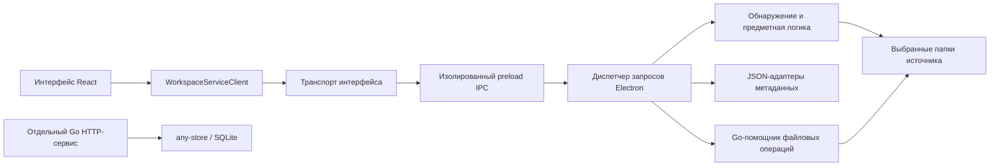

# Архитектура Workspace

## Версия и границы исследования

Исходная версия кода: `080b416c57b2869024ac62363e96b68b40f499c0`. Исследование выполнено 8 октября 2026 года после объединения изменений в main. Это описание архитектуры по исходникам, а не новый продуктовый контракт или план миграции. Действующее приложение описано отдельно от реализованных, но не подключённых компонентов и будущих намерений. Приёмочные проверки приложения в рамках подготовки документов повторно не запускались.

Workspace — локальное desktop-приложение на Electron для управления проектами, которые уже существуют как папки на диске. React отображает доску, таблицу, настройки и карточки проектов. Изолированный preload-мост связывает интерфейс с собственным Node-бэкендом приложения. Сейчас метаданные продукта сохраняются через JSON-адаптеры. В репозитории также есть Go-программа с двумя разными назначениями: действующий ограниченный помощник файловых операций и пока не подключённый HTTP-сервис с документным хранилищем.

Связанное исследование: [архитектура bb](bb-architecture.ru.md). Авторитетными источниками остаются [границы продукта](../development/product.md), [API-контракты](../api/), принятые [ADR — архитектурные решения](../adr/) и [уточнение действующей и целевой моделей данных](../data-model.md#current-runtime-and-target-scope). [Оригинал на английском](workspace-architecture.md).

## Предметная модель

Канонические понятия определены в [GLOSSARY.md](../../GLOSSARY.md):

| Понятие | Значение и следствие для архитектуры |
| --- | --- |
| Конфигурация Workspace | Сохранённая привязка источника, интерпретация папок и представления. Несколько конфигураций могут использовать один источник или разные корневые папки. |
| Источник проектов | Выбранная корневая папка; граница обнаружения проектов и файловых операций. |
| Проект | Папка, обнаруженная по роли `project`, вместе с её свойствами. Это не задача разработки в GitHub и не диалог с агентом. |
| Роль папки | `group` разрешает обход вложенных папок, `status` задаёт статус, `project` определяет корень проекта. |
| Статус | Вычисляется из содержащей проект папки с ролью `status`. Проект вне такой папки получает `No status` — «Без статуса». |
| Представление | Сохранённая доска или таблица с фильтрами, группировкой, порядком и настройками отображения. |
| Свойство | Системное или пользовательское поле проекта; определения, варианты, значения и история сохраняются отдельно. |

Файлы проектов остаются на диске. Представление не создаёт отдельную копию проекта. Удаление Workspace или представления удаляет метаданные приложения, а не папки проектов. Действия со статусом могут перемещать папки через специальную защищённую операцию; обычная фильтрация или изменение порядка не означают изменение файловой системы. Эти границы уточняют [привязки источников](../adr/006-workspace-source-bindings.md), [перемещение по статусам](../api/workspace-status-move.md) и [порядок строк таблицы](../adr/008-table-row-order.md).

## Схема работающих компонентов

Отдельный HTTP-сервис не подключён к действующему пути запросов Electron. Go-помощник завершает работу в режиме CLI до открытия базы данных или запуска HTTP.

Цепочка запуска: [package.json](../../package.json) → [electron/main.js](../../electron/main.js). Главный процесс регистрирует IPC и загружает собранный интерфейс. [src/main.tsx](../../src/main.tsx) монтирует React, локализацию и корневой компонент приложения. Основное окно использует desktop-оформление и минимальный размер 1024×720; адаптивность внутри этого окна ещё не означает поддержку мобильного браузера.

Для разработки используются [scripts/dev-desktop.mjs](../../scripts/dev-desktop.mjs) и [electron/developmentRuntime.js](../../electron/developmentRuntime.js): проверенный локальный адрес Vite, HMR — обновление интерфейса без перезапуска — и отдельные для checkout метаданные и настройки в `.workspace-dev`. Обычный режим загружает `dist/renderer/index.html`. Изменения Electron и бэкенда требуют перезапуска процесса.

## Ответственность модулей

| Область | Модули-владельцы | Действующая ответственность |
| --- | --- | --- |
| Отображение и сборка приложения | [App.tsx](../../src/App.tsx), [компоненты Workspace](../../src/components/workspace/) | Доска, таблица, настройки, панели проектов, координация сервисов, очереди изменений, уведомления, DOM и фокус. |
| Сессия интерфейса | [workspaceSession.js](../../src/workspaceSession.js), [workspaceSessionLifecycle.js](../../src/workspaceSessionLifecycle.js) | Команды и снимки состояния панелей, вкладок, фокуса и выбора; подключаемые адаптеры сохранения, восстановления и проверки актуальности ответов. |
| Сервисная граница | [workspaceServiceClient.js](../../src/workspaceServiceClient.js), [workspaceRendererTransport.ts](../../src/workspaceRendererTransport.ts) | Именованные операции приложения и выбор Electron-моста. |
| Интеграция с привилегированным процессом | [preload.cjs](../../electron/preload.cjs), [workspaceIpc.js](../../electron/workspaceIpc.js) | Списки разрешённых методов, обработка запросов, разрешение источников и областей данных, совместимость и восстановление. |
| Обнаружение и модель проектов | [workspaceBackend.js](../../src/workspaceBackend.js), [folderModel.js](../../src/folderModel.js), [workspaceObjects.js](../../src/workspaceObjects.js) | Сканирование файловой системы, роли, объекты проектов, деревья файлов и настройки. |
| Свойства и проекции | [workspaceProperties.js](../../src/workspaceProperties.js), [workspaceViews.js](../../src/workspaceViews.js), [workspaceGrouping.js](../../src/workspaceGrouping.js) | Типизированные значения, нормализация представлений, фильтрация, группировка и сортировка. |
| Файловые операции | [localOpen.js](../../src/localOpen.js), [workspaceStatusMove.js](../../src/workspaceStatusMove.js), [workspaceProjectCreate.js](../../src/workspaceProjectCreate.js), [workspaceProjectRename.js](../../src/workspaceProjectRename.js) | Ограничение операций выбранным источником, открытие во внешних программах, смена статуса, создание и физическое переименование. |
| Целевое постоянное хранилище | [main.go](../../cmd/workspace-sidecar/main.go), [store.go](../../internal/workspacestore/store.go), [workspaceSidecarClient.js](../../src/workspaceSidecarClient.js) | Отдельные Go HTTP-операции над документами и частичный HTTP-клиент; Electron их не выбирает. |

Правило «React должен оставаться тонким» описывает архитектурное намерение, но ещё не каждый компонент. Чистый владелец сессии уже выделен, однако `App.tsx` по-прежнему координирует значительную часть загрузки и CRUD — создания, чтения, изменения и удаления данных. Диспетчер также объединяет несколько сценариев и задачи совместимости. Репозиторий содержит один пакет приложения и Go-модули; это отличается от монорепозитория bb с несколькими приложениями.

## Интерфейс, состояние и оформление

Состояние разделено на три категории:

1. **Загруженные данные приложения:** Workspace, представления и проекции в [workspaceAppState.ts](../../src/workspaceAppState.ts); React связывает их с загрузкой через сервисы.
2. **Сессия интерфейса:** `createWorkspaceSession` предоставляет `getSnapshot`, `subscribe` и `dispatch`. Чистые переходы управляют вкладками, панелями, фокусом, выбранным проектом и экраном. React подписывается через `useSyncExternalStore`. Вспомогательные модули [раскладки панелей](../../src/workspacePaneLayout.js), [дерева разделения](../../src/workspaceSplitTree.js) и [вкладок проектов](../../src/workspaceProjectTabs.js) сохраняют собственную механику.
3. **Локальные настройки устройства:** браузерное хранилище содержит оформление, язык, размеры панелей и другие настройки отображения. Они отделены от значений свойств проектов и истории.

Адаптер жизненного цикла получает хранилище и текущий сервисный клиент через зависимости. [workspaceSessionStorage.js](../../src/workspaceSessionStorage.js) и [workspaceProjectSession.js](../../src/workspaceProjectSession.js) сохраняют прежние форматы, нормализуют восстановление и исключают деревья файлов из записываемой сессии. Проверка актуальности использует Workspace, представление и поколения запросов: запоздалый ответ предпросмотра или дерева файлов не может заменить более новый выбор. Общая загрузка, CRUD-очереди и DOM-эффекты остаются в слое сборки приложения. См. [ADR-010](../adr/010-renderer-session-command-owner.md) и [ADR-011](../adr/011-renderer-session-lifecycle.md).

Согласно действующему [ADR-012](../adr/012-project-close-and-preview-only-right-host.md), закрытие активного развёрнутого проекта возвращает к выбранной доске или таблице, сбрасывает намерение предпросмотра и делает ожидаемые ответы неактуальными. Другие неактивные вкладки и допустимые соседние области разделённого экрана сохраняются. Правая область содержит только предпросмотр проекта; отдельного навигационного запускающего экрана в ней нет. Восстановить размер и закрыть — разные действия.

Интерфейс использует React 19, TypeScript, Vite, Tailwind, примитивы Radix/shadcn, DnD Kit и TanStack Table. Фактическое оформление задают [styles.css](../../src/styles.css) и компоненты; адаптация регулируется [политикой bb → Workspace](../development/design/bb-workspace-policy.md). Полный client-core bb, стек Query/Jotai и среда исполнения plugin UI в проект не перенесены. [package.json](../../package.json) фиксирует диапазоны зависимостей.

## Потоки запросов и данных

**Чтение представления.** `WorkspaceServiceClient.getViewProjection` передаёт запрос через `window.workspace.request` и IPC-канал `workspace:request`. Диспетчер определяет источник и роли выбранного Workspace, обнаруживает текущие папки, загружает определения и значения в области источника и вычисляет отфильтрованную и сгруппированную проекцию. `getProject` может повторно проверить проект вне текущего фильтра; дерево файлов использует актуальный адрес папки. См. [API представлений](../api/workspace-views.md) и [API источников и сессии](../api/workspace-session-sources.md).

**Изменение свойства.** `updateProjectPropertyValue` проверяет обнаруженный проект и область свойства, нормализует типизированное значение и сохраняет его вместе с историей через JSON-адаптер свойств. Старый метод `saveProperty` не равнозначен этому современному пути записи значений. См. [API свойств](../api/workspace-properties.md).

**Переименование папки проекта.** `renameProject` вызывает подключённый механизм переименования: он проверяет цель, выполняет поэтапное физическое переименование внутри одной родительской папки через Go-помощник, записывает фазы восстановления и сохраняет известные ссылки на проект. Операция изменяет имя папки, а не только отображаемую подпись в метаданных. См. [API переименования](../api/workspace-project-rename.md).

Диспетчер последовательно выполняет обычные операции, включая чтение, через очередь изменений внутри процесса. Обработка настроек источника может завершить восстановление перемещения или переименования до обслуживания запроса. Ожидание системного выбора папки вынесено из очереди; целевой Workspace фиксируется заранее. Такой порядок не создаёт транзакцию между несколькими файлами или блокировку между процессами. Источник: [createWorkspaceIpcHandler](../../electron/workspaceIpc.js).

## Хранение, области данных и идентичность

В обычном режиме метаданные по умолчанию находятся в `.workspace` относительно рабочей папки процесса. `.folder-kanban` сохраняется как источник обратной совместимости. Действующие хранилища:

| Хранилище | Содержимое и область данных |
| --- | --- |
| `settings.json` | Привязки источников Workspace, сохранённые снимки ролей корневых папок, поля совместимости, проверенные адреса проектов и журналы восстановления файловых операций. |
| `views.json` | Карты Workspace и представлений; фильтры, группировка, отображение и порядок для каждого представления. |
| `properties.json` | Определения, варианты выбора, значения проектов, вычисляемые цвета статусов и история в области источника. |
| Хранилище интерфейса | Вкладки, панели и экраны каждого Workspace; намерение предпросмотра для представлений и локальные настройки устройства. |
| Папки выбранного источника | Пользовательские файлы проектов; находятся отдельно от метаданных. |

Конфигурации Workspace, роли папок, представления и сессии настраиваются независимо. Данные свойств общие для Workspace, использующих один источник. Старое поле `workspaceId` в документе свойства может содержать **область источника**, а `workspaceId` в API-запросе выбирает конфигурацию Workspace. Если считать их одним пространством идентификаторов, изменится принадлежность данных. См. [действующие области модели данных](../data-model.md#current-runtime-and-target-scope).

Потребители работают с ID как с непрозрачными ссылками. Тем не менее текущий механизм обнаружения вычисляет запасные ID из адресов папок. Проверенные явные перемещения и переименования сохраняют известные ID через `projectLocators` в области источника и проверки устройства/inode. Это ещё не общий реестр, который согласует произвольные внешние перемещения папок. [ADR-004](../adr/004-project-identity-and-audit-migrations.md) остаётся Proposed — предложенным решением. Источники: [createFolderObjectId](../../src/workspaceObjects.js), [createScanResponse](../../src/workspaceBackend.js), [commitProjectLocations](../../src/workspaceStatusMove.js).

JSON записывается через уникальные временные файлы с последующей заменой переименованием. Поэтому обычная запись не описывается как частичная перезапись исходного файла на месте, но атомарность между хранилищами и гарантия долговечности через fsync этим не доказаны. Журналы восстановления покрывают конкретные файловые сценарии, а не любой каскад изменений метаданных. Источники: [адаптер настроек](../../src/workspaceBackend.js), [адаптер представлений](../../electron/workspaceIpc.js), [адаптер свойств](../../src/workspacePropertyStore.js).

## Безопасность и границы файловых операций

Electron сохраняет `contextIsolation: true`, `nodeIntegration: false` и `sandbox: true`. Интерфейс использует именованные сервисные операции; preload и диспетчер независимо ограничивают методы. [Транспорт интерфейса](../../src/workspaceRendererTransport.ts) выдаёт ошибку при отсутствии preload-моста, а не переключается на HTTP-сервис.

Файловые действия проверяются относительно выбранного источника, включая проверку фактического пути там, где она необходима. Предпросмотр ограничен поддерживаемыми расширениями; внешнее открытие использует системный адаптер. Действующий ответ предпросмотра содержит нативный путь и сведения о содержимом, а не предоставляет универсальный HTTP-доступ к файлам. Эти настройки и проверки не подтверждают устранение всех исторических замечаний по безопасности. См. [localOpen.js](../../src/localOpen.js) и [аудит безопасности](../security/20260923-project-security-audit.md).

Смена статуса использует защищённое перемещение с восстановлением. Допустимые переносы карточек доски по статусам и переносы строк таблицы в видимые явные группы статусов используют одну операцию. Группировка по пользовательскому свойству и назначение `No status` не разрешают произвольное перемещение папок.

Создание и переименование используют короткоживущие CLI-режимы Go. Защищённые реализации есть для macOS и Windows; неподдерживаемые безопасные операции завершаются отказом. Строгая безопасная поддержка создания и переименования на Linux ещё не завершена; кросс-компиляция Windows не заменяет проверку неблагоприятных сценариев на самой платформе. Режим базы данных/HTTP того же бинарного файла — отдельный путь запуска. См. [защиту создания](../adr/009-project-creation-os-guard.md), [контракт переименования](../api/workspace-project-rename.md) и [точку входа Go](../../cmd/workspace-sidecar/main.go).

## Реализованные, не подключённые и будущие возможности

| Возможность | Состояние в исследованной версии |
| --- | --- |
| Локальные доска и таблица, свойства, просмотр файлов, сессии, создание, переименование и смена статуса | Реализованы через Electron с указанными выше ограничениями операций и платформ. |
| Документное хранилище Go any-store/SQLite и HTTP-операции | Реализованы отдельно; Electron продолжает использовать JSON. |
| Удалённый веб-доступ и развёртывание сервера | Нет подключённого продуктового транспорта, аутентификации или сборки приложения в серверном режиме. Vite — сервер разработки. |
| Мобильный браузер и нативное мобильное приложение | Готового клиента и браузерного транспорта нет. Адаптивность desktop-интерфейса их не обеспечивает. |
| Провайдеры ИИ, выполнение ИИ-скиллов, плагины | Нет подключённой среды провайдеров, модели агентных сессий или plugin SDK/загрузчика. Скиллы разработки не являются функциями ИИ внутри продукта. |
| Облачная синхронизация метаданных | Будущее направление; действующего подключения `any sync` нет. |
| Публичный маркетинговый сайт | Запрошен как будущая работа; исследованная версия не подтверждает наличие готового аналога. |

Принятый целевой [ADR-001](../adr/001-local-first-workspace-storage.md) сохраняет направление Go/any-store на SQLite; [ADR-006](../adr/006-workspace-source-bindings.md) уточняет текущую работу через JSON. Перед заменой JSON остаются вопросы полноты сохранения полей представлений при записи и чтении, совместимости областей источников, миграции/восстановления, жизненного цикла и упаковки. В текущих Go-структурах представлений отсутствуют, например, ручной порядок строк/колонок, скрытые колонки, ширины таблицы и некоторые настройки доски. Отдельный запуск HTTP-sidecar не мигрирует данные и не перенаправляет приложение. См. [разрывы интеграции sidecar](../architecture.md#storage--sidecar-layer) и [реализацию хранилища](../../internal/workspacestore/store.go).

Это наблюдения о состоянии архитектуры, а не утверждённая последовательность реализации. Бэкенд остаётся собственным бэкендом Workspace.

## Сборка, проверки и выпуск

[package.json](../../package.json) определяет `npm run dev`, сборку интерфейса и помощника, Node-тесты, Go-тесты и проверку TypeScript. `npm run verify` сначала собирает помощник, затем запускает Node-тесты, Go-тесты, typecheck и сборку интерфейса. Ladle предоставляет каталог компонентов; oxlint/oxfmt — настроенные проверки кода и форматирования.

Для проверки поведения есть изолированные сценарии [сессии](../../scripts/verify-session.mjs), [desktop](../../scripts/verify-desktop.mjs) и [объединённой версии](../../scripts/verify-unification.mjs) с Electron/Playwright. [Сборка помощника](../../scripts/build-sidecar.mjs) включает целевые платформы, но компиляция отличается от приёмки файловых операций на самой платформе. [Запись об объединении](../../work/workspace-unification/README.md) содержит ранее выполненные интеграционные проверки; это исторические свидетельства, а не проверки, заново проведённые для исследования.

В исследованной версии не найдены отслеживаемые GitHub Actions CI-workflow и полный процесс выпуска установщиков, подписания и обновления. Правила поиска бинарного помощника в ресурсах ещё не доказывают наличие готового дистрибутива. GitHub Issues, вспомогательные шаги Beads и скиллы Matt описывают процесс разработки отдельно от архитектуры работающего приложения. См. [workflow](../development/workflow.md) и [трекер задач](../agents/issue-tracker.md).

## Расхождения кода и документации

Два существующих описания отстают от объединённого кода:

- [Архитектура разработки](../development/architecture.md) всё ещё называет переименование из исходного checkout отдельной работой. Текущий диспетчер уже импортирует механизм переименования и обрабатывает `renameProject`.
- [Архитектура](../architecture.md) относит сессию и её жизненный цикл к Domain / Backend. Текущий чистый владелец сессии относится к состоянию интерфейса; адаптер жизненного цикла получает зависимости для побочных эффектов.

Старые описания сессии и правой области также требуют уточнения по принятому ADR-012. Исследование фиксирует наблюдаемые различия и не переписывает действующие контракты. При следующем архитектурном ревью нужно заново проверить импорты и фактическое подключение компонентов на новой версии кода.
