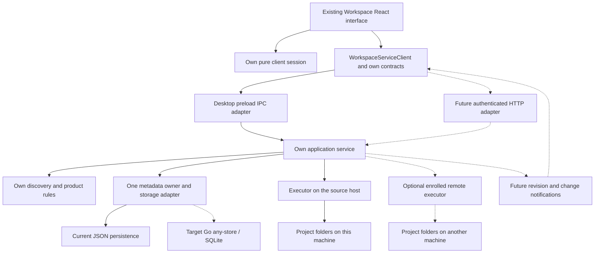

# Workspace with architectural lessons from bb

## Conclusion and evaluation scope

**A hybrid is suitable: retain Workspace's product model, appearance and backend, while adopting bb's separation of client behavior, application policy, persistence and machine execution.** Importing the complete bb runtime is a much poorer fit for the current folder-management product.

This is a hypothetical architecture evaluation, not an accepted ADR, an implementation specification or a claim that the proposed components exist. The user confirmed comparison of the hybrid, full-stack adoption and a fork, including both server-owned folders and remotely controlled folders on the user's computer. The current task updates research only.

Evidence: [current Workspace](workspace-architecture.md) at `080b416c57b2869024ac62363e96b68b40f499c0`; [inspected bb](bb-architecture.md) at `f135a001e72942cee9118d2693208ec0725e2f18`. The user's additional `af72bb8` description is a separate reference; this evaluation does not attribute findings from our inspected source or exact dependency versions to that revision. Neither a compatibility build nor a distributed-runtime prototype was performed.

## Three approaches

| Approach | What would change | Suitability and cost |
| --- | --- | --- |
| Hybrid: own backend plus selected bb principles | Extract our application service, retain pure session ownership, formalize own contracts, add adapters when needed; keep our storage direction and UI. | Recommended. Useful for today's desktop and compatible with later web/server/AI work. Requires integration work but preserves the product's domain. |
| Adopt the complete bb-style stack | Node server/daemon, HTTP/WebSocket everywhere, extensive shared packages, bb-style SQL/ORM/toolchain and operational services. | Could suit a primarily distributed agent product. Excessive for current folder management; replacing the store would reopen the accepted Go/any-store decision. Reproducing boundaries does not require reproducing every dependency. |
| Fork bb and build Workspace into it | Maintain an upstream-derived product and adapt its projects, threads, environments, UI and extension lifecycle. | Strongest when the main product becomes an agent IDE. Retaining our backend alongside bb introduces two product models and integration surfaces; removing bb's assumptions also costs work. Upstream updates become an additional maintenance obligation. |

Extracting the service does not require a separate daemon: it can initially run in the existing Electron main process. Renderer/preload and the target Go sidecar retain their process boundaries. A physically separate daemon is justified by independent execution lifetime or a remote machine, rather than by a desire to match bb's directory tree.

## What to reuse, adapt and retain

| Area | Recommended combination | Important limitation |
| --- | --- | --- |
| Main code | Our modules; typed contracts and gradual TypeScript improvements where useful. | A mass rewrite or version upgrade is not the architecture itself. |
| Repository/build | Explicit module ownership now; workspace packages and pnpm/Turbo when multiple deployables justify them. | Monorepo tooling adds build/release maintenance; it need not precede extraction. |
| Client core | Retain `workspaceSession` and its injected lifecycle; adapt useful pure algorithms and no-DOM boundary checks. | bb client-core is framework-independent but still contains thread/provider/terminal domain assumptions. |
| Data loading | Consider TanStack Query for service-derived caches, errors and invalidation when multi-client loading warrants it. | Keep session transitions separate. Its defaults require intentional retry/refetch configuration. |
| UI state | Keep our command/snapshot session. Introduce atoms only for a demonstrated independent need. | Jotai is not required to benefit from bb's architecture. |
| Styling | Our appearance/tokens plus existing Tailwind/Radix/shadcn, component stories and accessibility practices. | Importing bb's full shared UI or theme can change visuals and pull monorepo dependencies. |
| Contract/SDK | Our `WorkspaceServiceClient`, our DTOs and runtime validation; IPC now, HTTP later. | bb SDK/server-contract expose bb operations; replacing their transport does not change that domain. |
| Backend/storage | Own application rules; current JSON adapters, then Go/any-store/SQLite after compatibility work. | bb's Drizzle schema is not the Workspace schema or a required storage replacement. |
| Host execution | Own filesystem executor using current safety checks and guarded helper; remote protocol only when needed. | bb daemon expects its enrollment, environments, thread lifecycle and internal server APIs. |
| AI/extensions | Later evaluate a narrow provider-bridge adapter; design an own extension host/contract. | bb plugin-sdk is a facade to bb's implemented host, not a ready standalone plugin engine. |
| Desktop/mobile | Keep Electron shell; add mobile web first if the product needs it. Evaluate native Expo separately. | Native mobile introduces its own UI, storage and release lifecycle. |
| Checks/site | Boundary tests, behavior tests, isolated acceptance and package smoke; separate marketing site. | Agent IDE editors, PTY, Tiptap, Monaco and Cloudflare account/tunnel services are not needed for current features. |

Concrete evidence: bb [client-core exports][bb-core], [SDK composition][bb-sdk], [shared-ui manifest][bb-ui], [plugin-sdk][bb-plugin] and [no-DOM guard][bb-guard]. Our [service client](../../src/workspaceServiceClient.js), [session](../../src/workspaceSession.js) and [lifecycle](../../src/workspaceSessionLifecycle.js) already provide valuable seams. Generic helpers can be copied selectively after checking dependencies and behavior; compatibility of complete packages has not been established.

## Proposed hybrid topology

This is a proposed responsibility map. Extracted owners/adapters are not all current modules. Dashed links denote future integrations. JSON and Go are successive alternatives behind the storage adapter, not simultaneous authoritative writers of the same dataset. The local executor may initially run in the application process.

If multiple deployables eventually exist, a possible layout is `apps/client` (shared React UI), `apps/desktop` (Electron), `apps/server` (own API/service host), optional `apps/executor`, and `apps/site` (marketing). Packages could hold `client-core`, `workspace-contract`, `application`, `domain` and adapter implementations. These are suggested future names; none is asserted to exist. Keeping the existing repository layout while extracting ownership is also valid.

## Client implementation and user interface

Keep current Board/Table, properties, source/role settings, pane chrome and project detail. Desktop appearance remains the baseline; a later phone layout needs adapted navigation and gestures rather than merely shrinking the desktop window.

The current `WorkspaceServiceClient` already accepts `transport.request`. Its current Electron adapter can remain while a future browser adapter implements the same application operations. Native picker, OS reveal and browser file preview require capability-specific behavior. A browser cannot select a server-local directory through an Electron picker, and a server-side `open` action does not open an app on the phone.

Keep three owners separate: session commands/snapshots; loaded service data; device-local preferences. A Query cache can improve resource loading without replacing the session model. Notifications would invalidate or refresh affected data; request generations still protect selection from late responses. Reconnect also needs an authoritative snapshot/revision, since current generation tokens do not detect another client's edits. See official [Query defaults][query-defaults] and [invalidation][query-invalidation].

Source for today's boundary: [renderer transport](../../src/workspaceRendererTransport.ts), [application state](../../src/workspaceAppState.ts), [session lifecycle](../../src/workspaceSessionLifecycle.js) and [native/file actions](../../src/localOpen.js).

## Application service, contracts and storage

The main extraction candidate is [createWorkspaceIpcHandler](../../electron/workspaceIpc.js): it is callable without Electron and accepts injected dependencies, but currently combines application operations, targeting, recovery, ordering and metadata adapters. Extract an own application-service owner; leave Electron registration and native interactions as adapters. Preserve [domain normalizers/projections](../../src/workspaceViews.js), [property rules](../../src/workspaceProperties.js) and existing API contracts.

A future Node HTTP host can route to that service, optionally using Hono. It does not need bb's server or relational schema. Go can remain the durable target behind its own validated contract. A complete Go-only application server is another option, but moving our Node product rules into it would be a separate backend rewrite.

Keep one authoritative metadata writer per dataset. Electron and server must not independently edit the same JSON files. Temporary-file replacement and the current process-local queue do not prevent lost updates across processes. Multi-client mutations need revisions/conflict handling as appropriate; database transactions do not automatically include project-directory changes.

Before selecting Go storage, preserve every current view field, source-scoped values/history, source bindings, opaque IDs and recovery behavior. Resolve [document parity gaps](../architecture.md#storage--sidecar-layer), migrate on isolated copies and implement lifecycle/packaging. The existing sidecar client is a partial document transport, not the complete remote application backend. This preserves [ADR-001](../adr/001-local-first-workspace-storage.md) and its [ADR-006 qualification](../adr/006-workspace-source-bindings.md).

## Deployment modes and folder location

| Mode | Where authority and files live | Consequences |
| --- | --- | --- |
| Independent local desktop | Own service/metadata and executor on the user's computer. | Offline current-product behavior; no remote daemon is necessary just to extract modules. |
| Phone controls local folders | Authoritative application service and filesystem executor on the user's computer; authenticated reachable endpoint or explicitly designed relay/tunnel. | Computer must be on/reachable. A website or server database alone cannot read its folders. Background-service lifetime must be defined separately from the Electron window. |
| Server-owned folders | Service, metadata and executor on the server; desktop/browser/phone are clients. | Server availability and backups matter. Browser capabilities differ from native actions. Current Linux creation/rename guards fail closed; deployment alone does not establish parity. |
| Central service with remote executor | Central authority plus enrolled source hosts. | Most bb-like option. Adds machine identity, credentials, protocol compatibility, job recovery and host-disconnection behavior. Worthwhile when central control of several machines is needed. |

Remote control is not synchronization. Replicating metadata does not replicate project files; copying files does not preserve sessions or resolve metadata conflicts. This evaluation does not assume that a powered-off computer's local folders become available remotely.

Host addressing needs an explicit machine/source identity. The same absolute path on two machines is not one source. Current path-derived namespaces and device/inode aliases are local evidence, not portable global IDs. Preserve existing opaque references through an explicit mapping/migration rather than silently changing shared-source values/history. Keep per-client session state distinct from authoritative product metadata.

## Future AI, skills and plugins

Add an agent context alongside folder management when requested, rather than turning each project into a bb thread. The folder remains the project; an agent session is separate work associated with an authorized source/host. GitHub Issues and auxiliary Beads steps remain development tracking, not runtime conversation entities.

A narrow future pilot could adapt a provider bridge behind an own `AgentExecutor` boundary. It must map session/turn states, cancellation, interactive requests, provider exits, instructions and durable history. bb's [agent-runtime contract][bb-runtime] and [daemon runtime manager][bb-daemon] provide evidence of the required surface; they are not a drop-in compatibility guarantee.

Runtime skills must be explicitly distributed to and applied by the chosen executor. Installed development skills do not automatically become AI capabilities in Workspace. An own plugin host needs contribution APIs, lifecycle/version rules and a deliberate trust model. Using bb plugin-sdk types alone creates none of its loader, UI slots, storage or permission behavior. In-process plugin code is trusted code unless a real isolation mechanism is designed and verified.

## Failure, concurrency and access boundaries

The distributed architecture has costs that the current local interface does not carry:

- Authenticated clients and enrolled machines, authorization of sources/operations, protected transport and revocation. Origin checks alone are not authentication; bb's direct wildcard API is not a ready public deployment template.
- Operation IDs and durable duplicate/retry handling. An HTTP timeout does not prove a rename failed; a retry must not blindly repeat it.
- Jobs whose lifetime is independent of a browser tab. Closing a phone page is not a request to roll back an in-progress filesystem workflow.
- Reconnect/snapshot recovery, event ordering and deduplication, unavailable hosts and server/executor version compatibility.
- Host-local path validation, explicit capability reporting and guarded operations. Remote file preview needs an authorized contained endpoint, not an executor's absolute path returned as a browser URL.
- Preservation of existing rename/Status journals and ambiguous-recovery behavior. A new transport must not weaken those safeguards.

Evidence: our [rename](../../src/workspaceProjectRename.js) and [Status move](../../src/workspaceStatusMove.js) workflows; bb [event sink][bb-events] and [daemon protocol][bb-protocol]. Revision notifications, durable operation IDs and remote enrollment are proposed additions, not existing Workspace guarantees.

For a central service with remote executors, define who retains execution journals and how a verified filesystem result commits authoritative locators. Recovery must retain host-local evidence, survive disconnects and reconcile completion before publishing changed metadata. The current same-process settings journal does not supply this distributed protocol; moving it centrally does not make a stateless executor sufficient.

## Conditional stages and verification

| Stage | Delivery boundary | Evidence needed before extending it |
| --- | --- | --- |
| 1. Local separation | Extract own application-service/adapters and preserve session/domain behavior. | Current desktop behavior, import boundaries and service/IPC contract tests; unchanged data and appearance. |
| 2. Durable storage, independently | Integrate own Go store only after parity/migration work. | Full view round trips, scope/ID/history compatibility, failure recovery and native packaging. This can be separate from web access. |
| 3. One-host web access | Authenticated browser transport to one authoritative service with explicit capabilities. | Real browser/phone flows, file access control, two-client writes, timeouts/reconnect and source-host platform acceptance. |
| 4. Remote executors if needed | Separate source-host execution and independent background lifetime. | Enrollment/revocation, duplicate commands, disconnect/restart and recovery of partially completed jobs. |
| 5. AI/extensions when requested | Narrow provider/skill/plugin capability. | Provider lifecycle, cancellation, instruction injection, trust model, protocol/extension version behavior. |

This is a dependency-aware recommendation, not newly created tasks or approval to implement these stages. Storage integration is not assumed to be a prerequisite for the first browser pilot if a single safe metadata owner is maintained. Polling can precede WebSocket where it satisfies current freshness needs.

## Trade-offs and decisions before implementation

The recommended combination is **our product/backend/data contracts + bb's ownership boundaries and verification methods + optional transports/executors**. It prepares growth while avoiding unused terminals, agent lifecycle services and mobile release infrastructure in today's desktop.

The price is maintaining own adapters and contracts instead of automatically receiving bb features. Node application logic plus Go storage also means two-language tooling and a process boundary. A daemon improves execution lifetime and reachability but adds operational maintenance. A centralized service simplifies multi-client authority but makes its availability consequential. A fork trades initial access to a rich platform for upstream coupling and domain adaptation.

Before actual delivery, decide which host owns each dataset, how offline/conflicting edits behave, which platforms/actions are supported, which remote access boundary is acceptable and whether plugins are trusted. Package distribution, runtime credentials and public-site deployment require their own decisions. Application and site sources remain private; a public marketing site does not imply a public repository. No implementation estimate or compatibility claim is inferred from this source-only assessment.

[bb-core]: https://github.com/get-bb/bb/blob/f135a001e72942cee9118d2693208ec0725e2f18/packages/client-core/src/index.ts
[bb-sdk]: https://github.com/get-bb/bb/blob/f135a001e72942cee9118d2693208ec0725e2f18/packages/sdk/src/core.ts
[bb-ui]: https://github.com/get-bb/bb/blob/f135a001e72942cee9118d2693208ec0725e2f18/packages/shared-ui/package.json
[bb-plugin]: https://github.com/get-bb/bb/blob/f135a001e72942cee9118d2693208ec0725e2f18/packages/plugin-sdk/src/index.ts
[bb-guard]: https://github.com/get-bb/bb/blob/f135a001e72942cee9118d2693208ec0725e2f18/packages/client-core/test/no-dom.test.ts
[query-defaults]: https://tanstack.com/query/latest/docs/framework/react/guides/important-defaults
[query-invalidation]: https://tanstack.com/query/latest/docs/framework/react/guides/query-invalidation
[bb-runtime]: https://github.com/get-bb/bb/blob/f135a001e72942cee9118d2693208ec0725e2f18/packages/agent-runtime/src/provider-adapter.ts
[bb-daemon]: https://github.com/get-bb/bb/blob/f135a001e72942cee9118d2693208ec0725e2f18/apps/host-daemon/src/runtime-manager.ts
[bb-events]: https://github.com/get-bb/bb/blob/f135a001e72942cee9118d2693208ec0725e2f18/apps/host-daemon/src/event-sink.ts
[bb-protocol]: https://github.com/get-bb/bb/blob/f135a001e72942cee9118d2693208ec0725e2f18/apps/server/src/ws/daemon-protocol.ts
