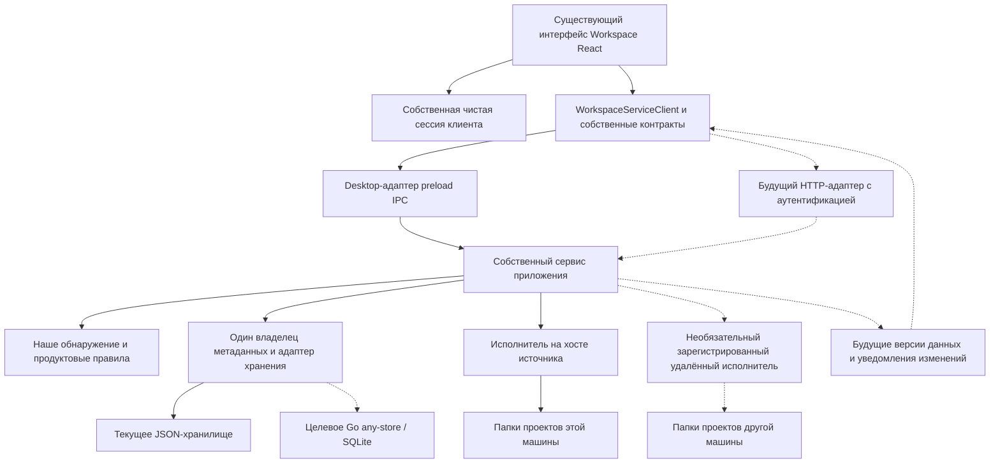

# Workspace с архитектурными наработками bb

## Вывод и границы оценки

**Гибрид подходит: сохраняем предметную модель, внешний вид и бэкенд Workspace, а из bb берём разделение клиентской логики, правил приложения, хранения и выполнения на машине.** Перенос полной среды bb значительно хуже соответствует нынешнему продукту для управления папками проектов.

Это оценка гипотетической архитектуры, а не принятый ADR, спецификация реализации или утверждение, что предложенные компоненты уже существуют. Пользователь подтвердил сравнение гибрида, полного переноса стека и форка, включая папки на сервере и удалённое управление папками на своём компьютере. Текущая задача изменяет только исследование.

Основания: [нынешний Workspace](workspace-architecture.ru.md), версия `080b416c57b2869024ac62363e96b68b40f499c0`; [исследованный bb](bb-architecture.ru.md), версия `f135a001e72942cee9118d2693208ec0725e2f18`. Дополнительное описание пользователя по `af72bb8` — отдельный ориентир; находки в нашей проверенной версии кода и точные версии зависимостей ему здесь не приписываются. Сборка на совместимость и прототип распределённой системы не выполнялись. [Технический оригинал на английском](workspace-bb-options.md).

## Три подхода

| Подход | Что изменится | Пригодность и цена |
| --- | --- | --- |
| Гибрид: собственный бэкенд и выбранные принципы bb | Выделяем собственный сервис приложения, сохраняем чистого владельца сессии, формализуем свои контракты, добавляем адаптеры по необходимости; сохраняем направление хранения и UI. | Рекомендуемый вариант. Полезен уже для desktop и совместим с будущими web/server/ИИ. Требует интеграции, но сохраняет предметную модель нашего продукта. |
| Полный стек по образцу bb | Node-сервер и daemon, HTTP/WebSocket для всех клиентов, большое число общих пакетов, SQL/ORM, инструменты и эксплуатационные сервисы по образцу bb. | Может подойти продукту для распределённых агентов. Для управления папками избыточен; замена хранилища потребует пересмотра Go/any-store. Повторение границ не требует повторения каждой зависимости. |
| Форк bb с встраиванием Workspace | Поддерживаем продукт на основе upstream и адаптируем его проекты, потоки, среды, интерфейс и жизненный цикл расширений. | Уместен прежде всего для IDE агентов. Сохранение нашего бэкенда рядом с bb создаёт две модели и интеграции; удаление предположений bb тоже требует работы. Обновления upstream становятся отдельной обязанностью поддержки. |

Выделение сервиса не требует отдельного daemon: сначала сервис может выполняться в существующем Electron main process. Renderer/preload и целевой Go sidecar сохраняют границы процессов. Физически отдельный daemon оправдан независимым временем работы или удалённой машиной, а не желанием повторить дерево папок bb.

## Что используем, адаптируем и сохраняем

| Область | Рекомендуемое сочетание | Важное ограничение |
| --- | --- | --- |
| Основной код | Наши модули; типизированные контракты и постепенное улучшение TypeScript там, где оно полезно. | Массовое переписывание или обновление версий само по себе не меняет архитектуру. |
| Репозиторий и сборка | Явная ответственность модулей сейчас; workspace-пакеты и pnpm/Turbo, когда появятся оправданные отдельные приложения. | Инструменты монорепозитория добавляют поддержку сборок и выпусков; их не обязательно внедрять до разделения модулей. |
| Клиентское ядро | Сохраняем `workspaceSession` и её внедряемые зависимости; адаптируем полезные чистые алгоритмы и проверки границы no-DOM. | Ядро bb независимо от фреймворков, но всё ещё предполагает потоки, провайдеров и терминалы. |
| Загрузка данных | Рассматриваем TanStack Query для кэша сервисных данных, ошибок и актуализации, когда это оправдано несколькими клиентами. | Переходы сессии остаются отдельно. Повторы и автоматическое обновление нужно настроить сознательно. |
| UI-состояние | Сохраняем нашу сессию с командами и снимками. Добавляем атомы только при доказанной отдельной потребности. | Jotai не обязателен для использования архитектурного опыта bb. |
| Оформление | Наш внешний вид и токены, существующие Tailwind/Radix/shadcn, истории компонентов и практики доступности. | Перенос всего shared UI или темы bb может изменить визуал и подтянуть зависимости монорепозитория. |
| Контракт и SDK | Наш `WorkspaceServiceClient`, наши DTO и проверка входных данных; IPC сейчас, HTTP позже. | SDK и server-contract bb предоставляют операции bb; замена транспорта не меняет предметную модель. |
| Бэкенд и хранение | Наши продуктовые правила; действующие JSON-адаптеры, затем Go/any-store/SQLite после работы над совместимостью. | Drizzle-схема bb не является схемой Workspace и не требует замены нашего хранилища. |
| Выполнение на хосте | Собственный исполнитель файловых операций с текущими проверками и защищённым помощником; удалённый протокол по необходимости. | Daemon bb ожидает свою регистрацию, среды, жизненный цикл потоков и внутренние серверные API. |
| ИИ и расширения | Позже проверяем узкий адаптер провайдера; проектируем собственные контракт и среду расширений. | Plugin SDK bb — фасад к среде bb, а не готовый независимый движок плагинов. |
| Desktop и mobile | Сохраняем Electron; при необходимости продукта начинаем с мобильного веб-доступа. Нативное Expo оцениваем отдельно. | Нативное мобильное приложение имеет собственные UI, хранение и процесс выпуска. |
| Проверки и сайт | Проверки границ, поведения, изолированная приёмка и smoke-проверки упаковки; отдельный маркетинговый сайт. | Редакторы IDE, PTY, Tiptap, Monaco и Cloudflare-сервисы учётных записей/туннелей не нужны нынешним функциям. |

Конкретные основания: [экспорты client-core][bb-core], [состав SDK][bb-sdk], [manifest shared-ui][bb-ui], [plugin-sdk][bb-plugin] и [проверка no-DOM][bb-guard] в bb. Наши [сервисный клиент](../../src/workspaceServiceClient.js), [сессия](../../src/workspaceSession.js) и [жизненный цикл](../../src/workspaceSessionLifecycle.js) уже дают полезные точки разделения. Универсальные помощники можно заимствовать выборочно после проверки зависимостей и поведения; совместимость целых пакетов пока не установлена.

## Предлагаемая схема гибрида

Это предлагаемая карта ответственности. Не все выделенные владельцы и адаптеры уже существуют как модули. Пунктир показывает будущие интеграции. JSON и Go — последовательные варианты за адаптером хранения, а не два одновременных главных писателя одного набора данных. Локальный исполнитель сначала может работать внутри процесса приложения.

Если появятся отдельные приложения, возможна структура: `apps/client` — общий React UI, `apps/desktop` — Electron, `apps/server` — наш API и хост сервиса, необязательный `apps/executor`, `apps/site` — маркетинг. Пакеты могут содержать `client-core`, `workspace-contract`, `application`, `domain` и реализации адаптеров. Это предлагаемые будущие имена, а не уже существующие папки. Сохранить нынешнюю структуру репозитория при выделении ответственности тоже допустимо.

## Реализация клиента и интерфейса

Сохраняем доску/таблицу, свойства, настройки источника/ролей, оформление панелей и карточку проекта. Внешний вид desktop остаётся исходной точкой; будущему телефонному интерфейсу понадобятся адаптация навигации и жестов, а не простое уменьшение окна.

Текущий `WorkspaceServiceClient` уже принимает `transport.request`. Electron-адаптер может остаться, а будущий браузерный адаптер — реализовать те же операции приложения. Системный выбор папки, открытие через ОС и браузерный предпросмотр требуют поведения по возможностям платформы. Браузер не может выбрать папку сервера через Electron picker, а серверный `open` не открывает программу на телефоне.

Разделяем трёх владельцев: команды/снимки сессии; загруженные сервисные данные; локальные настройки устройства. Query-кэш может улучшить загрузку ресурсов без замены модели сессии. Уведомления актуализируют затронутые данные; поколения запросов по-прежнему защищают выбор от поздних ответов. После переподключения также нужен авторитетный снимок или версия данных: нынешние поколения запросов не обнаруживают изменения другого клиента. См. официальные [настройки Query по умолчанию][query-defaults] и [инвалидацию кэша][query-invalidation].

Действующая граница подтверждается [транспортом интерфейса](../../src/workspaceRendererTransport.ts), [состоянием приложения](../../src/workspaceAppState.ts), [жизненным циклом сессии](../../src/workspaceSessionLifecycle.js) и [нативными/файловыми действиями](../../src/localOpen.js).

## Сервис приложения, контракты и хранение

Главный кандидат для выделения — [createWorkspaceIpcHandler](../../electron/workspaceIpc.js): его можно вызывать без Electron, он принимает зависимости, но сейчас совмещает операции приложения, выбор целей, восстановление, порядок выполнения и адаптеры метаданных. Выделяем собственного владельца сервисной логики; регистрацию Electron и нативные взаимодействия оставляем адаптерами. Сохраняем [нормализацию/проекции](../../src/workspaceViews.js), [правила свойств](../../src/workspaceProperties.js) и существующие API-контракты.

Будущий Node HTTP-хост может направлять запросы в этот сервис, при желании используя Hono. Ему не нужны сервер bb или реляционная схема bb. Go остаётся целевым постоянным хранилищем за своим проверяемым контрактом. Полный сервер приложения только на Go — другой вариант, но перенос наших продуктовых правил из Node будет отдельным переписыванием бэкенда.

У каждого набора метаданных должен быть один авторитетный писатель. Electron и сервер не должны независимо редактировать одни JSON-файлы. Замена через временный файл и текущая очередь внутри процесса не предотвращают потерю обновлений между процессами. Изменения от нескольких клиентов потребуют версий и обработки конфликтов там, где это необходимо; транзакции базы не включают автоматически изменение папок проектов.

До выбора Go-хранилища сохраняем каждое текущее поле представления, значения/историю в области источника, привязки источников, непрозрачные ID и восстановление. Закрываем [разрывы документного контракта](../architecture.md#storage--sidecar-layer), мигрируем на изолированных копиях, реализуем жизненный цикл и упаковку. Существующий sidecar-клиент — частичный транспорт документов, а не полный удалённый бэкенд приложения. Это сохраняет [ADR-001](../adr/001-local-first-workspace-storage.md) и его [уточнение ADR-006](../adr/006-workspace-source-bindings.md).

## Режимы развёртывания и расположение папок

| Режим | Где находятся управление данными и файлы | Следствия |
| --- | --- | --- |
| Самостоятельный локальный desktop | Наш сервис, метаданные и исполнитель на компьютере пользователя. | Сохраняется работа нынешнего продукта без сети; удалённый daemon не нужен только ради выделения модулей. |
| Телефон управляет локальными папками | Авторитетный сервис приложения и файловый исполнитель на компьютере пользователя; доступ через защищённый доступный endpoint или специально спроектированный relay/туннель. | Компьютер должен быть включён и доступен. Один сайт или серверная база не дают доступа к его папкам. Время работы фоновой службы нужно определить отдельно от окна Electron. |
| Папки на сервере | Сервис, метаданные и исполнитель на сервере; desktop, браузер и телефон — клиенты. | Важны доступность сервера и резервирование. Возможности браузера отличаются от нативных действий. Сейчас безопасное создание/переименование Linux завершается отказом; развёртывание не обеспечивает равенство функций. |
| Центральный сервис и удалённые исполнители | Центральный владелец данных и зарегистрированные хосты источников. | Наиболее близкий к bb вариант. Добавляет идентичность машин, учётные данные, совместимость протоколов, восстановление операций и отключение хостов. Оправдан при управлении несколькими машинами из одного места. |

Удалённое управление — не синхронизация. Репликация метаданных не реплицирует файлы проектов; копирование файлов не сохраняет сессии и не разрешает конфликты метаданных. Оценка не предполагает, что локальные папки выключенного компьютера становятся доступны удалённо.

Адресация хостов требует явной идентичности машины и источника. Одинаковый абсолютный путь на двух машинах — не один источник. Нынешние пространства имён из путей и device/inode-псевдонимы — локальные свидетельства, а не переносимые глобальные ID. Сохраняем существующие непрозрачные ссылки через явное сопоставление/миграцию, а не незаметно меняем общие значения и историю источника. Сессии отдельных клиентов остаются отдельно от авторитетных метаданных продукта.

## Будущие ИИ, скиллы и плагины

При запросе добавляем агентный контекст рядом с управлением папками, а не превращаем каждый проект в поток bb. Папка остаётся проектом; агентная сессия — отдельная работа, связанная с разрешёнными источником и хостом. GitHub Issues и вспомогательные шаги Beads остаются трекингом разработки, а не сущностями диалога во время работы продукта.

Узкий будущий пилот может адаптировать bridge провайдера за собственной границей `AgentExecutor`. Потребуется сопоставить состояния сессий/ходов, отмену, интерактивные запросы, завершение провайдера, инструкции и постоянную историю. [Контракт agent-runtime][bb-runtime] и [менеджер исполнения daemon][bb-daemon] показывают необходимую поверхность, но не гарантируют готовую совместимость.

Runtime-скиллы нужно явно распространять на выбранного исполнителя и применять там. Установленные скиллы разработки автоматически не становятся ИИ-функциями Workspace. Собственной среде плагинов нужны API возможностей, правила жизненного цикла/версий и выбранная модель доверия. Типы plugin-sdk bb сами по себе не создают загрузчик, UI-слоты, хранение или разрешения. Код плагина внутри процесса является доверенным, пока не спроектирована и не проверена настоящая изоляция.

## Отказы, параллельные изменения и доступ

Распределённая архитектура добавляет обязательства, которых нет у нынешнего локального интерфейса:

- Аутентификация клиентов и зарегистрированных машин, разрешения на источники/операции, защищённый транспорт и отзыв доступа. Проверка origin не заменяет аутентификацию; прямой wildcard API bb не является готовым шаблоном публичного развёртывания.
- ID операций и постоянная обработка повторов/дубликатов. HTTP-тайм-аут не доказывает неуспех переименования; повтор не должен слепо выполнять операцию ещё раз.
- Операции с жизненным циклом независимо от вкладки браузера. Закрытие страницы телефона не означает откат выполняющегося файлового сценария.
- Восстановление после соединения, снимки состояния, порядок/дедупликация событий, недоступные хосты и совместимость версий сервера/исполнителя.
- Проверка путей на хосте файлов, явное сообщение доступных возможностей и защищённые операции. Удалённому предпросмотру нужен разрешённый endpoint внутри источника, а не абсолютный путь исполнителя вместо браузерного URL.
- Сохранение журналов переименования/смены статуса и поведения при неоднозначном восстановлении. Новый транспорт не должен ослаблять эти проверки.

Основания: наши [переименование](../../src/workspaceProjectRename.js) и [смена статуса](../../src/workspaceStatusMove.js); [event sink][bb-events] и [протокол daemon][bb-protocol] в bb. Уведомления версий, постоянные ID операций и удалённая регистрация — предлагаемые дополнения, а не действующие гарантии Workspace.

Для центрального сервиса с удалёнными исполнителями нужно определить владельца журналов выполнения и порядок фиксации подтверждённого файлового результата в авторитетных метаданных. Восстановление должно сохранять локальные свидетельства хоста, переживать разрыв связи и согласовывать завершение до публикации новых локаторов. Нынешний журнал settings в одном процессе не обеспечивает такой распределённый протокол; перенос журнала на сервер не делает исполнителя без собственного состояния достаточным.

## Условные этапы и проверки

| Этап | Граница результата | Что подтвердить перед расширением |
| --- | --- | --- |
| 1. Локальное разделение | Выделить собственный сервис приложения/адаптеры и сохранить поведение сессии и предметной модели. | Текущее desktop-поведение, границы импортов, сервисные/IPC-контракты; сохранность данных и внешнего вида. |
| 2. Постоянное хранилище, независимо | Подключить свой Go-store после полноты контракта и миграции. | Полное сохранение/чтение представлений, совместимость областей/ID/истории, восстановление после отказов и нативная упаковка. Этап может быть отдельным от веб-доступа. |
| 3. Веб-доступ к одному хосту | Защищённый браузерный транспорт к одному владельцу данных с явными возможностями. | Реальные сценарии браузера/телефона, защита файлов, изменения двух клиентов, тайм-ауты/переподключение и приёмка ОС хоста. |
| 4. Удалённые исполнители по потребности | Отдельное выполнение на хосте источника и независимая фоновая работа. | Регистрация/отзыв, повторные команды, отключение/перезапуск и восстановление частично выполненных операций. |
| 5. ИИ/расширения по запросу | Узкая возможность провайдера, скилла или плагина. | Жизненный цикл провайдера, отмена, внедрение инструкций, доверие, совместимость протокола/версий расширений. |

Это рекомендация с учётом зависимостей, а не новые задачи или разрешение реализовать этапы. Интеграция хранилища не считается обязательным условием первого браузерного пилота, если сохраняется один безопасный владелец метаданных. Опрос данных может предшествовать WebSocket, если удовлетворяет требуемой актуальности.

## Компромиссы и решения перед реализацией

Рекомендуемое сочетание — **наш продукт, бэкенд и контракты данных + границы ответственности и методы проверок bb + необязательные транспорты/исполнители**. Оно готовит рост без неиспользуемых терминалов, сервисов агентного жизненного цикла и инфраструктуры мобильных выпусков в нынешнем desktop.

Цена — поддержка собственных адаптеров и контрактов вместо автоматического получения функций bb. Продуктовая логика Node и хранение Go означают два языка инструментов и границу процессов. Daemon улучшает независимость времени работы и доступность, но добавляет эксплуатацию. Центральный сервис упрощает авторитет данных для нескольких клиентов, но делает его доступность значимой. Форк даёт доступ к развитой платформе ценой привязки к upstream и адаптации предметной модели.

Перед реализацией нужно выбрать владельца каждого набора данных, поведение офлайн/конфликтующих изменений, поддерживаемые платформы/действия, границу удалённого доступа и доверие плагинам. Распространение пакетов, учётные данные runtime и публикация сайта требуют собственных решений. Исходники приложения и сайта остаются приватными; публичный маркетинговый сайт не означает публичный репозиторий. Оценка по исходникам не даёт подтверждённые сроки или гарантию совместимости.

[bb-core]: https://github.com/get-bb/bb/blob/f135a001e72942cee9118d2693208ec0725e2f18/packages/client-core/src/index.ts
[bb-sdk]: https://github.com/get-bb/bb/blob/f135a001e72942cee9118d2693208ec0725e2f18/packages/sdk/src/core.ts
[bb-ui]: https://github.com/get-bb/bb/blob/f135a001e72942cee9118d2693208ec0725e2f18/packages/shared-ui/package.json
[bb-plugin]: https://github.com/get-bb/bb/blob/f135a001e72942cee9118d2693208ec0725e2f18/packages/plugin-sdk/src/index.ts
[bb-guard]: https://github.com/get-bb/bb/blob/f135a001e72942cee9118d2693208ec0725e2f18/packages/client-core/test/no-dom.test.ts
[query-defaults]: https://tanstack.com/query/latest/docs/framework/react/guides/important-defaults
[query-invalidation]: https://tanstack.com/query/latest/docs/framework/react/guides/query-invalidation
[bb-runtime]: https://github.com/get-bb/bb/blob/f135a001e72942cee9118d2693208ec0725e2f18/packages/agent-runtime/src/provider-adapter.ts
[bb-daemon]: https://github.com/get-bb/bb/blob/f135a001e72942cee9118d2693208ec0725e2f18/apps/host-daemon/src/runtime-manager.ts
[bb-events]: https://github.com/get-bb/bb/blob/f135a001e72942cee9118d2693208ec0725e2f18/apps/host-daemon/src/event-sink.ts
[bb-protocol]: https://github.com/get-bb/bb/blob/f135a001e72942cee9118d2693208ec0725e2f18/apps/server/src/ws/daemon-protocol.ts
