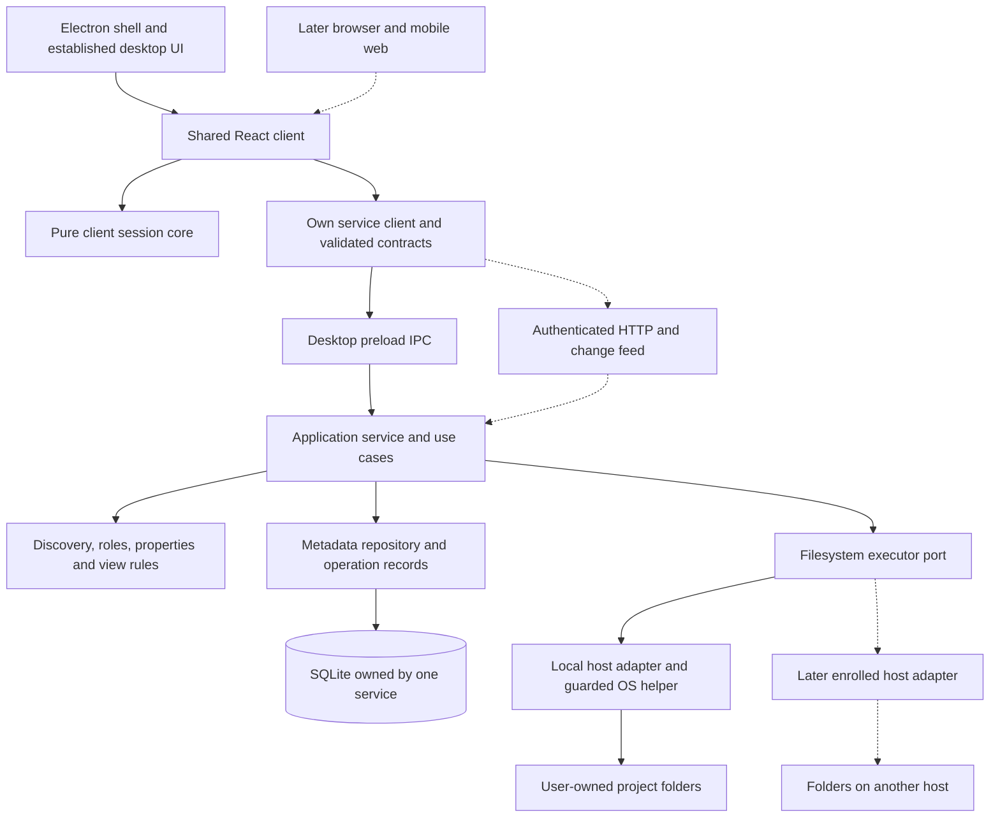
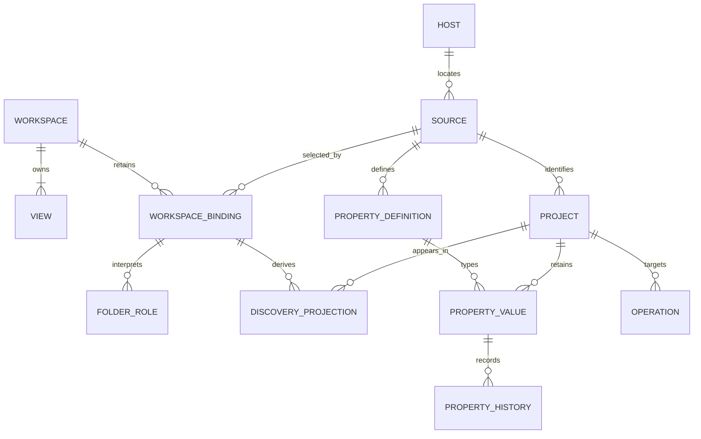
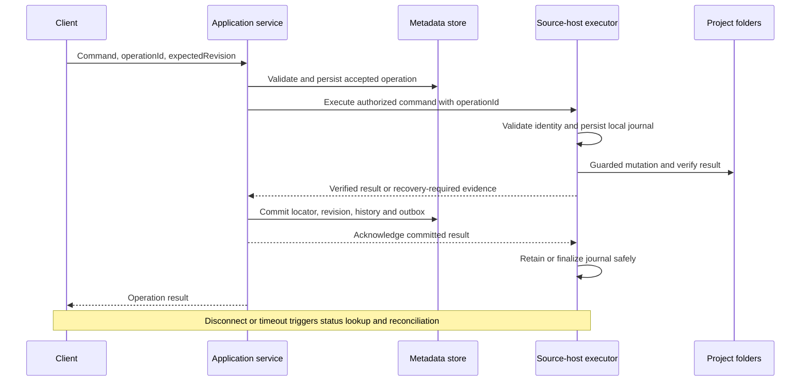

# Workspace from scratch using bb architectural lessons

## The product stays; the implementation starts fresh

**For a new Workspace, I would adopt bb's separation of responsibilities and build our own folder-management domain on top. My default starting candidate is a TypeScript modular application with SQLite, a shared React client and a thin Electron shell.** A Go/any-store implementation remains a credible alternative when document storage or a Go execution boundary has a concrete advantage.

The user confirmed the same product with a new architecture and an unrestricted stack comparison for this research. Existing folders remain projects; Board, Table, properties, source selection and folder roles remain the product. Desktop keeps the established appearance and works independently offline. Later, a phone can access server-owned folders or folders on a reachable personal computer. AI, skills and plugins come later.

This is a **hypothetical design, not an accepted ADR or permission to rewrite the existing application**. It changes no runtime, dependency or storage decision. The [hybrid assessment](workspace-bb-options.md) discusses evolving existing code; this page asks what we would establish on day one without legacy JSON migration or inherited module boundaries.

Evidence snapshots: Workspace `080b416c57b2869024ac62363e96b68b40f499c0` and bb `f135a001e72942cee9118d2693208ec0725e2f18`. The user's `af72bb8` description is a separate reference. Source facts below support architectural lessons; the proposed names, schema and workflows are our inference. No new-product prototype or compatibility build has been performed.

## What bb would teach us on day one

| Lesson from inspected bb | Greenfield Workspace decision | What we would defer |
| --- | --- | --- |
| Server policy and host execution have separate owners. | Application use cases call a filesystem executor port; only that executor accesses source folders. | Remote enrollment and a separately shipped daemon until their lifetime or location requires them. |
| Contract packages describe process boundaries. | Own DTOs and runtime schemas, versioned errors and a transport-independent client. | bb's thread/environment API and SDK, which encode another product. |
| A client-core package is tested without DOM dependencies. | Pure session commands, selections and layout transitions outside React; an import-boundary check. | Direct reuse of bb-specific thread/provider/panel types. |
| Server cache and interaction state have different lifecycles. | Explicit owners for authoritative data, cached data, session and device preferences. | A second global state system without an identified responsibility. |
| Structured persistence and machine execution are different subsystems. | Transactional metadata plus operation recovery evidence outside the metadata transaction. | Treating a database transaction as a rollback of directory changes. |
| Agent runtime normalizes provider behavior. | Reserve a later `AgentExecutor` boundary associated with a project and host. | Chat, terminal, editor, provider adapters and plugin host in the folder-management MVP. |

Evidence: [server composition][bb-server], [daemon composition][bb-host], [client-core boundary test][bb-core], [database connection][bb-db] and [provider adapter][bb-agent]. Reusing these ideas does not require forking bb or claiming that its packages are compatible with Workspace.

## Architecture: modules first, processes when needed

Solid routes describe the proposed first local delivery; dashed routes describe later capabilities. These are not existing module names. Initially, the application service and local executor adapter can run in Electron's main process; the renderer calls an allowlisted preload bridge. Pure rules do not import Electron, HTTP or SQLite.

The executor resolves locators and validates containment at the source host, including races, symlink/reparse behavior, destination ownership and platform-specific no-clobber guarantees. A small native helper can be justified even in a TypeScript-first product. JavaScript path validation alone does not establish safe filesystem mutation. The [current creation guard](../adr/009-project-creation-os-guard.md) shows why platform acceptance remains necessary.

Later, the same application modules can be hosted in a standalone Node service. Moving the service out of Electron should change composition and transport, not duplicate product rules. Heavy scans belong outside the UI-critical execution path; work scheduling must also account for synchronous database access. A process boundary is introduced for a concrete execution or lifecycle need, not for every module.

## Domain model and ownership of data

This is a conceptual proposal, not executable DDL. A Workspace may have no selected source; it may retain several historical bindings but has at most one active binding. The view cardinality expresses a configured Workspace retaining at least one usable view. Operation records here represent project-targeted commands; other jobs can have different targets.

| Record or state | Proposed scope | Important consequence |
| --- | --- | --- |
| `Host`, `Source`, project registry | Host address plus stable source identity; projects belong to a source. | The same path on two machines identifies different sources. A path is a mutable locator. |
| `Workspace`, binding and folder roles | Working configuration and its selected/retained interpretation. | Two configurations can share files and values while interpreting the tree differently. |
| `View` and presentation ranks | Workspace/view. | Filtering and sorting do not move files; same-group row reorder changes presentation only. |
| Custom definitions, options, values and history | Source/project, with explicit keys and foreign references. | Removing a Workspace must not cascade-delete shared data or folders. |
| Derived Name/Status and discovery projection | Project locator and the active binding's role interpretation. | A single unconditional `Project.statusId` would be wrong when interpretations differ. |
| Session, tabs, pane selection, device preferences | Client/device; optional per-device persistence. | A phone and desktop need not share their focused tab or navigation state. |

Discovery still treats `group` as a container, `status` as a status ancestor and `project` as a boundary where scanning stops. Projects outside a status role have `No status`. Preserve one supported Status level and the existing allowed Status destinations. Views and configuration removal do not remove user files.

Create opaque stable project IDs in a registry at first discovery, with a separate locator and reconciliation evidence. An explicit verified move updates the locator while preserving identity, properties and history. UUIDs do not identify an arbitrary externally moved folder by themselves: missing entries, replacement folders, copies and ambiguous matches need explicit reconciliation states and user-visible recovery. A replacement must never inherit the previous occupant's metadata merely because its path matches.

These requirements derive from [the glossary](../../GLOSSARY.md), [source bindings](../adr/006-workspace-source-bindings.md), [data scopes](../data-model.md#current-runtime-and-target-scope) and [Status semantics](../api/workspace-status-move.md). The general registry is a new design proposal; current [ADR-004](../adr/004-project-identity-and-audit-migrations.md) remains Proposed.

## Stack choice without legacy constraints

| Candidate | Why consider it from scratch | Cost or condition |
| --- | --- | --- |
| TypeScript application + Node + SQLite, e.g. Drizzle/better-sqlite3 | One main language for client, contracts and application logic; explicit transactions; fewer custom process contracts. This is my default candidate for folder management and later web access. | Native database packaging, synchronous work scheduling, migrations and guarded OS operations still need engineering and platform checks. |
| TypeScript application + Go/any-store persistence | Document-shaped metadata with a dedicated store owner; relevant when that ecosystem is an intentional product direction. | Two languages and a store protocol; packaging, lifecycle, transaction semantics and full metadata round trips must be verified. Do not presume automatic synchronization. |
| Go application service + own HTTP/IPC adapters | Worth considering when the team wants Go to own both product logic and filesystem operations. | Shared DTO generation/validation and separate client tooling; more cross-language implementation. Go alone is not proof of filesystem safety. |
| Fork bb and replace its domain/UI | Useful mainly if agent orchestration becomes the initial core product. | Thread/environment assumptions, unused IDE features and upstream maintenance make it a weaker fit for the confirmed product. |

For the first candidate: React/Vite, TypeScript contracts with runtime validation such as Zod, TanStack Query for service-derived cache, our own session reducer and existing visual language using Tailwind/Radix-style primitives. Hono is an option for the later Node HTTP host, supported by its [official Node adapter][hono]. Drizzle is a schema/query option, not a required domain layer; see its [overview][drizzle]. Exact versions would be pinned after a packaging and behavior pilot, rather than copied from a research snapshot.

SQLite WAL permits concurrent reads and a writer, but only one writer at a time; it is not a cross-machine shared-file database. Store it on the owning host, define contention/durability/backup policy and access it through the service. See [SQLite WAL][sqlite]. A metadata commit still cannot atomically commit a directory operation.

## The client: four owners instead of one large component

| Owner | Contains | Excludes |
| --- | --- | --- |
| Service/repository | Projects, properties, views, revisions and operation status. | Device focus and DOM effects. |
| Query cache | Resource loading, cached projections, pending/error state and invalidation. | Authoritative durable storage or session transitions. |
| Pure client-core | Commands/snapshots for tabs, selection, panes, Close/Restore and per-view intent. | Filesystem work, React hooks and transport implementation. |
| UI/effect adapters | Rendering, focus, dialogs, notifications and device-local preferences. | Discovery or storage rules. |

Close an active expanded project to its selected Board/Table view; keep the right host for an actual preview only. Preserve existing desktop semantics and appearance. A phone needs deliberate navigation, touch targets and narrow-screen properties rather than a shrunken desktop pane tree. Native Expo would be a later separate client decision.

Include server identity in cache keys before connecting multiple datasets. On disconnect, show uncertain freshness; on reconnect, fetch authoritative revisions/snapshots. A change feed invalidates relevant resources. It is not the only copy of product state. Selection generations reject late preview replies independently of revision conflict handling.

Configure retry and refetch policy intentionally; TanStack Query's default stale/refocus/reconnect behavior is documented in [Important Defaults][query]. Filesystem commands require explicit operation semantics rather than blanket automatic retries. Jotai can support independent small UI state if needed, but the design does not require it alongside the session owner.

## Filesystem commands are recoverable workflows

The diagram covers a successful commit path; failure paths are not silently equivalent to success. A pure metadata edit can be a short transaction. Rename and Status move combine external effects with metadata, so they need operation identity, project/source coordination and durable recovery evidence. Persist the accepted operation before execution; persist host-local evidence before destructive phases. Database commit and change-notification outbox belong in the same transaction where the chosen store supports it.

A repeated `operationId` with the same command returns the recorded state; different content under that ID is rejected. Conflicting project mutations are serialized or rejected. Before publication, verify filesystem identity, update relevant retained role locators and preserve project values/history. After a timeout, query status rather than blindly repeating a move. Recovery inspects evidence; uncertain contents are retained and reported as `recovery-required`.

The executor acknowledgement matters for future remote hosts: losing the server response must not erase the only evidence of a completed physical change. After restart or disconnect, reconcile the host journal and metadata owner before releasing the mutation barrier. This requires a specified state machine, tested failure points and versioned messages; the diagram does not assert distributed atomicity or exactly-once filesystem effects. External applications can still modify folders, and an application lock does not lock out those writers.

The existing [rename contract](../api/workspace-project-rename.md) and [Status recovery contract](../api/workspace-status-move.md) provide useful safety experience. Greenfield avoids compatibility migrations, not these failure modes. bb's [event sink][bb-events] illustrates event transport, not proof of a durable exactly-once command queue.

## Desktop, server and phone: choose an authority per dataset

| Deployment | Metadata authority and files | Availability and compromise |
| --- | --- | --- |
| Standalone desktop | Local service owns metadata; local executor accesses folders. | No cloud or account required; background work ends with the service unless an independent host is installed. |
| Phone controlling a personal computer | Computer's service remains the sole owner; an authenticated browser connects. | Computer/service must be reachable. Prefer a private network or deliberate protected gateway; never assume LAN binding is public-access security. |
| Server-owned folders | Server service owns metadata and execution; desktop and mobile web are clients. | Server backup/availability and tested filesystem/platform support become operating responsibilities. |
| Central service with remote host | Central metadata owner; enrolled executor owns access to that host's files and local execution evidence. | Adds enrollment, revocation, protocol compatibility and distributed recovery; implement only when the simpler modes are insufficient. |

Desktop can connect to a remote dataset while keeping a separate local dataset for independent offline work. It must not start a second independent metadata writer for the same centrally owned source. Moving a source between authorities needs an explicit ownership-transfer procedure; presenting the same physical folder as two unrelated sources would create conflicting interpretation and mutation owners.

Offline remote mode initially permits clearly labelled cached reads and blocks mutation; editing the same remote dataset offline would require a separate synchronization/conflict design. Neither metadata replication nor remote control makes files on a powered-off machine available. File synchronization is its own feature.

Remote access needs user authentication, source/action authorization, protected transport, machine credentials where applicable and revocation. A native picker or OS reveal is a host capability, not a browser capability. File preview uses an authorized contained endpoint; host absolute paths do not become browser URLs. bb's [multi-device documentation][bb-access] explicitly distinguishes unsafe exposure from protected access.

Electron retains `contextIsolation: true`, `nodeIntegration: false`, `sandbox: true` and narrow validated preload methods. These align with [Electron security guidance][electron]; shared language does not justify exposing Node or raw IPC to the renderer.

## AI, skills and plugins have their own later boundary

A project remains a folder-backed product entity. A future agent session is separate and references the authorized project/source/host; it does not replace a Project or a development issue. The application service decides policy, the executor prepares the allowed working context and a provider adapter handles the provider lifecycle.

The later contract must include start/resume/cancel, progress, interaction/approval requests, outcomes and provider failure. Skills are versioned instruction assets deliberately distributed and applied on the execution host. Installed Matt development skills do not automatically become product runtime skills. Provider credentials belong to the appropriate protected runtime, not browser bundles or project properties.

For first-party extensions, explicit typed contribution slots can be sufficient. Third-party executable plugins require a separate trust model, capabilities, lifecycle/versioning and an isolation strategy where untrusted code is intended. bb's [plugin SDK][bb-plugin] depends on its implemented host; importing types creates no loader or sandbox. Do not ship a universal plugin platform merely to leave a future option open.

## Repository and development workflow

A small monorepo could contain `apps/client`, `apps/desktop` and later `apps/server`/`apps/site`. Packages could hold `domain`, `application`, `workspace-contract`, `client-core`, `persistence` and `filesystem-executor`. At first, several can be modules in one package; stable responsibilities matter more than folder count. pnpm workspaces can manage multiple packages; Turbo is justified only if build coordination benefits from it.

Enforce dependency direction: React uses client-core/contracts; application uses domain and ports; adapters implement ports; composition roots wire them together. Renderer and pure-core checks catch forbidden Node/DOM imports. No shared barrel should pull a native database or Electron into browser code.

Keep a compact documentation set: product/domain glossary, API contracts, accepted decisions, setup and verification. Research remains reference material. GitHub Issues in a private repository are the primary task/status source; Beads holds auxiliary execution steps linked to an issue. Matt skills support research, grilling, design, implementation and review as appropriate. This proposed workflow creates no new issues or repositories.

The public marketing site is a separate deployable with its own copy, screenshots and download links. Site and application sources remain private. Hosting a public site does not require publishing product code, databases, credentials or research documents. No bb account/tunnel/marketplace infrastructure is required for the first marketing site.

## Build and verify in useful vertical slices

| Slice | Useful deliverable | Verification that earns the next step |
| --- | --- | --- |
| Local foundation | Bind a source, assign roles, discover projects, show Board/Table and retain typed properties/views. | Domain fixtures, same-source sharing, stable identity/replacement cases, session transitions and restart/backup round trips. |
| Safe mutation | Create/rename/explicit Status move with recoverable operation records. | Real supported-OS acceptance in isolated folders; crashes at state transitions, occupied targets, replacement/symlink races, external edits and preserved history. |
| Independent service + web | Same use cases through a hosted service; authenticated browser/mobile UI. | Contract compatibility, two clients and conflicting revisions, reconnect, file authorization, narrow-screen flows and actual packaged desktop startup. |
| Remote executor if needed | Host-local execution behind a versioned protocol. | Enrollment/revocation, duplicate commands, lost acknowledgements, host/server restarts and ambiguous partial completion. |
| AI/extensions when requested | One useful provider/skill or contribution path. | Real lifecycle/cancellation, instruction delivery, credential boundaries and declared plugin trust behavior. |

CI starts with type checks, focused domain/service/client tests and import-boundary checks; add contract, browser and packaged smoke as those surfaces appear. Use bb's test-boundary approach rather than equating tool adoption with coverage. Pin runtime/native dependencies and verify distributable artifacts on supported operating systems. SQLite backup must use a consistent database backup procedure, not an unverified copy of a live database file alone; project-folder backup remains separate. See the official [SQLite Backup API][sqlite-backup].

## Why this is preferable, and what could change the choice

Greenfield's advantage is choosing identities, scopes, ownership and contracts before adapters acquire incompatible assumptions. It removes legacy conversion work but still requires safe filesystems, durable recovery, native packaging and explicit remote behavior. Its cost is a new implementation and validation effort, so this page does not claim it is cheaper than improving the current application.

For the confirmed product, I would start with **our domain + TypeScript modular application/SQLite candidate + pure shared client-core + thin Electron shell + guarded local executor**, then host the service for web use, and introduce remote/agent processes only with their features. I would choose Go/any-store instead if its document-storage direction is a deliberate requirement supported by a working transaction/recovery/packaging pilot. A full bb fork becomes more attractive only if agent orchestration replaces folder management as the initial product.

Before committing to a real greenfield implementation, verify a minimal vertical prototype against three questions: can it preserve project identity and shared-source semantics; can it recover an interrupted mutation; can the same use case work through desktop and hosted transports without duplicated rules? Team expertise, supported platforms, workload and synchronization requirements could change the stack choice. This page supplies a reasoned candidate and alternatives, not a new binding technical decision.

[bb-server]: https://github.com/get-bb/bb/blob/f135a001e72942cee9118d2693208ec0725e2f18/apps/server/src/start-server.ts#L105
[bb-host]: https://github.com/get-bb/bb/blob/f135a001e72942cee9118d2693208ec0725e2f18/apps/host-daemon/src/start-host-daemon.ts#L167
[bb-core]: https://github.com/get-bb/bb/blob/f135a001e72942cee9118d2693208ec0725e2f18/packages/client-core/test/no-dom.test.ts#L37
[bb-db]: https://github.com/get-bb/bb/blob/f135a001e72942cee9118d2693208ec0725e2f18/packages/db/src/connection.ts#L275
[bb-agent]: https://github.com/get-bb/bb/blob/f135a001e72942cee9118d2693208ec0725e2f18/packages/agent-runtime/src/provider-adapter.ts
[bb-events]: https://github.com/get-bb/bb/blob/f135a001e72942cee9118d2693208ec0725e2f18/apps/host-daemon/src/event-sink.ts#L168
[bb-access]: https://github.com/get-bb/bb/blob/f135a001e72942cee9118d2693208ec0725e2f18/docs/multiple-devices.md#L47
[bb-plugin]: https://github.com/get-bb/bb/blob/f135a001e72942cee9118d2693208ec0725e2f18/packages/plugin-sdk/src/index.ts
[hono]: https://hono.dev/docs/getting-started/nodejs
[drizzle]: https://orm.drizzle.team/docs/overview
[sqlite]: https://www.sqlite.org/wal.html
[query]: https://tanstack.com/query/latest/docs/framework/react/guides/important-defaults
[electron]: https://www.electronjs.org/docs/latest/tutorial/security

[sqlite-backup]: https://www.sqlite.org/backup.html
