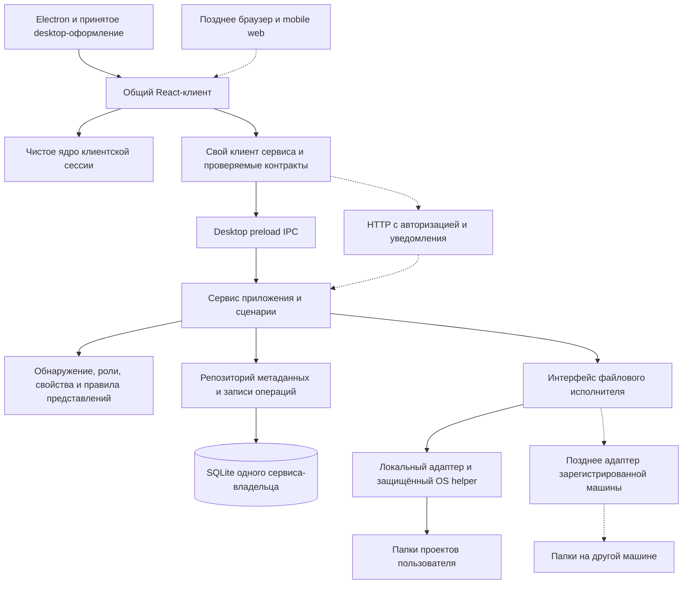
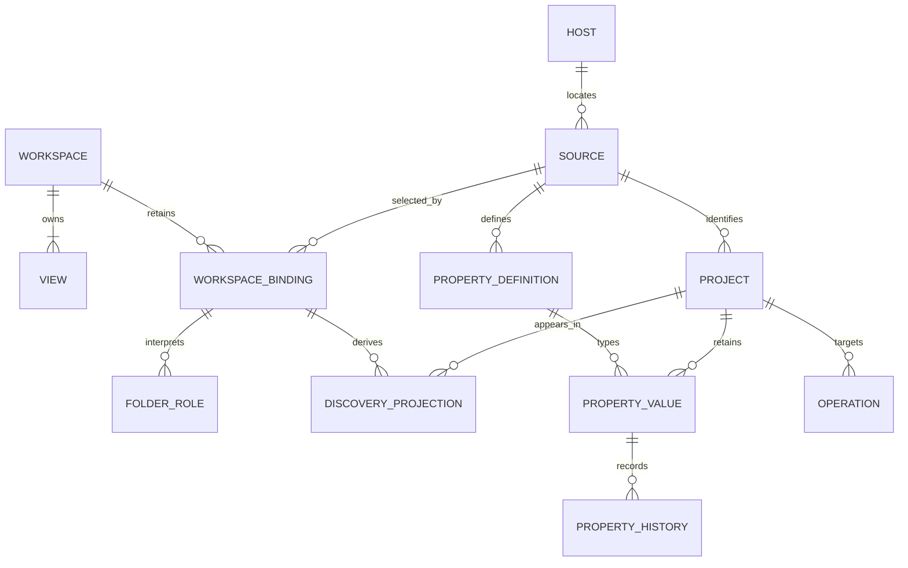
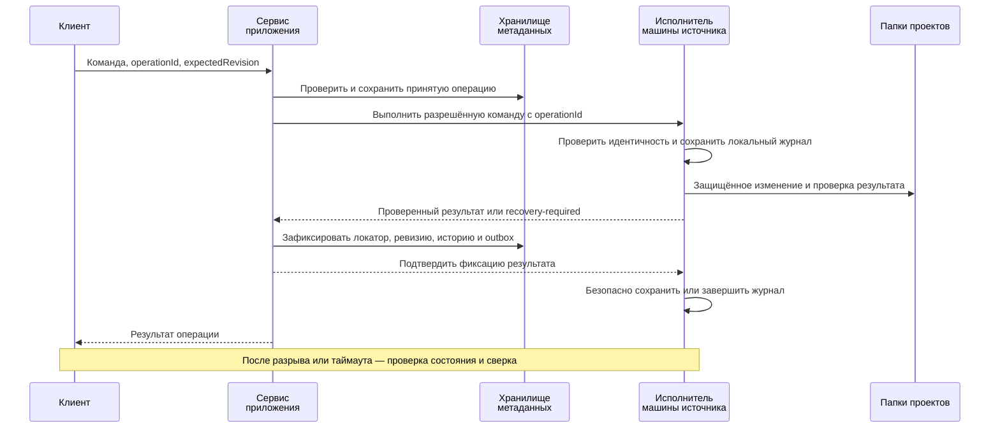

# Workspace с нуля на основе архитектурного опыта bb

## Продукт сохраняется, реализация начинается заново

**Создавая новый Workspace, я бы перенял из bb разделение ответственности и построил собственную предметную модель управления папками. Стартовый вариант, который я рекомендую проверить: модульное приложение на TypeScript с SQLite, общим React-клиентом и тонкой оболочкой Electron.** Go/any-store остаётся разумной альтернативой, если документное хранилище или граница выполнения на Go дают конкретное преимущество.

Пользователь подтвердил: рассматриваем тот же продукт с новой архитектурой и свободно сравниваем стек в рамках исследования. Существующие папки остаются проектами; доска, таблица, свойства, выбор источника и роли папок сохраняются. Desktop сохраняет принятое оформление и самостоятельно работает без сети. Позднее телефон получает доступ к папкам сервера либо к папкам доступного по сети личного компьютера. ИИ, скиллы и плагины добавляются позднее.

Это **гипотетическая архитектура, а не принятый ADR и не разрешение переписать действующее приложение**. Она не меняет runtime, зависимости или решение о хранилище. [Оценка гибрида](workspace-bb-options.ru.md) рассматривает развитие существующего кода; эта страница — то, что мы заложили бы с первого дня без миграции старых JSON-данных и унаследованных границ модулей.

Исследованные снимки: Workspace `080b416c57b2869024ac62363e96b68b40f499c0` и bb `f135a001e72942cee9118d2693208ec0725e2f18`. Описание пользователя для `af72bb8` — отдельный источник. Факты исходников ниже обосновывают архитектурные уроки; предлагаемые названия, схема данных и процессы — наши выводы. Прототип нового продукта и проверка совместимости сборкой не выполнялись.

## Что мы взяли бы из bb с первого дня

| Урок исследованного bb | Решение для нового Workspace | Что отложили бы |
| --- | --- | --- |
| Продуктовые решения сервера отделены от выполнения на машине. | Сценарии приложения вызывают интерфейс файлового исполнителя; только исполнитель обращается к папкам источника. | Регистрацию удалённых машин и отдельный daemon до появления потребности в независимом времени работы или другой машине. |
| Контракты описывают границы процессов. | Собственные DTO, проверяемые схемы, версии ошибок и клиент, независимый от транспорта. | API и SDK bb для threads/environments: они описывают другой продукт. |
| Клиентское ядро проверяется без зависимостей от DOM. | Чистые команды сессии, выбор и переходы панелей вне React; проверка допустимых импортов. | Прямой перенос типов bb для чатов, провайдеров и панелей. |
| Серверный кеш и состояние взаимодействия имеют разные жизненные циклы. | Явные владельцы достоверных данных, кеша, сессии и настроек устройства. | Вторую глобальную систему состояния без определённой ответственности. |
| Структурированное хранение и выполнение на машине — разные подсистемы. | Транзакционные метаданные и свидетельства восстановления операций вне транзакции метаданных. | Представление, будто транзакция БД откатывает изменения каталогов. |
| Agent runtime нормализует поведение провайдеров. | Будущую границу `AgentExecutor`, связанную с проектом и машиной. | Чат, терминал, редактор, адаптеры провайдеров и хост плагинов в MVP управления папками. |

Основания: [сборка сервера][bb-server], [сборка daemon][bb-host], [проверка границы client-core][bb-core], [подключение БД][bb-db] и [адаптер провайдера][bb-agent]. Для использования этих идей не нужен форк bb или заявление о совместимости его пакетов с Workspace.

## Архитектура: сначала модули, затем необходимые процессы

Сплошные связи описывают предложенную первую локальную версию; пунктир — последующие возможности. Это не названия действующих модулей. Сначала сервис приложения и локальный адаптер исполнителя могут работать в главном процессе Electron; renderer обращается к ограниченному preload-мосту. Чистые правила не импортируют Electron, HTTP или SQLite.

Исполнитель разрешает расположение и проверяет границы источника непосредственно на машине с папками: учитывает гонки, symlink/reparse, принадлежность цели и гарантии защиты от перезаписи на конкретной ОС. Даже в продукте на TypeScript может быть оправдан небольшой нативный helper. Проверка строк путей на JavaScript сама по себе не доказывает безопасность изменения файлов. [Действующий защитный механизм создания](../adr/009-project-creation-os-guard.md) показывает, почему нужна проверка на поддерживаемых платформах.

Позднее те же модули приложения могут работать в самостоятельном Node-сервисе. Выделение сервиса из Electron меняет сборку компонентов и транспорт, а не дублирует продуктовые правила. Тяжёлое сканирование следует вынести из пути выполнения, от которого зависит отзывчивость интерфейса; планирование работ также должно учитывать синхронное обращение к БД. Граница процесса появляется ради конкретной задачи выполнения или жизненного цикла, а не для каждого модуля.

## Предметная модель и владение данными

Это концептуальная схема, а не исполняемый DDL. Workspace может ещё не иметь выбранного источника; он может сохранять несколько прошлых привязок, но активна не более одной. Связь с представлениями выражает сохранение хотя бы одного рабочего view у настроенного Workspace. Операции здесь направлены на проекты; другие фоновые задачи могут иметь иные цели.

| Запись или состояние | Предлагаемая область владения | Следствие |
| --- | --- | --- |
| `Host`, `Source`, реестр проектов | Адрес машины и стабильная идентичность источника; проекты принадлежат источнику. | Одинаковые пути на двух машинах обозначают разные источники. Путь — изменяемый локатор. |
| `Workspace`, привязка и роли папок | Рабочая конфигурация и выбранная либо сохранённая интерпретация. | Две конфигурации могут разделять файлы и значения, но по-разному интерпретировать дерево. |
| `View` и порядок отображения | Workspace/view. | Фильтры и сортировка не двигают файлы; перестановка строк внутри группы меняет только представление. |
| Пользовательские определения, варианты, значения и история | Источник/проект, с явными ключами и ссылками. | Удаление Workspace не должно каскадно удалять общие данные или папки. |
| Вычисляемые Name/Status и проекция обнаружения | Локатор проекта и интерпретация ролей активной привязки. | Единственный безусловный `Project.statusId` ошибочен, если интерпретации различаются. |
| Сессия, вкладки, выбор панелей и настройки устройства | Клиент/устройство; возможно сохранение отдельно для устройства. | Телефон и desktop не обязаны разделять активную вкладку и навигацию. |

Обнаружение по-прежнему трактует `group` как контейнер, `status` как предка, задающего статус, а `project` — как границу, на которой сканирование останавливается. Проект вне status-роли получает `No status`. Сохраняются один поддерживаемый уровень Status и действующие допустимые направления перемещения. Удаление представления или конфигурации не удаляет пользовательские файлы.

При первом обнаружении создаём в реестре непрозрачный стабильный ID проекта, отдельно сохраняем локатор и свидетельства для сопоставления. Явное проверенное перемещение обновляет локатор, сохраняя идентичность, значения и историю. UUID сам по себе не распознаёт папку, которую произвольно переместили вне приложения: пропажи, подмены, копии и неоднозначные совпадения требуют явных состояний сверки и понятного восстановления. Новая папка не должна получать данные прежнего владельца только из-за совпадения пути.

Основания: [глоссарий](../../GLOSSARY.md), [привязки источников](../adr/006-workspace-source-bindings.md), [области данных](../data-model.md#current-runtime-and-target-scope) и [семантика Status](../api/workspace-status-move.md). Общий реестр — новое предложение; действующий [ADR-004](../adr/004-project-identity-and-audit-migrations.md) остаётся Proposed.

## Выбор стека без унаследованных ограничений

| Вариант | Почему рассматривать с нуля | Цена или условие |
| --- | --- | --- |
| Приложение TypeScript + Node + SQLite, например Drizzle/better-sqlite3 | Один основной язык для клиента, контрактов и логики; явные транзакции; меньше собственных межпроцессных контрактов. Это мой стартовый кандидат для управления папками и последующего web-доступа. | Упаковка нативной БД, планирование синхронной работы, миграции и защищённые OS-операции всё равно требуют разработки и платформенных проверок. |
| Приложение TypeScript + хранилище Go/any-store | Документные метаданные с отдельным владельцем хранилища; подходит, если эта экосистема — осознанное продуктовое направление. | Два языка и протокол хранилища; необходимо проверить упаковку, жизненный цикл, транзакции и полное сохранение/чтение метаданных. Автоматическую синхронизацию не предполагаем. |
| Сервис приложения на Go + свои HTTP/IPC-адаптеры | Имеет смысл, если команда хочет отдать Go и продуктовую логику, и файловые операции. | Генерация/проверка общих DTO и отдельные клиентские инструменты; больше реализации на границах языков. Сам выбор Go не доказывает безопасность работы с файлами. |
| Форк bb с заменой предметной модели и UI | Полезен преимущественно тогда, когда оркестрация агентов становится основой первого продукта. | Предположения о thread/environment, лишние IDE-функции и сопровождение upstream делают его менее подходящим для подтверждённого продукта. |

Для первого варианта: React/Vite, контракты TypeScript с runtime-проверкой, например Zod, TanStack Query для кеша данных сервиса, собственная модель команд сессии и наше оформление на основе Tailwind/Radix-подобных примитивов. Hono — вариант для будущего Node HTTP-сервиса с [официальным Node-адаптером][hono]. Drizzle — средство описания схемы и запросов, а не обязательный доменный слой; см. [обзор][drizzle]. Точные версии фиксируются после пробной упаковки и проверки поведения, а не переносятся из исследованного снимка.

SQLite WAL позволяет одновременно читать и писать, но писатель в каждый момент один; это не общая межмашинная файловая БД. Файл хранится на машине-владельце, а доступ идёт через сервис; нужны политика конкуренции, сохранности и резервирования. См. [SQLite WAL][sqlite]. Транзакция метаданных всё равно не делает изменение каталогов атомарным с ней.

## Клиент: четыре владельца вместо большого компонента

| Владелец | Что содержит | Что исключает |
| --- | --- | --- |
| Сервис/репозиторий | Проекты, свойства, представления, ревизии и состояние операций. | Фокус устройства и DOM-эффекты. |
| Query-кеш | Загрузку ресурсов, кеш проекций, ожидание/ошибки и актуализацию. | Достоверное долговременное хранилище или переходы сессии. |
| Чистый client-core | Команды/снимки вкладок, выбора, панелей, Close/Restore и намерения для view. | Файловую работу, React hooks и реализацию транспорта. |
| UI/адаптеры эффектов | Отрисовку, фокус, диалоги, уведомления и настройки устройства. | Правила обнаружения или хранения. |

Закрытие активного развёрнутого проекта возвращает к выбранной доске/таблице; правый host существует только для настоящего предпросмотра. Сохраняем действующее desktop-поведение и внешний вид. Телефону нужны продуманная навигация, удобные зоны нажатия и свойства на узком экране, а не уменьшенное дерево desktop-панелей. Нативный клиент Expo — отдельное последующее решение.

До подключения нескольких наборов данных включаем идентичность сервера в ключи кеша. При отключении показываем неопределённую актуальность; при восстановлении получаем достоверные ревизии/снимки. Поток изменений актуализирует затронутые ресурсы и не является единственным экземпляром состояния продукта. Поколения выбора отклоняют запоздалый предпросмотр независимо от обработки конфликтов ревизий.

Явно настраиваем повторные запросы и обновление; поведение TanStack Query при устаревшем кеше, фокусе и переподключении описано в [Important Defaults][query]. Файловым командам нужна собственная семантика операции вместо безусловных автоматических повторов. Jotai может обслуживать независимые небольшие части UI, если потребуется, но рядом с владельцем сессии архитектура его не требует.

## Файловые команды — процессы с восстановлением

Схема показывает путь успешной фиксации; ошибочные пути не приравниваются к успеху. Обычное изменение метаданных может быть короткой транзакцией. Переименование и перемещение Status сочетают внешние эффекты и метаданные: им нужны идентичность операции, координация проекта/источника и долговременные свидетельства восстановления. Принятая операция сохраняется до выполнения, локальные свидетельства — до разрушительных фаз. Фиксация БД и outbox уведомлений входят в одну транзакцию там, где выбранное хранилище это поддерживает.

Повторный `operationId` с той же командой возвращает сохранённое состояние; другое содержимое под этим ID отклоняется. Конфликтующие изменения проекта выполняются последовательно или отклоняются. До публикации проверяем файловую идентичность, обновляем затронутые сохранённые локаторы ролей и сохраняем значения/историю проекта. После таймаута запрашиваем состояние, а не слепо повторяем перемещение. Восстановление исследует свидетельства; неизвестное содержимое сохраняется с явным результатом `recovery-required`.

Подтверждение исполнителю важно для будущих удалённых машин: потеря ответа сервера не должна стирать единственное свидетельство уже выполненного физического изменения. После перезапуска или разрыва сверяем журнал машины и состояние владельца метаданных до снятия блокировки изменений. Для этого нужны описанная машина состояний, проверки точек отказа и версионируемые сообщения. Схема не обещает распределённой атомарности или однократного выполнения файловых эффектов. Внешние приложения по-прежнему могут менять папки; блокировка приложения не блокирует этих писателей.

Действующие [контракт переименования](../api/workspace-project-rename.md) и [восстановление перемещения Status](../api/workspace-status-move.md) дают полезный опыт безопасности. Создание с нуля избавляет от совместимых миграций, но не от этих отказов. [Event sink bb][bb-events] показывает передачу событий, а не доказывает наличие надёжной очереди команд с exactly-once выполнением.

## Desktop, сервер и телефон: один владелец набора данных

| Развёртывание | Владелец метаданных и файлы | Доступность и компромисс |
| --- | --- | --- |
| Самостоятельный desktop | Локальный сервис владеет метаданными; локальный исполнитель обращается к папкам. | Облако и учётная запись не нужны; фоновые задачи заканчиваются вместе с сервисом, если не установлен независимый host. |
| Телефон управляет личным компьютером | Сервис компьютера остаётся единственным владельцем; подключается браузер с аутентификацией. | Компьютер/сервис должен быть доступен. Предпочтительна частная сеть или осознанный защищённый шлюз; открытый LAN-порт не означает безопасный публичный доступ. |
| Папки принадлежат серверу | Серверный сервис владеет метаданными и выполнением; desktop/mobile web выступают клиентами. | Доступность/резервирование сервера и проверенная поддержка его ОС становятся обязанностями эксплуатации. |
| Центральный сервис и удалённая машина | Центральный владелец метаданных; зарегистрированный исполнитель владеет доступом к файлам машины и локальными свидетельствами выполнения. | Добавляет регистрацию, отзыв доступа, совместимость протоколов и распределённое восстановление; нужен, когда простых режимов недостаточно. |

Desktop может подключаться к удалённому набору данных и сохранять отдельный локальный для самостоятельной работы без сети. Но он не запускает второго независимого писателя метаданных для того же централизованного источника. Перенос источника между владельцами требует явной процедуры передачи ответственности; представление одной физической папки двумя независимыми источниками создаёт конфликтующих владельцев интерпретации и изменений.

Начальный офлайн-режим удалённого подключения допускает чтение явно обозначенного кеша и блокирует изменения. Редактирование того же удалённого набора без сети требует отдельной архитектуры синхронизации/конфликтов. Репликация метаданных и удалённое управление не делают доступными файлы выключенной машины. Синхронизация файлов — собственная функция.

Для удалённого доступа нужны аутентификация пользователя, разрешения на источники/действия, защищённый транспорт, учётные данные машин при необходимости и отзыв доступа. Нативный picker или открытие в ОС — возможности машины, а не браузера. Предпросмотр файлов использует разрешённый endpoint с проверкой границ; абсолютные пути хоста не становятся URL браузера. [Документация bb о нескольких устройствах][bb-access] явно различает опасное открытие API и защищённый доступ.

Electron сохраняет `contextIsolation: true`, `nodeIntegration: false`, `sandbox: true` и узкие проверяемые preload-методы. Это согласуется с [рекомендациями Electron по безопасности][electron]; общий язык не оправдывает доступ renderer к Node или произвольному IPC.

## ИИ, скиллы и плагины — отдельная последующая граница

Проект остаётся продуктовой сущностью, связанной с папкой. Будущая сессия агента существует отдельно и ссылается на разрешённый проект/источник/машину; она не заменяет Project или задачу разработки. Сервис приложения задаёт политику, исполнитель готовит разрешённый рабочий контекст, адаптер провайдера обслуживает жизненный цикл конкретного провайдера.

Последующий контракт включает start/resume/cancel, прогресс, запросы взаимодействия/подтверждения, результаты и отказы провайдера. Скиллы — версионируемые материалы инструкций, которые намеренно доставляются и применяются на машине выполнения. Установленные для разработки навыки Matt не становятся автоматически runtime-скиллами продукта. Ключи провайдеров принадлежат подходящему защищённому runtime, а не браузерным сборкам или свойствам проектов.

Для собственных расширений может хватить явных типизированных точек подключения. Сторонним исполняемым плагинам нужны отдельная модель доверия, разрешения, жизненный цикл/версии и стратегия изоляции там, где предполагается недоверенный код. [Plugin SDK bb][bb-plugin] зависит от реализованного хоста bb; импорт типов не создаёт загрузчик или sandbox. Универсальную платформу плагинов не нужно выпускать только ради сохранения будущей возможности.

## Репозиторий и процесс разработки

Небольшой monorepo может включать `apps/client`, `apps/desktop`, позднее `apps/server`/`apps/site`. Пакеты могут содержать `domain`, `application`, `workspace-contract`, `client-core`, `persistence` и `filesystem-executor`. Сначала несколько из них могут быть модулями одного пакета: устойчивые обязанности важнее числа папок. pnpm workspaces управляют несколькими пакетами; Turbo оправдан, когда приносит пользу координации сборки.

Проверяем направление зависимостей: React использует client-core/контракты; application — domain и интерфейсы; адаптеры реализуют интерфейсы; точки сборки соединяют компоненты. Проверки renderer и чистого ядра ловят запрещённые Node/DOM-импорты. Общий barrel не должен затягивать нативную БД или Electron в браузер.

Оставляем компактную документацию: продуктовый/доменный глоссарий, API-контракты, принятые решения, настройку и проверки. Исследования остаются справочными материалами. GitHub Issues приватного репозитория — основной источник задач/статусов; Beads содержит вспомогательные шаги исполнения со ссылкой на issue. Навыки Matt помогают в исследовании, уточнении, проектировании, реализации и review по необходимости. Предложенный процесс не создаёт новые issues или репозитории.

Публичный маркетинговый сайт — отдельная поставляемая часть с собственными текстами, снимками и ссылками на загрузку. Исходники сайта и приложения остаются приватными. Публичный сайт не требует публикации кода продукта, БД, ключей или исследовательских документов. Инфраструктура аккаунтов, туннелей и marketplace bb для первого сайта не нужна.

## Реализация и проверки полезными сквозными этапами

| Этап | Полезный результат | Проверка перед следующим шагом |
| --- | --- | --- |
| Локальная основа | Привязка источника, назначение ролей, обнаружение проектов, доска/таблица, сохранение типизированных свойств/views. | Доменные fixtures, общие данные одного источника, идентичность/подмена, переходы сессии и сохранение/чтение после перезапуска и восстановления резервной копии. |
| Безопасные изменения | Создание, переименование и явное перемещение Status с восстанавливаемыми записями операций. | Проверка на настоящих поддерживаемых ОС в изолированных папках: падения на переходах состояний, занятые цели, подмены/symlink-гонки, внешние изменения и сохранённая история. |
| Самостоятельный сервис и web | Те же сценарии через отдельный сервис; браузер/mobile UI с аутентификацией. | Совместимость контрактов, два клиента и конфликты ревизий, переподключение, разрешения файлов, узкий экран и запуск упакованного desktop. |
| Удалённый исполнитель при необходимости | Выполнение на машине за версионируемым протоколом. | Регистрация/отзыв, дубли команд, потерянные подтверждения, перезапуски машины/сервера и неоднозначное частичное завершение. |
| ИИ/расширения по запросу | Один полезный путь работы провайдера/скилла или точки расширения. | Настоящий жизненный цикл/отмена, доставка инструкций, границы ключей и заявленное доверие плагинам. |

CI начинается с проверки типов, профильных тестов domain/service/client и допустимых импортов. Контрактные, браузерные и smoke-проверки поставляемого приложения добавляются вместе с соответствующими границами. Перенимаем подход bb к проверке ответственности, а не приравниваем внедрение инструментов к покрытию. Фиксируем runtime/нативные зависимости и проверяем поставляемые артефакты на поддерживаемых ОС. Для SQLite нужна согласованная процедура резервирования БД, а не непроверенное копирование одного файла работающей базы; резервирование папок проектов остаётся отдельным. См. официальный [SQLite Backup API][sqlite-backup].

## Почему этот вариант предпочтителен и что может его изменить

Преимущество создания с нуля — выбрать идентичность, области данных, владельцев и контракты до того, как адаптеры накопят несовместимые предположения. Исчезает преобразование старых данных, но остаются безопасная файловая работа, надёжное восстановление, нативная упаковка и явное поведение удалённого доступа. Цена — новая реализация и её проверка; страница не утверждает, что это дешевле развития нынешнего приложения.

Для подтверждённого продукта я начал бы с **нашей предметной модели + модульного TypeScript-приложения с SQLite как кандидата + общего чистого client-core + тонкого Electron + защищённого локального исполнителя**. Затем выделил бы сервис для web и добавлял удалённые/агентные процессы вместе с их функциями. Go/any-store выбрал бы вместо этого, если документное направление — осознанное требование, подтверждённое работающим пилотом транзакций, восстановления и упаковки. Полный форк bb становится привлекательнее, если управление агентами заменяет управление папками как основу первого продукта.

До настоящего решения о новой реализации проверяем минимальный сквозной прототип по трём вопросам: сохраняет ли он идентичность проектов и общие данные источника; восстанавливается ли после прерванного изменения папки; выполняется ли тот же сценарий через desktop и отдельный сервис без дублирования правил? Опыт команды, поддерживаемые платформы, нагрузка и требования к синхронизации могут изменить выбор стека. Страница предлагает обоснованный кандидат и альтернативы, а не вводит новое обязательное техническое решение.

[bb-server]: https://github.com/get-bb/bb/blob/f135a001e72942cee9118d2693208ec0725e2f18/apps/server/src/start-server.ts#L105
[bb-host]: https://github.com/get-bb/bb/blob/f135a001e72942cee9118d2693208ec0725e2f18/apps/host-daemon/src/start-host-daemon.ts#L167
[bb-core]: https://github.com/get-bb/bb/blob/f135a001e72942cee9118d2693208ec0725e2f18/packages/client-core/test/no-dom.test.ts#L37
[bb-db]: https://github.com/get-bb/bb/blob/f135a001e72942cee9118d2693208ec0725e2f18/packages/db/src/connection.ts#L275
[bb-agent]: https://github.com/get-bb/bb/blob/f135a001e72942cee9118d2693208ec0725e2f18/packages/agent-runtime/src/provider-adapter.ts
[bb-events]: https://github.com/get-bb/bb/blob/f135a001e72942cee9118d2693208ec0725e2f18/apps/host-daemon/src/event-sink.ts#L168
[bb-access]: https://github.com/get-bb/bb/blob/f135a001e72942cee9118d2693208ec0725e2f18/docs/multiple-devices.md#L47
[bb-plugin]: https://github.com/get-bb/bb/blob/f135a001e72942cee9118d2693208ec0725e2f18/packages/plugin-sdk/src/index.ts
[hono]: https://hono.dev/docs/getting-started/nodejs
[drizzle]: https://orm.drizzle.team/docs/overview
[sqlite]: https://www.sqlite.org/wal.html
[query]: https://tanstack.com/query/latest/docs/framework/react/guides/important-defaults
[electron]: https://www.electronjs.org/docs/latest/tutorial/security

[sqlite-backup]: https://www.sqlite.org/backup.html
