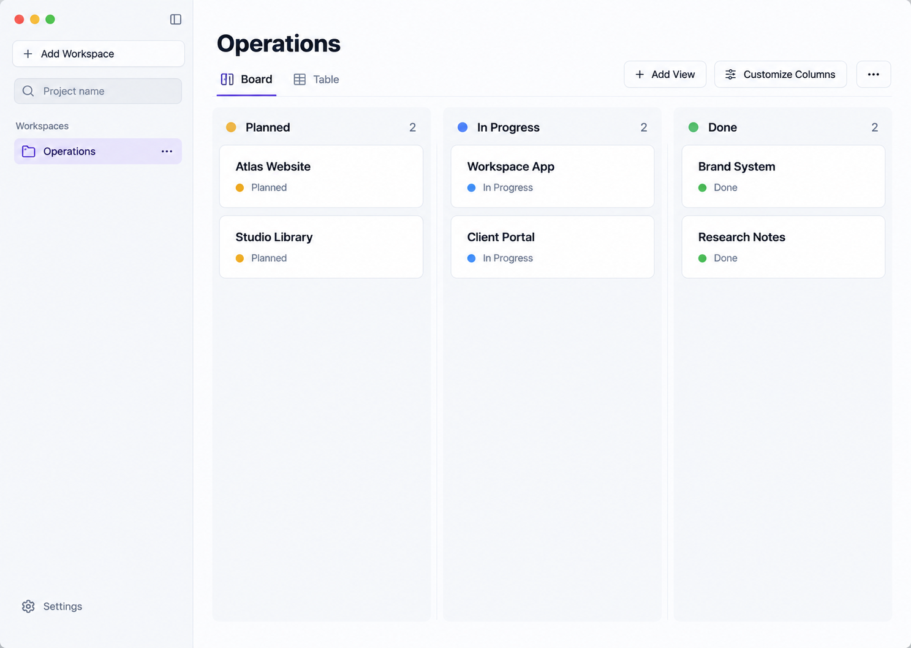
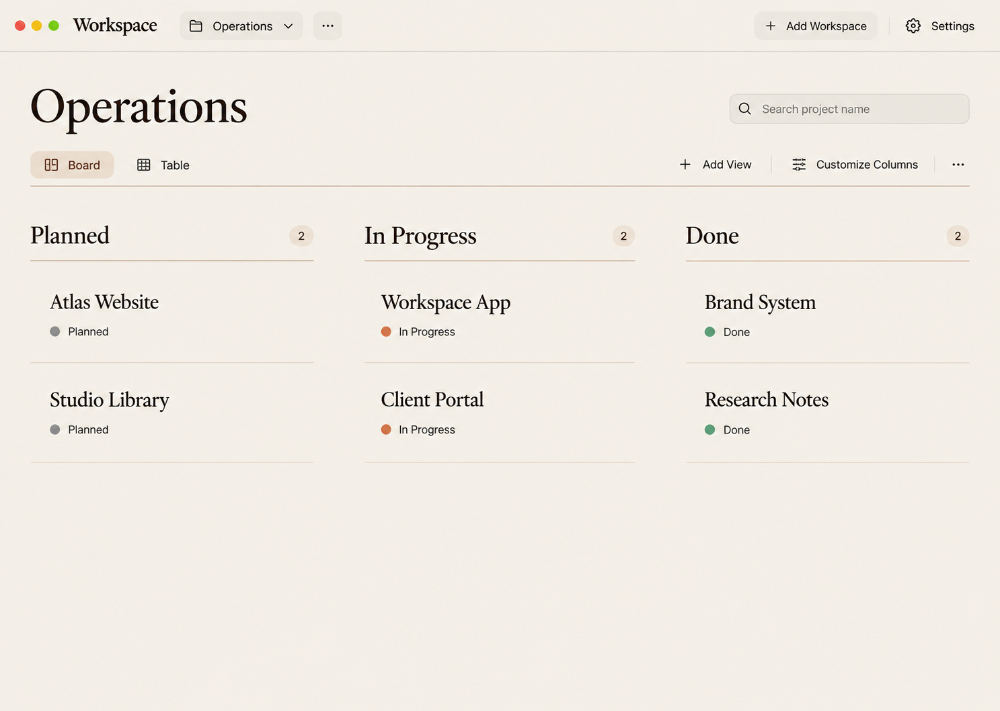
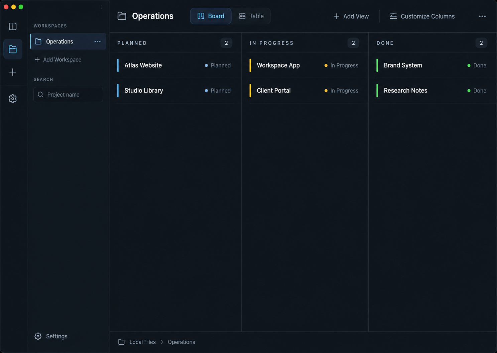
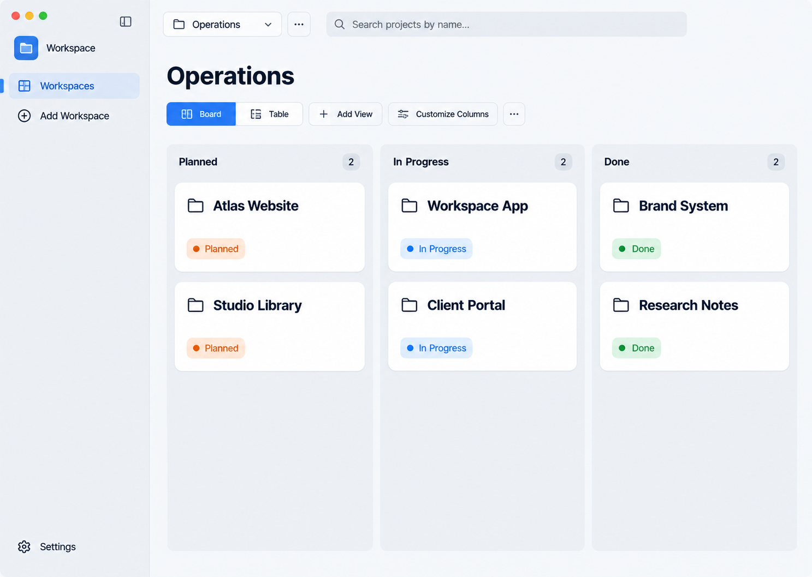
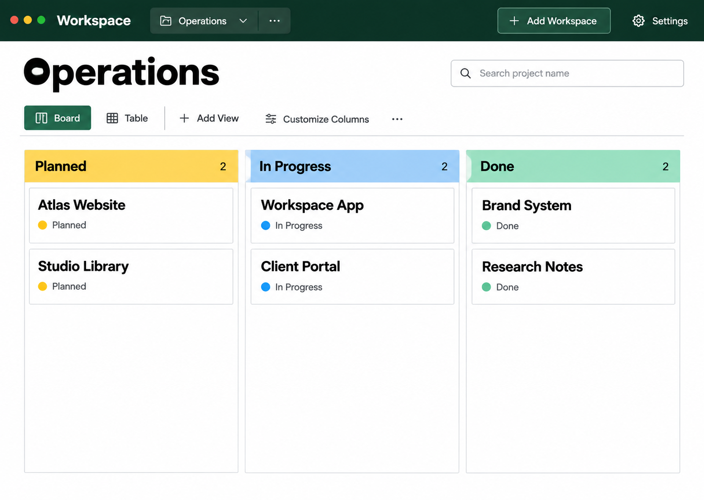

# Пять направлений дизайна Workspace

Рекомендую **1 — Quiet Precision**: он улучшает иерархию и читаемость, сохраняя знакомую структуру доски. Если главный приоритет — плотность, предпочтителен **3 — Night Console**.

Это статичные визуальные концепты для выбора направления, не внедрённый интерфейс и не интерактивный прототип. Изображения не подтверждают работу скрытых меню, клавиатуры или адаптивности. Функции остаются обязательным контрактом следующего этапа; ниже указаны точки доступа к ним. Исходный код приложения и рабочие данные не менялись.

## Основание

21 сентября 2026 года запущен реальный Electron checkout. Отдельная рабочая директория `/tmp/workspace-design-review` и отдельный `--user-data-dir` изолируют тестовые данные от рабочей `.workspace`. Исходный транспорт — Electron preload IPC и текущие JSON-адаптеры; его не заменяли.

Осмотрены и сохранены: пустое состояние без выбранной папки, заполненная доска, таблица и панель проекта с Properties и File tree. После этих захватов ScreenCaptureKit начал возвращать ошибки захвата; повторное подключение и перезапуск не восстановили native capture. Поэтому настройки, остальные меню, полноэкранный проект и состояния ошибки/загрузки дополнительно изучены по исходникам и действующим документам, а не представлены как визуально проверенные. Нативные снимки получены в фактически доступном окне 940×768; целевые концепты запрошены 1440×1024, ImageGen выдал одинаковые 1487×1058 без последующего растягивания.

Исходные снимки: [Board](source-board.png), [Table](source-table.png), [Project details](source-detail.png), [Empty](source-empty.png).

## Что можно улучшить

1. **Контекст рабочего пространства слабее управляющих кнопок.** Название Operations видно в sidebar, но в основной области отсутствует выраженный заголовок. Крупная светлая Add Workspace перетягивает внимание с повседневной работы.
2. **Ширина колонок расходуется неравномерно с доступным окном.** На фактическом снимке третья группа за правым краем; горизонтальная прокрутка — допустимое поведение, но текущий размер колонок скрывает общий обзор даже шести проектов.
3. **Мало различий между уровнями.** Фон, колонка, карточка и одинаковые серые статусы дают несколько близких тёмных слоёв. Названия читаются, но статусная структура различается в основном текстом.
4. **Инструменты вида малозаметны.** Customize Columns и Add View представлены небольшими значками справа. Подписи в концептах делают назначение яснее, ценой части ширины.
5. **Панель деталей вытесняет рабочую поверхность.** На небольшом окне она занимает заметную долю пространства. В следующем этапе нужно сохранить resize/expand/close и проверить совместное размещение с доской.

Это дизайнерские наблюдения на тестовом наборе, а не результаты пользовательского исследования или доказанный рост скорости работы.

## Одинаковый сценарий сравнения

Везде выбран Workspace Operations, Board, панель проекта закрыта. Planned: Atlas Website и Studio Library; In Progress: Workspace App и Client Portal; Done: Brand System и Research Notes. На карточках только имя и статус. Нет выдуманных сроков, владельцев, прогресса или дополнительных метрик. Английские подписи сохранены как в просмотренном приложении; русский язык интерфейса остаётся доступен через Settings.

## 1. Quiet Precision — Точная светлая доска

Знакомая боковая навигация, ясный заголовок рабочего пространства и отдельная строка видов. Нейтральный гротеск, лавандовый акцент и небольшие статусные маркеры. Средняя плотность.

**Сильная сторона:** Наиболее сбалансированный вариант для ежедневной работы: проекты читаются первыми, настройки вида собраны рядом. Сохраняется привычная структура приложения.

**Компромисс:** Боковая панель всё ещё занимает ширину; при множестве свойств потребуется горизонтальная прокрутка. Слишком светлые вторичные подписи нужно проверить на контраст при реализации.

**Референс:** [Linear: иерархия оболочки и плотность](https://linear.app/now/how-we-redesigned-the-linear-ui). Это интерпретация принципов, не копия продукта.

## 2. Paper Studio — Рабочий стол как документ

Навигация перенесена в верхнюю полосу, группы разделены линиями. Тёплая бумажная палитра, заголовки и названия проектов с засечками; спокойная низкая плотность.

**Сильная сторона:** Подходит для небольшого портфеля творческих проектов: названия становятся главным содержанием, доске достаётся вся ширина.

**Компромисс:** Крупная типографика и большие интервалы уменьшают число одновременно видимых проектов. Для частого переключения между многими пространствами список в меню менее удобен.

**Референс:** [Notion: простые группы и настраиваемые карточки](https://www.notion.com/help/boards). Это интерпретация принципов, не копия продукта.

## 3. Night Console — Плотная рабочая консоль

Узкая панель значков и соседний навигатор, однострочная верхняя панель, плоские компактные строки внутри групп. Тёмный графит, голубой акцент, технические подписи групп.

**Сильная сторона:** Для длительной работы с большим числом проектов. Минимум вертикальных отступов и чёткое разделение навигации, инструментов и данных.

**Компромисс:** Две зоны слева расходуют ширину. Мелкие вторичные подписи и насыщенные маркеры требуют аккуратной настройки; некоторые команды продублированы в панели и навигаторе.

**Референс:** [Nova: управляемая боковая панель](https://help.panic.com/nova/sidebar/). Это интерпретация принципов, не копия продукта.

## 4. Native Focus — Спокойное настольное приложение

Отдельный верхний выбор пространства и широкий поиск, системный гротеск, голубые элементы управления, крупные карточки с папками. Просторная композиция с низкой плотностью.

**Сильная сторона:** Быстро распознаются проекты-папки и основные действия. Подходит, если важнее читаемость и ощущение привычного macOS-приложения.

**Компромисс:** Карточки занимают много высоты. На компактном окне придётся уменьшать отступы; общий пункт Workspaces дублирует выбор пространства сверху.

**Референс:** [Things: спокойная иерархия и системные акценты](https://culturedcode.com/things/). Это интерпретация принципов, не копия продукта.

## 5. Color Atlas — Выразительная доска статусов

Верхняя навигация вместо постоянного sidebar, строгая прямоугольная сетка, жирный гротеск. Тёмно-зелёная оболочка и цветные заголовки групп, средняя плотность.

**Сильная сторона:** Статусные группы легко различать с первого взгляда; много ширины для названий и дополнительных свойств.

**Компромисс:** Насыщенная оболочка перетягивает внимание. При большом числе статусов много цветов создадут шум; крупный заголовок отнимает вертикальное место.

**Референс:** [Airtable: визуальные группы одного набора данных](https://www.airtable.com/guides/build/create-custom-views-of-data). Это интерпретация принципов, не копия продукта.

## Как сохраняется функциональность

Визуальные макеты показывают только основной экран. Действия скрытых уровней ниже — обязательная спецификация сохранения, а не заявление, что они уже реализованы в изображении.

| Возможность существующего приложения | Доступ во всех направлениях |
|---|---|
| Выбор, создание, переименование, удаление и порядок Workspace | Operations и меню рядом; Add Workspace. В 1/3 список слева, в 2/5 верхний селектор, в 4 селектор сверху и Workspaces слева. Полный список и его drag reorder сохраняются в раскрытом навигаторе/селекторе. Удаление сохраняет существующее подтверждение. |
| Свернуть/развернуть навигацию | В 1/3/4 значок sidebar. В 2/5 постоянная панель заменена раскрываемым селектором Operations: открыть/закрыть его даёт компактный/полный доступ к списку без удаления команд. Это изменение расположения, не удаление управления пространствами. |
| Поиск по имени проекта внутри активного Workspace, очистка, отсутствие результатов | Поле поиска видно в каждом макете. Очистка возвращает активные фильтры; no-results содержит Clear search. Поиск по свойствам не добавляется. |
| Board/Table, создание, дублирование, переименование, удаление и порядок видов | Board/Table, Add View и соседнее меню «…». Существующее перетаскивание вкладок, запрет удаления последнего вида и сохранение порядка остаются. Временно показаны только два исходных вида. |
| Ширина колонок, видимость/порядок свойств, фильтры значений | Customize Columns во всех пяти. Внутри остаются текущие controls, включая slider ширины. Видимость не удаляет данные. Колонки фиксируют выбранную ширину и прокручиваются при нехватке места. |
| Открыть проект, панель деталей, resize, expand/close, вкладки проектов | Нажатие имени/карточки открывает существующую панель. Её действия и полноэкранные вкладки сохраняются; закрытая панель на всех макетах — одинаковое исходное состояние. |
| Свойства: Text/Number/Date/Select/Multi-select, inline editing, создание/переименование/удаление, значения и их порядок, скрытые свойства | Карточка → Properties; в Table — меню заголовка и редакторы ячеек. Board inline editing сохраняется в видимых свойствах. Name/Status сохраняют существующие ограничения. Wrap content остаётся настройкой Text-колонки в Table. |
| Дерево папок/файлов, просмотр поддерживаемых файлов, открытие во внешнем приложении и в файловом менеджере | Карточка → File tree и существующие действия файла/папки. Типы файлов и проверки путей не меняются. |
| Язык, source folder, folder role tree, статусы/цвета | Settings → существующие разделы. Back to workspace и выбор Operations возвращают на рабочий экран. Роли/идентичности/хранилище не меняются. |
| Loading/empty/error/success и безопасность | Сохраняются существующие состояния, retry, сообщения и подтверждения; при редизайне они получат выбранные токены. Нет drag между основными статусами. Status выводится из ролей папок, новая кнопка создания проекта не добавляется. |
| Клавиатура и доступность | Фокус, labels/tooltips и возврат фокуса после меню обязательны при реализации. Статусы кодируются текстом и цветом. По статичному PNG нельзя подтвердить keyboard/contrast соответствие. |

## Рекомендация и следующий этап

**Выбрать Quiet Precision как основу.** Он оставляет навигацию и виды на привычных местах, подчёркивает активное пространство и даёт спокойную визуальную иерархию. Для реальной реализации предлагаю сохранить текущий Geist, уменьшить доминирование Add Workspace и дать читаемые подписи инструментам вида. Это рекомендация, не уже внесённые изменения.

После выбора следует отдельно проработать выбранный стиль для Table, открытых деталей, Settings, меню свойств и empty/error/loading; проверить 1440×960 и 1024×720 с длинными названиями и многими свойствами. Русские подписи требуют отдельной проверки ширины. Текущее сравнение выбирает визуальное направление, но не заменяет такую проверку.

## Источники и границы

Официальные страницы открыты 21.09.2026. Linear и Things дополнительно просмотрены в браузере; их UI-снимки сохранены как исследовательские свидетельства. Notion, Nova и Airtable использованы по официальному описанию представлений и навигации. В ImageGen прикреплён фактический снимок Workspace; внешние страницы передавались как сформулированные принципы, не как прикреплённые визуальные файлы.

- [Linear — redesign](https://linear.app/now/how-we-redesigned-the-linear-ui): разделение оболочки, заголовков, панелей и данных.
- [Notion — boards](https://www.notion.com/help/boards): группы, отображаемые свойства и спокойное оформление доски. Шрифт с засечками в Paper Studio — наше самостоятельное решение.
- [Nova — sidebar](https://help.panic.com/nova/sidebar/): сворачивание, размер и расположение панелей. Палитра Night Console — самостоятельное решение.
- [Things](https://culturedcode.com/things/): визуальная простота и системная подача. Kanban не приписывается Things.
- [Airtable — custom views](https://www.airtable.com/guides/build/create-custom-views-of-data): разные визуальные представления общего набора данных. Drag-and-drop из Airtable не переносится в Workspace.
