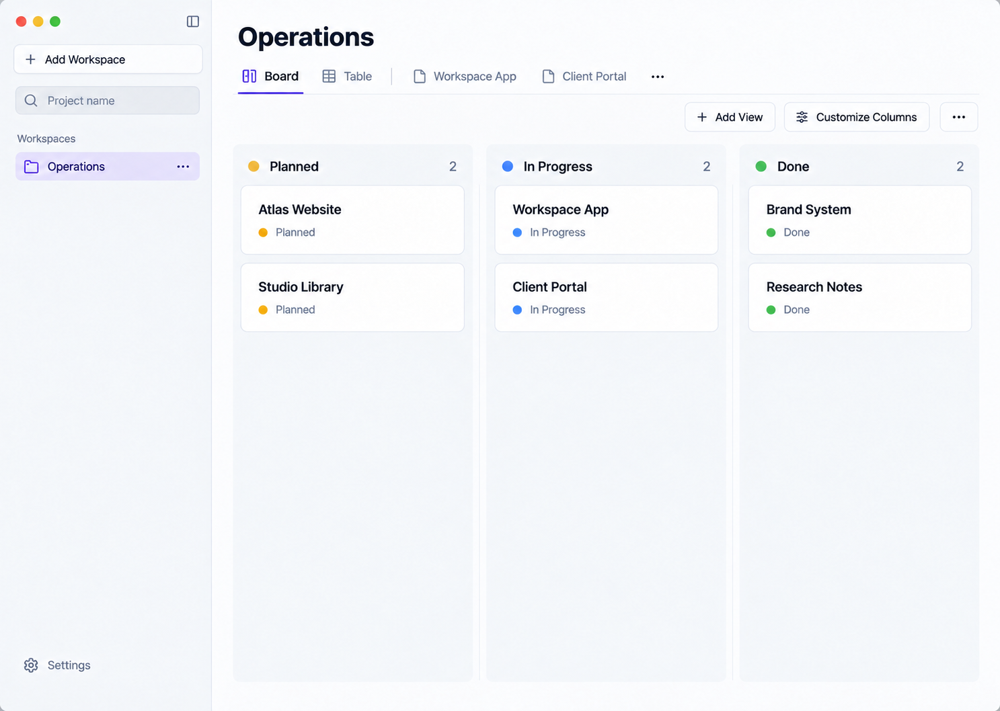
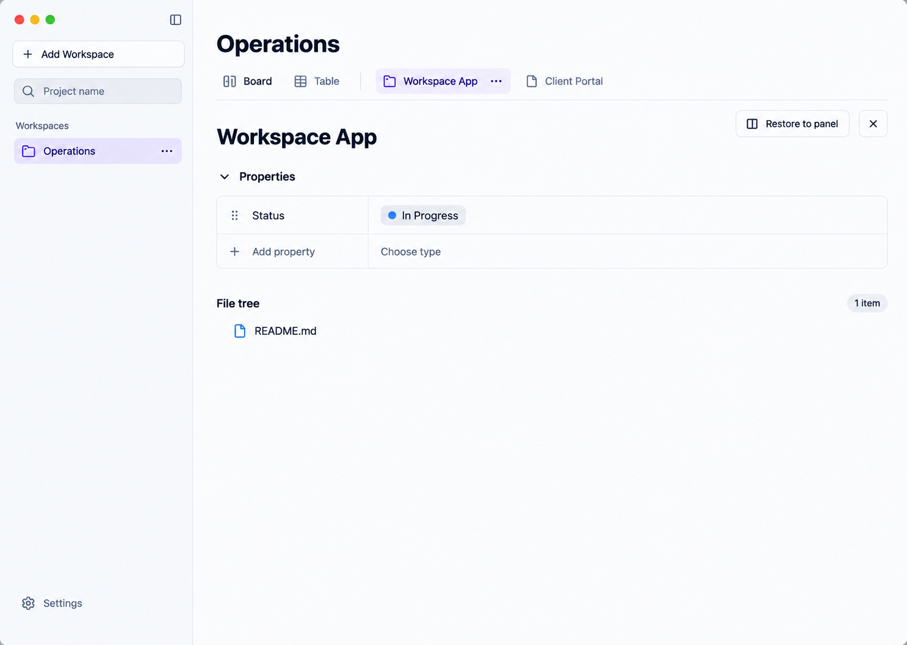
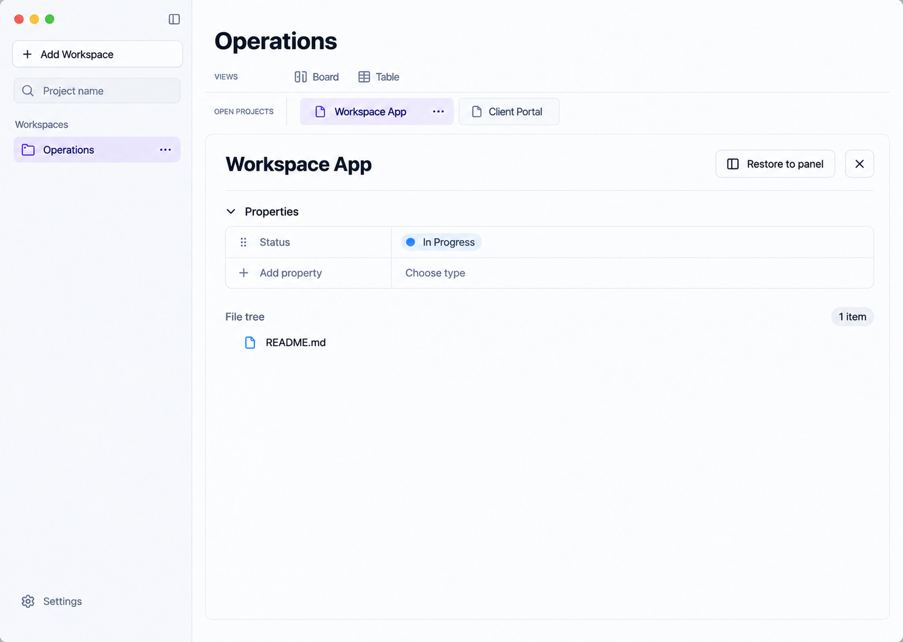
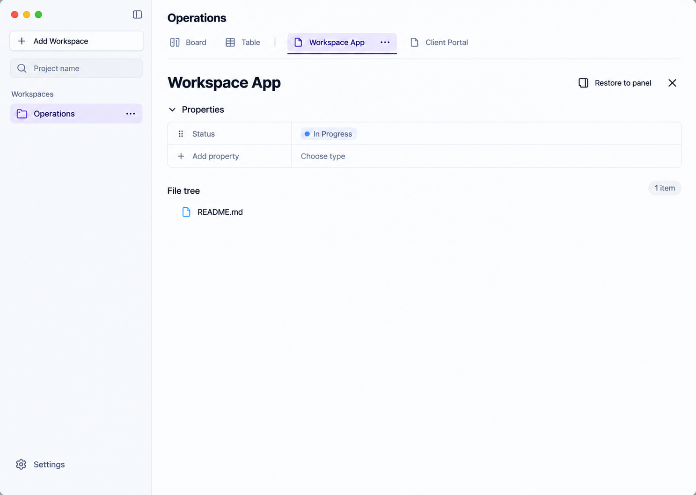
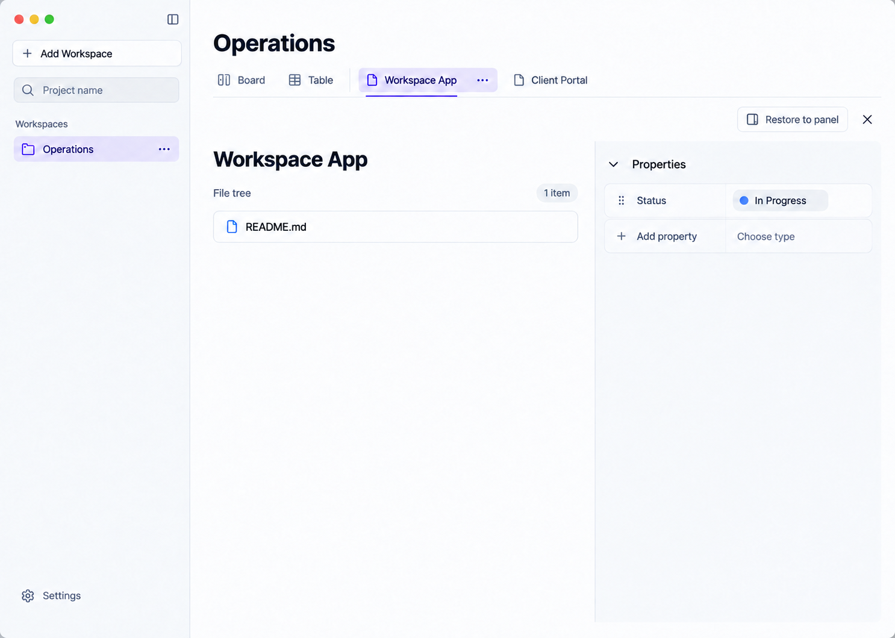
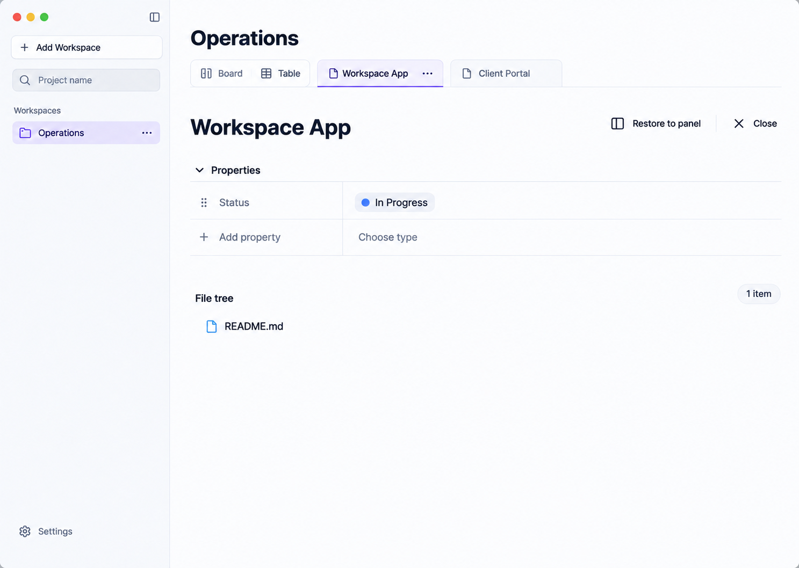

# Quiet Precision: вкладки карточек и четыре вариации

Исправлено упущение: **во всех пяти макетах видны и Board/Table, и отдельные вкладки проектов Workspace App / Client Portal**. Рекомендую оставить **№1** как основное направление; **№2** полезен, если важнее максимально явно развести два типа вкладок.

Это пять направлений внутри выбранного светлого Quiet Precision: нейтральные поверхности, лавандовый акцент, левая навигация и гротеск сохранены. Старые варианты не перезаписаны. Код приложения не менялся. Дополнительная доска №1 — второе состояние первого направления, а не шестой вариант.

## Исправленный первый вариант: доска

Доска сохраняет исходные шесть проектов. Board выбран; обе ранее открытые вкладки проектов остаются справа и сейчас неактивны. Add View и Customize Columns доступны на рабочей поверхности, как в текущем приложении. Под общим «…» группы проектов подразумевается доступ к командам конкретной вкладки через её контекстное меню; оно не закрывает все проекты разом.

## Одинаковое состояние всех пяти вариантов ниже

Workspace Operations; активна развёрнутая карточка **Workspace App**, рядом неактивная **Client Portal**. Board/Table доступны, но не выбраны. Единственное свойство — **Status: In Progress**, только для чтения. В File tree — **README.md**, 1 item. Ни сроков, ни исполнителей, ни выдуманных пользовательских полей не добавлено. «Во весь экран» означает всю основную область приложения, с сохранением sidebar, а не OS fullscreen.

## 1. Quiet Precision · обновлённый

Минимальное изменение выбранного дизайна: группы видов и открытых проектов стоят рядом, разделены вертикальной линией. Свойства и файлы идут сверху вниз.

**Плюс:** Самая близкая к понравившемуся варианту композиция; знакомая навигация.

**Компромисс:** Когда вкладок много, одной строке становится тесно.

## 2. Clear Levels · два уровня

Views и Open projects вынесены в два явно подписанных ряда. Остальная светлая палитра, sidebar и содержимое сохранены.

**Плюс:** Самое ясное различие между видом рабочего пространства и открытой карточкой.

**Компромисс:** Дополнительная строка отнимает высоту, вокруг содержимого больше рамок.

## 3. Compact Precision · плотнее

Контекст Operations уменьшен, верхняя панель и строки свойств компактнее. Проект выделяется без большого промежутка.

**Плюс:** Больше места для длинного списка файлов и множества свойств.

**Компромисс:** Меньше воздуха, более мелкие подписи; потребуется проверка читаемости.

## 4. File Workspace · файлы в центре

Файлы слева в широкой области, свойства справа в узкой колонке внутри того же полноэкранного проекта.

**Плюс:** Удобно при частом обращении к содержимому папки; свойства всегда рядом.

**Компромисс:** На узком окне колонки придётся складывать; длинным текстовым свойствам справа теснее.

## 5. Reading Focus · спокойные линии

Вкладки оформлены как документы, активная подчёркнута. У свойств лёгкие разделители, крупнее заголовок и свободнее вертикальный ритм.

**Плюс:** Меньше ощущения формы и рамок, спокойнее просмотр одной карточки.

**Компромисс:** Реже видны элементы по высоте, чем в компактном варианте.

## Что действительно проверено в приложении

Через CUA выполнена последовательность на неизменённом renderer текущего приложения и его же WorkspaceServiceClient/backend handler с временными проектами:

1. Нажатие карточки открывает боковую панель и само по себе вкладку не создаёт.
2. Expand project создаёт отдельную именованную вкладку и разворачивает проект; Board/Table остаются рядом, но не выбраны.
3. Возврат на Board сохраняет открытые вкладки. Можно открыть и развернуть второй проект, затем переключиться обратно на первую вкладку.
4. Контекстное меню вкладки содержит Duplicate tab, Restore view, Close view.
5. Restore side panel удаляет только вкладку восстановленного Workspace App и показывает его боковую панель над доской; Client Portal остаётся открытой вкладкой.

[Развёрнутый проект](source-expanded-workspace-two-tabs.png) · [Доска с вкладками](source-board-two-retained-tabs.png) · [Меню вкладки](source-project-tab-context-menu.png) · [Restore](source-restored-side-panel.png).

Нативный Electron был запущен, но ScreenCaptureKit недоступен. Поэтому новые фактические снимки получены в браузере через временную диагностическую loopback-оболочку, а не нативным захватом Electron. JSX/renderer bundle и backend не изменены; shim заменяет только transport и ограничивает методы allowlist. Данные лежат отдельно в `/tmp/workspace-design-review`, браузер использует отдельный origin. Эти снимки подтверждают renderer-поведение, но не нативную интеграцию окна. Дополнительно прошли 6 существующих тестов reducer вкладок.

## Контракт сохранения действий

| Действие | Как сохраняется |
|---|---|
| Board и Table, saved views | Отдельная группа видов во всех пяти; её выбор возвращает рабочую поверхность, не удаляя project tabs. |
| Expand project | В боковой панели проекта; создаёт новую tab instance, даже если тот же проект уже открыт. |
| Выбор открытой карточки | Отдельные вкладки Workspace App / Client Portal; active только одна. |
| Duplicate / Restore / Close конкретной вкладки | Контекстное меню вкладки; «…» в макете делает этот вход заметнее. Это меню существующих команд, не новая функция. |
| Restore и Close активной карточки | Видимые элементы справа в заголовке проекта. Restore сохраняет боковую панель и снимает только текущую вкладку; Close закрывает instance. |
| Порядок и несколько копий одного проекта | Сохраняются drag reorder и отдельная identity каждой вкладки. Закрытие активной выбирает предыдущую слева, иначе Board/Table; неактивной не меняет текущий экран. Эти правила сверены с кодом и тестами. |
| Сохранение сессии | Вкладки, порядок и последняя активная поверхность сохраняются по Workspace. Проверено по коду; отдельный перезапуск браузера не выполнялся. |
| Properties, Hidden properties, типы/значения/порядок/редакторы | Существующие команды в свойствах остаются; секции сворачиваются независимо. На тестовом наборе скрытых свойств нет. Status остаётся read-only. |
| File tree и открытие файлов | Существующие действия файла/папки; здесь показан только реально существующий README.md. |
| Add View / Customize Columns | Возвращаются при выборе Board/Table; скрыты во всех полноэкранных карточках, как в реальном runtime. |
| Workspace CRUD/порядок, Search, Settings, язык и роли папок | Сохраняются sidebar, меню Operations, поиск и Settings. Поиск остаётся по имени, filesystem safety и роли/хранилище неизменны. |

Настройка ширины колонок, фильтры значений и видимости, inline editing, табличные редакторы, Wrap content, загрузка/ошибки/empty и запрет drag между статусами сохраняются как в [предыдущей карте функций](../design-directions-2026-09-21/README.md). Новые изображения не являются интерактивным прототипом: реальные размеры hit targets, клавиатура, контраст и 1024×720 потребуют проверки на этапе реализации.

## Что предлагаю выбрать

**№1** — самая аккуратная доработка понравившегося макета без смены композиции. Если одновременно открывается много карточек и важна очевидность их отличия от видов — **№2**. №3 полезен при высокой плотности, №4 — при работе главным образом с файлами, №5 — для спокойного просмотра свойств.

Общая визуальная основа взята из выбранного первого макета. Источники предыдущего исследования остаются применимы: [Linear — иерархия оболочки](https://linear.app/now/how-we-redesigned-the-linear-ui), [Notion — представления доски](https://www.notion.com/help/boards). Нового широкого поиска направлений не было: задача теперь — вариации выбранного решения.
