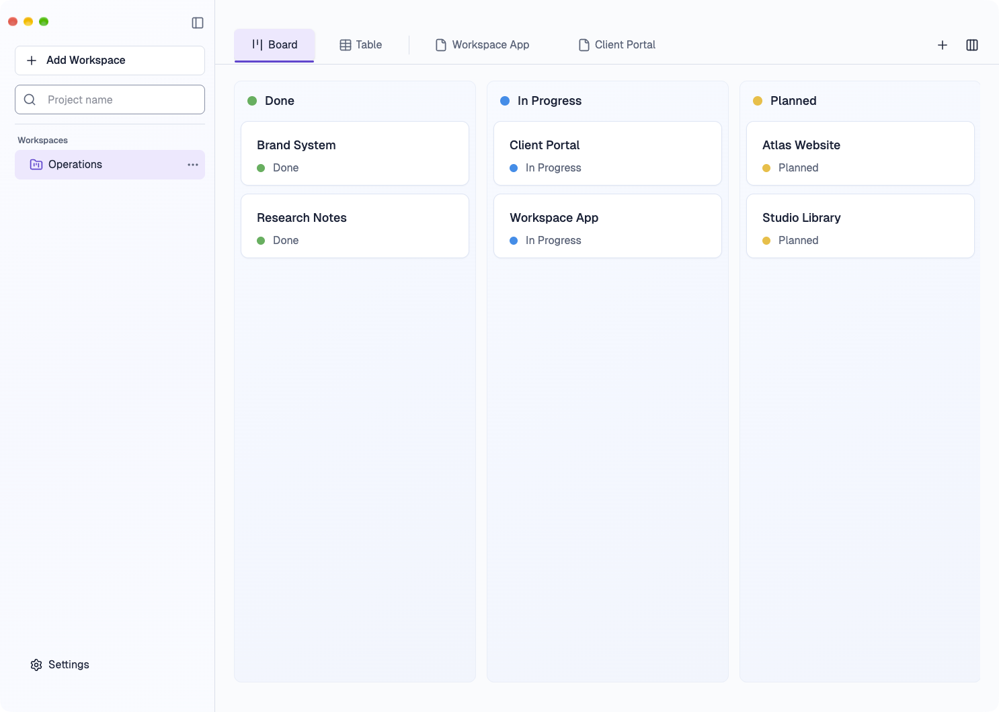
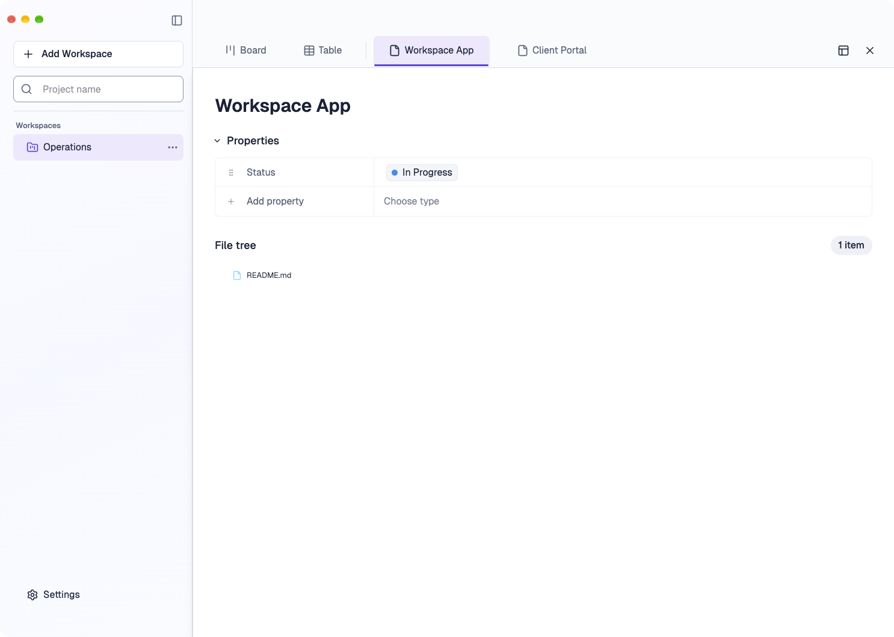

# Compact №3: attempt 2 native visual comparison

Both target mockups and final actual Electron window captures are 1486×1059 PNGs with comparable six-project fixture data. The [provenance](attempt2-provenance.md) distinguishes full native windows from secondary CDP renderer diagnostics. The comparison uses named regions specified in [task.json](../task.json); no arbitrary pixel threshold was invented.

| Selected target | Actual full native Electron window |
|---|---|
|  |  |
|  |  |

| Region | Observed final composition | Remaining difference / reason |
|---|---|---|
| Native frame/sidebar | Full native frame and traffic lights visible. Sidebar 320px vs target about 322px; inset, Add Workspace/search, workspace row and bottom Settings occupy comparable positions. Sidebar has a subtle light gradient. | Target uses a stronger soft glow/shadow treatment in places. The app keeps its accessible input and button borders. |
| Top row/tabs | Board/Table row 96px. Expanded row 113px as target, while its title remains near y164. Active view/project tab has both lavender fill and 3px violet underline. Text tabs scroll; actions stay pinned right. | Target's extra ellipsis and different view icon strokes are illustration details; adding an unsupported command would violate the product contract. |
| Board | Columns begin around x348/y120 vs target x349/y121; 360px fixture width and 16px gaps. Tinted gradient panels, fine inner borders, soft card borders/shadows, 18px names, 16px statuses and yellow/blue/green dots are visible. | Runtime status order is Done → In Progress → Planned; target reverses it. Discovery/status rules are preserved. Project card order within statuses follows actual projection, not illustration placement. |
| Expanded | Title near x357/y164 vs target x357/y162; Properties y229 vs target y228; Status/Add property rows start y263 vs target y262; File tree around y401 vs target y402. Native property controls and README.md row remain working. | Target shows an ellipsis inside active project tab and a different restore glyph. Existing context menu and restore action remain available without adding a new command. |
| 1440×960 | [Board](native-attempt2-final-board-window-1440x960.png) and [expanded](native-attempt2-final-expanded-window-1440x960.png) are exact full native windows. Board capture contains no outgoing detail panel after waiting for dialog removal. | Third Board column extends beyond the right edge as designed for horizontal Board scrolling. |
| 1024×720 | [Board](native-attempt2-final-board-window-1024x720.png), [expanded](native-attempt2-final-expanded-window-1024x720.png) and [keyboard focus](native-attempt2-final-focus-window-1024x720.png) are exact full native windows. Restore/Close or Add View/Customize remain visible; tabs clip and scroll horizontally. | Only two Board columns fit at once; remaining columns are reachable by horizontal scroll. |

The final native pair removes the material scale, geometry, status-accent and active-state gaps in the prior result. The remaining order, icon and slight surface-treatment differences above are visible and bounded. This is acceptance evidence for the isolated running Electron fixture, not a claim that the exited former PID 56841 or every user dataset was photographed.
