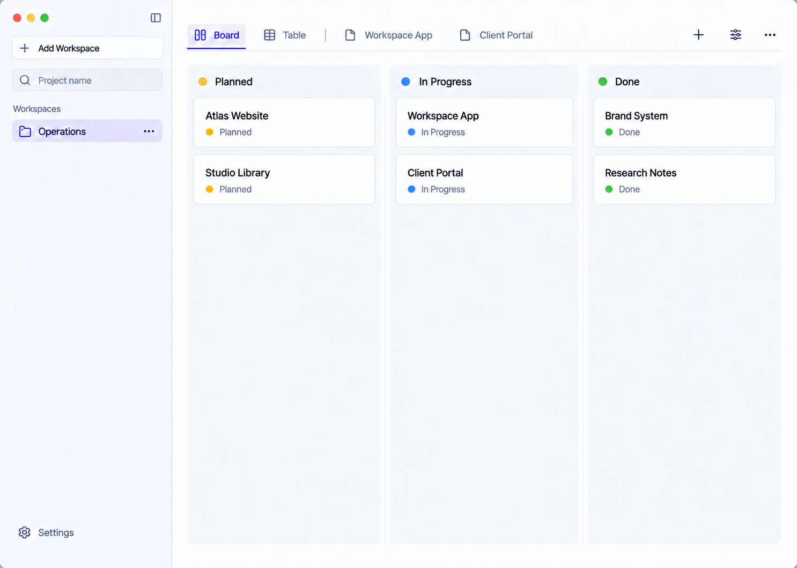
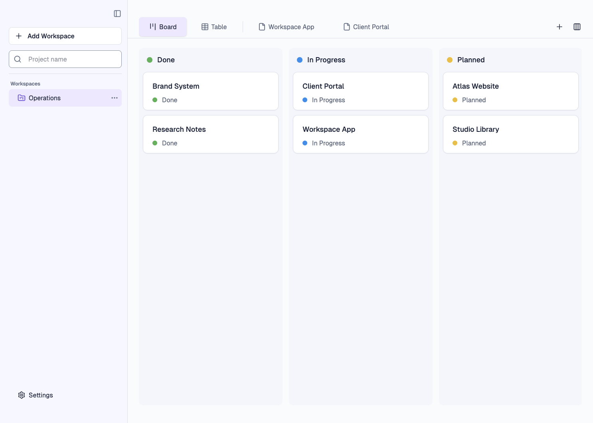
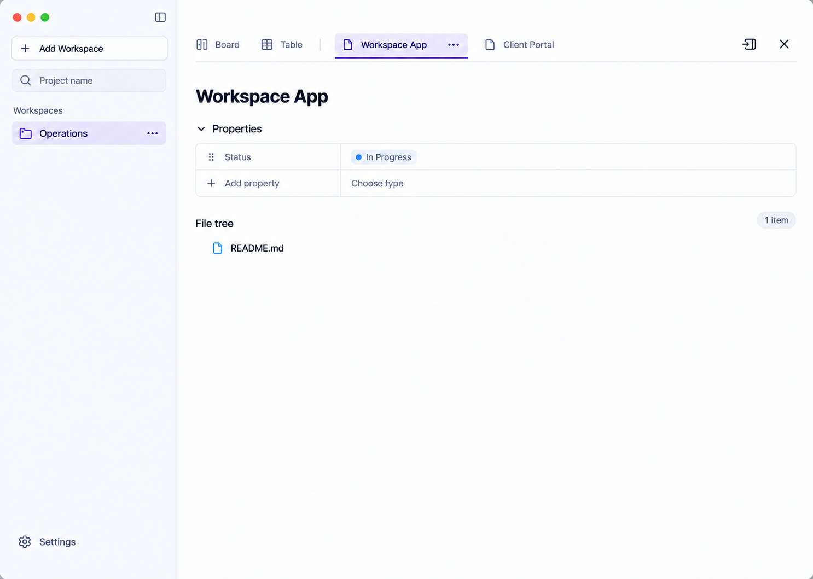
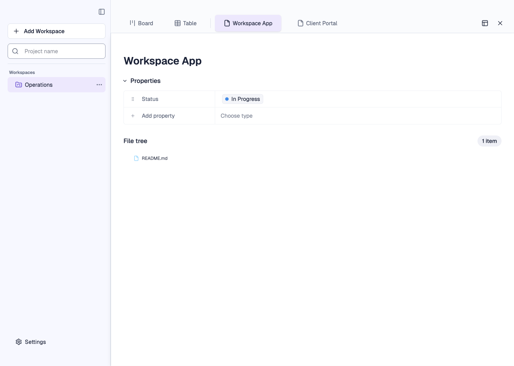

# Compact №3 final visual comparison — candidate pending live-window capture

Both selected references and both final Electron renderer captures below are full-size 1486×1059 PNGs with the same six project names and status labels. The test fixture contains only separate temporary project folders and one README.md per project. Board width 360px and status yellow/blue/green are saved fixture settings through real preload IPC. The screenshots were taken inside a running isolated Electron process, using CDP `Page.captureScreenshot`; [native-provenance.md](native-provenance.md) records the exact boundary.

| Selected reference | Running Electron renderer |
|---|---|
|  |  |
|  |  |

The comparison was specified before implementation in [task.json](../task.json) and [baseline-deviation-map.md](baseline-deviation-map.md). It compares named regions and behavior, with no invented pixel-distance pass threshold.

| Region | Baseline deviation | Final observed geometry/composition | Remaining difference or constraint |
|---|---|---|---|
| Sidebar | Width 248px, controls and text small, workspaces high and tight | Width 320px vs reference about 322px; inner inset 22px; Add Workspace around y69, selected workspace around y223, Settings at bottom | macOS traffic lights and rounded system frame are outside renderer capture; require direct window screenshot. |
| Top row | 48px, compact 13px tabs and icons | One 96px row; text tabs and actions align near reference Board y66; Add View and Customize remain icon only with tooltip/accessibility | Expanded mockup has a taller apparent row (~113px), while working app keeps 96px consistently. Its separate visible ellipsis is an illustration-only command. |
| Board panels/cards | Outlined white panels from x264/y64; smaller 384px columns and status badges | Tinted panels start x348/y120 vs reference x349/y121, width 360px, 16px gutters; cards start near x358/y181 vs reference x360/y182. Card names ~18px and status ~16px; dots use saved status colors. | Folder discovery orders statuses Done → In Progress → Planned; reference orders Planned → In Progress → Done. Reordering would change status rules. A visible count was replaced by accessible-only count to match selected composition. |
| Expanded title/properties/tree | Title x269/y71, small sections and 37px rows | Title x357/y164 vs reference x357/y162; Properties y229 vs reference y228; two 48px rows start y263 vs reference y262; File tree y401 vs reference y402. | Side-panel form keeps dense sizing; expanded view alone gets the large scale. README icon/line is rendered by the real file tree. |
| Responsive and actions | Previous browser fixtures were visually denser; live native compact not established | [Board 1440×960](native-final-board-1440x960.png), [Board 1024×720](native-final-board-1024x720.png), [expanded 1024×720](native-final-expanded-1024x720.png) show one row, text-tab overflow and pinned actions. [Focus 1024×720](native-focus-1024x720.png) visibly shows the Add View focus ring. | At 1024 Board intentionally scrolls horizontally to reach the Planned column; the tab strip clips long/inactive names and scrolls rather than wrapping. |

Computed palette contrast ratios for the relevant light surfaces: primary text on sidebar 14.91:1, muted text on sidebar 5.61:1, primary on board panel 14.62:1, muted on board panel 5.50:1, purple focus ring on white 6.29:1. These are palette calculations, not a full per-pixel text audit.

Material renderer composition differences identified in the baseline are corrected or explained above. The **already-open user window** was not captured; its original PID has exited. The native full-window criterion remains inconclusive pending independent exact-app capture. A green test suite or this CDP renderer pair alone must not be reported as direct live-window acceptance.
